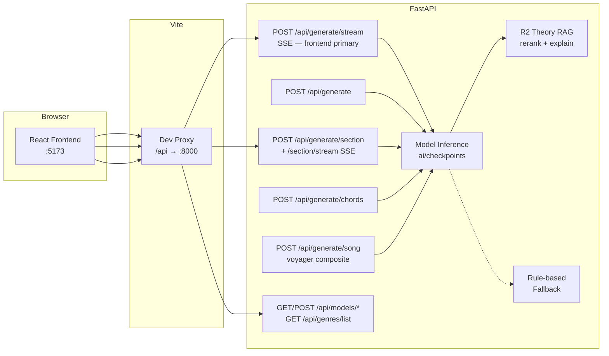
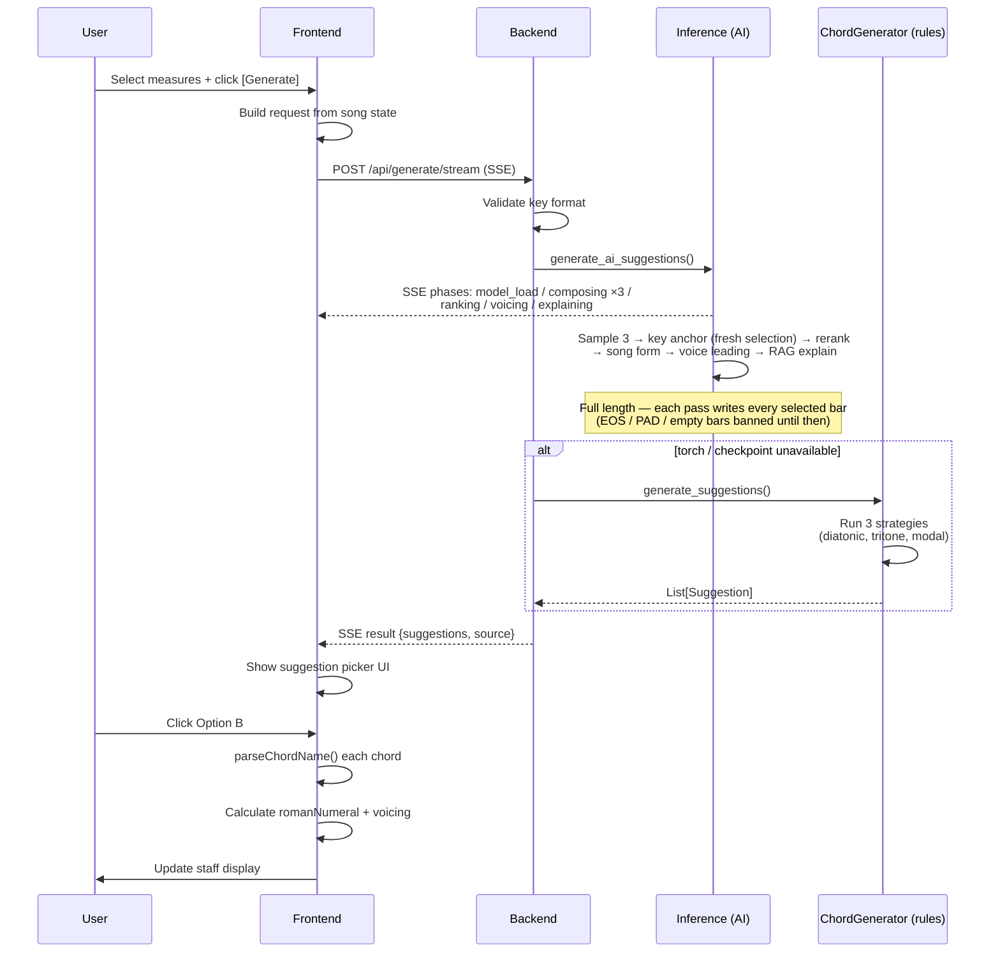

# TheArtist — API Specification

> Shared contracts for the editor, TheVoyager, and future plugin clients

---

## Architecture Overview



Score import, MIDI export, local DAW handoff, and MCP use the same backend services. Their implemented contracts are described below; there is no generic `POST /api/export` endpoint.

## Base URL

```
Development: http://localhost:8000/api
Production:  TBD
```

Vite dev server proxies `/api` → `http://localhost:8000/api` (configured in `vite.config.ts`).

---

## Endpoints

| Endpoint | Contract |
|---|---|
| `POST /api/import/score` | Explicitly attached score → Meta transcription draft for human review |
| `POST /api/export/midi` | Edited `ExportSpec` → `audio/midi` bytes |
| `GET /api/daw/targets` | Installed Logic/Ableton availability on the backend machine |
| `POST /api/daw/open` | Explicit local file output and Logic open / Ableton reveal |
| `GET /api/capabilities` | Versioned service/tool discovery |
| `/mcp/` | Streamable HTTP MCP; shared generation, import and export services ([MCP contract](docs/mcp.md)) |

These complement the existing generation and model endpoints below. PDF export is rendered in the browser; it has no REST endpoint.

### GET `/api/health`

Health check. Returns `{ "status": "ok" }`.

### POST `/api/generate`

Generate chord suggestions for selected measures. Used by the frontend chord editor.

**Status:** Implemented — AI inference (Music Transformer) with rule-based fallback.

**Request:**

```json
{
  "key": "G major",
  "bpm": 80,
  "genre": "jazz",
  "modelKey": "ft_f4",
  "timeSignature": [4, 4],
  "context": [
    { "measure": 0, "chords": ["Gmaj7", "Em7"] },
    { "measure": 1, "chords": ["Am7", "D7"] },
    { "measure": 2, "chords": [null, null] },
    { "measure": 3, "chords": [null, null] }
  ],
  "selectedMeasures": [2, 3],
  "sectionType": "verse"
}
```

| Field | Type | Description |
|-------|------|-------------|
| `key` | `string` | Key signature, e.g. `"C major"`, `"A minor"` |
| `bpm` | `number` | Tempo (20-300) |
| `genre` | `string \| null` | Genre hint — any key of the 13-genre vocabulary: `"jazz"`, `"pop"`, `"rock"`, `"blues"`, `"bossa"`, `"classical"`, `"country"`, `"rnb_soul"`, `"hip_hop"`, `"electronic"`, `"funk"`, `"folk"`, `"gospel"` — or `null` |
| `modelKey` | `string \| null` | Checkpoint to use: `"phase0"`, `"ft_f1"`…`"ft_f5"`, `"ft_f1_v2"`, or `"ft_f1_lora_<genre>"` (R4 LoRA adapters). Default: `ft_f1` (recommended pop-preserving baseline). If `null` and `genre` is provided, backend dispatches via `GENRE_MODEL_DISPATCH`. See [Model Checkpoints](#model-checkpoints). |
| `timeSignature` | `[number, number]` | e.g. `[4, 4]`, `[3, 4]`, `[6, 8]` |
| `context` | `ContextMeasure[]` | All measures in the song with existing chords |
| `selectedMeasures` | `number[]` | Indices of measures to generate chords for (1-64; more → 400) |
| `sectionType` | `string \| null` | Any of the 17 [song-form section](#song-form-sections) ids, or `null` for no song-form rules. The frontend sends it explicitly (no positional guessing). Unknown ids → 400. |

**Response (200):**

```json
{
  "suggestions": [
    {
      "label": "Option A — Diatonic — ii-V voice leading",
      "chords": {
        "2": ["Bm7", "E7"],
        "3": ["Am7", "D7"]
      },
      "explanations": [
        {
          "chord_a": "Bm7",
          "chord_b": "E7",
          "concept": "ii-V",
          "explanation": "Bm7 → E7 forms a ii-V unit targeting A...",
          "chapter": "2",
          "section": "The II V",
          "page_start": 17,
          "page_end": 19
        }
      ]
    },
    {
      "label": "Option B — Tritone substitution",
      "chords": {
        "2": ["Bm7", "Ab7"],
        "3": ["Am7", "Ab7"]
      },
      "explanations": null
    },
    {
      "label": "Option C — Modal interchange",
      "chords": {
        "2": ["Bbmaj7", "Eb7"],
        "3": ["Am7", "Dm7"]
      },
      "explanations": null
    }
  ],
  "source": "ai"
}
```

| Field | Type | Description |
|-------|------|-------------|
| `suggestions` | `Suggestion[]` | 1-5 chord progression options |
| `suggestions[].label` | `string` | Human-readable description of harmonic approach |
| `suggestions[].chords` | `Record<string, [string, string]>` | Measure index → 2 chord names (slot 0, slot 1) |
| `suggestions[].explanations` | `TheoryExplanation[] \| null` | Per-transition theory pointers from the R2 RAG layer (`RAG_ENABLED_GENRES` only — jazz family + classical; `null` otherwise). Each: `{chord_a, chord_b, concept, explanation, chapter, section, page_start, page_end}`. |
| `source` | `"ai" \| "rules"` | Which generator produced the suggestions (`"rules"` = rule-based fallback fired). |

**Error (4xx):**

```json
{
  "detail": "Expected key format: 'C major' or 'A minor'"
}
```

400 = bad key format, no measures selected, more than 64 measures selected, or an unknown `sectionType`. Body-schema violations (e.g. `bpm` outside 20-300) are rejected by FastAPI with 422.

**Current strategies (rule-based fallback):**
1. **Diatonic ii-V** — weighted diatonic chord selection, ending with ii-V targeting I
2. **Tritone substitution** — ii → bII7 instead of ii → V7
3. **Modal interchange** — borrow chords from parallel major/minor

---

### POST `/api/generate/stream`

Streaming variant of `/api/generate` — **the frontend's primary generate path** (`frontend/src/engine/chordGenerator.ts` calls this to drive the live progress UI; plain `/api/generate` remains the non-streaming equivalent for programmatic callers).

**Status:** Implemented — same request body and validation as `/api/generate`. Response is `text/event-stream` (SSE; served with `X-Accel-Buffering: no` + `Cache-Control: no-cache` so frames are not proxy-buffered).

**Request:** identical to `/api/generate`.

**SSE frames** (event name = inference pipeline phase; one frame per event — see `backend/app/routes/generate.py` + `app/services/inference.py`):

| Event | Payload | When |
|-------|---------|------|
| `model_load` | `{"label": "Loading <model label>"}` | Only when the checkpoint is cold (first request after startup / model switch). |
| `composing` | `{"label", "step", "total", "creativity"}` | ×3 — one per temperature pass; `step` 1-3, `total` 3, `creativity` ∈ `conservative` (0.7) / `balanced` (0.9) / `creative` (1.1). |
| `ranking` | `{"label": "Scoring consonance and theory grounding"}` | Composite rerank stage (R1 consonance + R2 theory). |
| `voicing` | `{"label": "Picking inversions for smooth bass motion"}` | Unless disabled via `THEARTIST_DISABLE_VOICE_LEADING`. |
| `explaining` | `{"label": "Generating per-transition theory explanations"}` | RAG-enabled genres only (jazz family + classical). |
| `complete` | `{"label": "Done"}` | Right before `result`. |
| `result` | Same payload shape as `/api/generate`'s 200 JSON (`{suggestions, source}`) plus `elapsed_ms` | Final frame, then the stream closes. |
| `error` | `{"detail": "..."}` | Terminal — the 400 validation errors of `/api/generate` are streamed as an `error` frame instead of an HTTP 4xx; a failure inside generation ends the stream with `{"detail": "Chord generation failed"}`. |

Every stream ends with exactly one terminal frame (`result` or `error`); phase frames carry `t_ms` (ms since the request started). Body-schema violations (e.g. `bpm` outside 20-300) are still rejected with HTTP 422 JSON before any stream starts.

If torch is unavailable, no phase frames fire — the rule-based fallback runs and only the `result` frame arrives, with `"source": "rules"`. If torch is present but the checkpoint has not been downloaded, a `model_load` frame fires first (the registry attempts the load), then the load fails and the same rule-based `result` arrives.

---

### POST `/api/generate/section`

Compose one song-form section (an 8-bar chorus, a 4-chord turnaround, …) after the measures already in the song. The section's measures are appended after `context`, so the suggestion keys are absolute measure indices.

**Status:** Implemented — same AI pipeline as `/api/generate` with the section's song-form rules, plus key anchoring for a section with no chords before it; rule-based fallback.

**Request:**

```json
{
  "key": "C major",
  "bpm": 96,
  "genre": "pop",
  "timeSignature": [4, 4],
  "sectionType": "chorus",
  "chordCount": 16,
  "context": [
    { "measure": 0, "chords": ["Cmaj7", "Am7"] },
    { "measure": 1, "chords": ["Dm7", "G7"] }
  ],
  "modelKey": null
}
```

| Field | Type | Description |
|-------|------|-------------|
| `key` | `string` | Same format as `/api/generate` (`"C major"`, `"A minor"`) |
| `bpm` | `number` | Tempo (20-300). Default `80` |
| `genre` | `string \| null` | Same 13-genre vocabulary as `/api/generate`. Default `null` |
| `timeSignature` | `[number, number]` | Default `[4, 4]` |
| `sectionType` | `string` | Required. One of the 17 [song-form section](#song-form-sections) ids |
| `chordCount` | `number` | Required, 2-128. Two chord slots per measure, so the section spans `ceil(chordCount / 2)` bars (an odd count rounds up) |
| `context` | `ContextMeasure[]` | The measures that come **before** the new section, indices `0..k-1` in order. Default `[]` (a fresh section) |
| `modelKey` | `string \| null` | Same checkpoint keys as `/api/generate`. Default `null` = genre dispatch |

**Response (200):**

```json
{
  "sectionType": "chorus",
  "title": "Chorus — 8 bars",
  "startMeasure": 2,
  "bars": 8,
  "chordCount": 16,
  "suggestions": [
    {
      "label": "Option A — F1 — 10K pop mix (conservative)",
      "chords": {
        "2": ["Am", "Gmaj"],
        "3": ["Fmaj", "Emaj"],
        ...
        "9": ["G7/D", "Cmaj"]
      },
      "explanations": null
    },
    ...
  ],
  "source": "ai",
  "modelUsed": "ft_f1"
}
```

| Field | Type | Description |
|-------|------|-------------|
| `sectionType` | `string` | Echoes the request |
| `title` | `string` | Default title for a single section: `"{Label} — {bars} bars"` (em dash, `bar` when 1), e.g. `"Chorus — 8 bars"` |
| `startMeasure` | `number` | `= len(context)` — absolute index of the section's first measure |
| `bars` | `number` | `= ceil(chordCount / 2)` |
| `chordCount` | `number` | `= bars * 2` |
| `suggestions` | `Suggestion[]` | Usually 3 (A/B/C), same shape as `/api/generate`. Each has exactly `bars` keys: `str(startMeasure)` … `str(startMeasure + bars - 1)`, each with 2 chords |
| `source` | `"ai" \| "rules"` | `"rules"` = the model was unavailable and the rule-based generator answered |
| `modelUsed` | `string \| null` | Checkpoint key that actually produced the chords when `source` is `"ai"` (a LoRA key that fell back to the F1 base reports `ft_f1`); `null` for rules |

**Errors:**

| Status | Body | When |
|---|---|---|
| 400 | `{"detail": "Expected key format: 'C major' or 'A minor'"}` | Bad key format. |
| 422 | Pydantic validation | Unknown or missing `sectionType`, `chordCount` outside 2-128, `bpm` outside 20-300, or another body-schema violation. |

**Internal flow:**
1. `context` + one empty row per new bar (indices from `len(context)`); the new indices are the selection.
2. AI (torch + checkpoint available): resolve the checkpoint exactly like `/api/generate` → sample 3 candidates → **key anchor** (only when no chord precedes the section) → rerank → song-form rules for `sectionType` → voice-leading inversions (a section whose rule resolves to the tonic — verse, chorus, outro, tag, head, A section — keeps a root-position final tonic) → RAG explanations. Song form runs before voice leading and explanations, so slash basses and theory notes describe the final chords.
3. Rules fallback: `generate_suggestions` with a position derived from the section (intro 0.0, verse 0.25, pre_chorus 0.4, chorus 0.6, post_chorus 0.65, bridge 0.7, outro 1.0, others 0.5), then the same song-form rules.

**Key anchoring** (`app/services/key_anchor.py`): with no chords to continue from, the model largely ignores the `[KEY:…]` token (a fresh "C major" pop request can come back in E major). Each candidate's diatonic collection is estimated by counting its chord tones inside each of the 12 major-scale collections (relative major and minor are the same collection); when the best collection beats the requested key's by at least 5% of all chord tones (and at least 2 tones), every chord — root and slash bass — is transposed by the interval between the two collections' tonics and spelled for the requested key (sharps for G D A E B major, E B minor and any key named with a `#`; flats for flat keys and C major / A minor). Rock and blues progressions centre on their collection's 5th degree instead (C–Bb–F or C7–F7–G7 sits in F major's collection): a candidate that opens on that degree and either closes on it or lands on it more often than on the collection's tonic is transposed so that this centre falls on the requested tonic — an E blues asked for in C major comes back as a C blues, not a G blues, and a C blues asked for in C major stays as it is. Such a result is spelled like the major key on the requested tonic (`F#m`, not `Gbm`, for A minor). Ties and near-ties keep the model's chords; a candidate is never moved when the section follows chords the model could continue from.

---

### POST `/api/generate/section/stream`

Streaming variant of `/api/generate/section`. Same request body and validation; response is `text/event-stream` with the same headers as `/api/generate/stream`.

**SSE frames:** the same phase frames as [`/api/generate/stream`](#post-apigeneratestream) (`model_load`, `composing` ×3, `ranking`, `voicing`, `explaining`, `complete`; each data object has `label` plus `t_ms`), then exactly one terminal frame:

| Event | Payload | When |
|-------|---------|------|
| `result` | The `/api/generate/section` 200 JSON plus `elapsed_ms` | Generation finished (AI or rules). |
| `error` | `{"detail": "..."}` | Bad key format (streamed instead of a 400), or a failure inside generation. |

Body-schema violations are HTTP 422 JSON before the stream starts, exactly like the JSON route, so a client must handle a non-2xx response from this route too.

---

### Song-form sections

One vocabulary for `sectionType` on every route. Canonical list: `backend/app/models/sections.py` (mirrored in `frontend/src/engine/songForm.ts`). Two chord slots per measure; `bars = ceil(chordCount / 2)`; at most 128 chords = 64 bars on every path. The rules live in `backend/app/services/song_form.py`; each keeps the chord count unchanged, and roman numerals are relative to the request key (minor keys use i / iv / V7).

| id | Label | Group | Default chords | Song-form rule |
|----|-------|-------|----------------|----------------|
| `intro` | Intro | common | 8 | Starts on I |
| `verse` | Verse | common | 16 | Ends V7 → I |
| `pre_chorus` | Pre-Chorus | common | 8 | Ends on V7 (half cadence) |
| `chorus` | Chorus | common | 16 | Ends V7 → I |
| `post_chorus` | Post-Chorus | common | 8 | Static loop: repeats its first 2 bars, no cadence |
| `bridge` | Bridge | common | 16 | Starts on IV, ends IV → V7 |
| `outro` | Outro | common | 8 | Ends IV → I (plagal) |
| `interlude` | Interlude | instrumental | 8 | None (the model's phrase) |
| `solo` | Solo | instrumental | 16 | None |
| `breakdown` | Breakdown | instrumental | 16 | Static: repeats its first bar |
| `drop` | Drop | instrumental | 16 | Static loop: repeats its first 2 bars |
| `vamp` | Vamp | instrumental | 4 | Static: repeats its first bar |
| `turnaround` | Turnaround | instrumental | 4 | Last 4 chords I – vi – ii – V7 (minor: i – VI – iiø – V7); under 4 chords just ends on V7 |
| `tag` | Tag | instrumental | 8 | Ends V7 → I, like an outro's close |
| `head` | Head | jazz | 64 | Ends V7 → I |
| `a_section` | A Section | jazz | 16 | Ends V7 → I |
| `b_section` | B Section | jazz | 16 | Starts on IV, ends IV → V7 |

A rule that ends on I writes a bare tonic triad (`Cmaj` / `Amin`), and voice leading leaves it in root position; other chords may still receive slash-bass inversions.

Chords a rule writes are spelled for the key. The five original sections (intro, verse, chorus, bridge, outro) keep their original spelling, flats except in B, F# and C#. The other sections follow the key signature like key anchoring, so an E major turnaround ends `Emaj7 – C#m7 – F#m7 – B7` and an E minor one `Em7 – Cmaj7 – F#m7b5 – B7`, while F major and D minor keep flats.

---

### POST `/api/generate/chords`

Simplified chord-generation endpoint for **programmatic callers** (TheVoyager and similar). Returns a flat list of bars instead of measure-keyed suggestions.

**Status:** Implemented — same AI inference path as `/api/generate` with rule-based fallback.

**Request:**

```json
{
  "key": "A minor",
  "genre": "jazz",
  "time_signature": [4, 4],
  "bpm": 110,
  "n_bars": 8,
  "context_bars": null,
  "temperature": 0.8,
  "model": "ft_f4",
  "n_candidates": 1
}
```

| Field | Type | Description |
|-------|------|-------------|
| `key` | `string` | Same format as `/api/generate` |
| `genre` | `string \| null` | Genre hint. 13-genre vocab: `jazz`, `pop`, `rock`, `blues`, `bossa`, `classical`, `country`, `rnb_soul`, `hip_hop`, `electronic`, `funk`, `folk`, `gospel` (alias: `bossa nova` → `bossa`). The serving tokenizer is the extended 359-vocab with a `[GENRE:<name>]` token per genre; genres outside the vocab fall through to unconditioned (`[GENRE:none]`). |
| `time_signature` | `[number, number]` | Default `[4, 4]` |
| `bpm` | `number \| null` | Optional BPM hint (20-300). Currently echoed in response; not encoded into the prompt (the trained tokenizer has no BPM-bucket tokens). Reserved for a future training round. |
| `n_bars` | `number` | Number of bars to generate (1-32) |
| `context_bars` | `string[][] \| null` | Optional preceding bars, e.g. `[["Cmaj7","Am7"],["Dm7","G7"]]` |
| `temperature` | `number` | Sampling temperature (0.1-2.0). Default `0.8` |
| `model` | `string` | Same checkpoint keys as `modelKey` above (`phase0` / `ft_f1`...`ft_f5` / `ft_f1_v2` / `ft_f1_lora_<genre>`). Defaults to `ft_f1` if omitted. |
| `n_candidates` | `number` | Default `1`. Range `1-5`. When `>1`, multiple chord progression candidates are returned with varied temperature for diversity. Response shape branches on this field (see below). |

**Response (200) — when `n_candidates=1` (default, backward-compat):**

```json
{
  "bars": [
    {"chords": ["Am7", "Fmaj7"]},
    {"chords": ["Cmaj7", "G7"]}
  ],
  "key": "A minor",
  "genre": "jazz",
  "bpm": 110,
  "model_used": "ft_f4"
}
```

**Response (200) — when `n_candidates > 1`:**

```json
{
  "candidates": [
    {"bars": [{"chords": ["Am7", "Fmaj7"]}, ...], "temperature": 0.6, "seed": null},
    {"bars": [{"chords": ["Am", "F"]}, ...],     "temperature": 0.8, "seed": null},
    {"bars": [{"chords": ["Am7", "Dm7"]}, ...], "temperature": 1.0, "seed": null}
  ],
  "key": "A minor",
  "genre": "jazz",
  "bpm": 110,
  "model_used": "ft_f4"
}
```

`model_used` echoes the actual checkpoint name (or `"rules"` if AI fallback fired). `bpm` echoes the request value (`null` if not provided). `temperature` per candidate is the actual temperature used for sampling (spread around `req.temperature` for diversity). `seed` is `null` (reserved for deterministic sampling).

---

### Model Checkpoints

`modelKey` (and `model` on `/api/generate/chords`) selects from the paper experiment checkpoints in `ai/checkpoints/` (gitignored — fetch from HuggingFace with `uv run --with huggingface_hub python model/_download.py`. Without them, every key falls through to rule-based generation):

| Key | Checkpoint dir | Description |
|-----|---------------|-------------|
| `phase0` | `phase0_pop_baseline` | Pop pretrain baseline (no jazz fine-tune) |
| `ft_f1` | `ft_jazz_pop80` | F1 — jazz + 10K pop mix (safest pop) |
| `ft_f1_v2` | `ft_jazz_pop80_v2` | F1 v2 — selection-corrected retrain (best checkpoint chosen on jazz-only val; hash-distinct from Phase 0). Standalone key; LoRA adapters keep pairing with `ft_f1`. |
| `ft_f2` | `ft_jazz_pop67` | F2 — 5K pop mix |
| `ft_f3` | `ft_jazz_pop50` | F3 — 2.5K pop mix (paper sweet-spot finding) |
| `ft_f4` | `ft_jazz_pop29` | F4 — 1K pop mix (jazziest, TheVoyager default for jazz) |
| `ft_f5` | `ft_jazz_only` | F5 — jazz only |

If `modelKey` is `null` or unknown and `genre` is provided, the backend uses `dispatch_model_for_genre(genre)` to pick the LoRA adapter (or fall back to `ft_f1` if the adapter isn't trained yet). If both are null/unknown, falls back to `DEFAULT_MODEL` = `ft_f1` (Pearl-recommended pop-preserving baseline as of 2026-05-09). Authoritative source: `app/services/inference.py:CHECKPOINTS` + `GENRE_MODEL_DISPATCH`.

**LoRA adapter keys (R4, 2026-05-09)**: `ft_f1_lora_country`, `ft_f1_lora_funk`, `ft_f1_lora_gospel`, `ft_f1_lora_rnb_soul`, `ft_f1_lora_hip_hop`, `ft_f1_lora_electronic`, `ft_f1_lora_folk`, `ft_f1_lora_classical`, `ft_f1_lora_rock`, `ft_f1_lora_blues`, `ft_f1_lora_bossa`. Each is F1 base + LoRA adapter (adapter file 0.4–6 MB depending on rank). Available when adapter dir exists at `ai/checkpoints/<key>/adapter/`. Until trained, requests fall through to F1 base via `dispatch_model_for_genre`.

**Model management endpoints** (`backend/app/routes/models.py`):

| Endpoint | Response | Purpose |
|---|---|---|
| `GET /api/models/status` | `{torch_available, models: {<key>: bool}}` | Per-checkpoint loaded state in the model registry. |
| `POST /api/models/warmup` | `{torch_available, loaded: {...}}` | Preload checkpoints into memory. |
| `GET /api/models/list` | `{default, models: [...], groups: {paper, lora}}` — each entry `{key, label, available, recommended}` | Populates the frontend model dropdown; the frontend filters out `available: false` keys. `recommended` = F1 + F1 v2 + F4. |
| `GET /api/genres/list` | `{default_genre, genres: [...]}` — each entry `{key, label, model_key, served_by, lora_ready}` | 13-genre vocabulary; `served_by` = actual checkpoint each genre routes to (LoRA fallback to F1). |

---

### POST `/api/generate/song` — Composite (chord + arrangement, voyager primary)

> **Status: Live**. Voyager primary path. Artist owns all musical-domain decisions internally; voyager needs to send only `genre` + `length_bars`. Three optional fields make the editor's Play-panel choices — comping rhythm, drum pattern (or none) and harmony instrument; left out or `null`, each is the genre's own.

Generate a full **3-track** song (harmony + bass + drum) in one call. Internally composes the chord progression on the genre-appropriate checkpoint, then layers harmony comping rhythm + bass + drum on top, returning symbolic events plus a base64 MIDI.

> **Melody layer was dropped 2026-05-10** — rationale: alignment-data scarcity + license posture. Variety previously carried by melody now lives in the harmony layer's per-genre comping rhythm + the user's instrument override.

**Request:**

```json
{
  "genre": "jazz",
  "length_bars": 8,
  "n_candidates": 1,
  "seed": null,
  "harmony_rhythm": null,
  "drum_pattern": null,
  "harmony_instrument": null
}
```

| Field | Type | Description |
|---|---|---|
| `genre` | `string` | One of 13 vocab: `jazz, pop, rock, blues, bossa, classical, country, rnb_soul, hip_hop, electronic, funk, folk, gospel`. Required. |
| `length_bars` | `int` | 1-64. Default 8. |
| `n_candidates` | `int` | Only `1` is supported; default `1`. Other values are 422. This endpoint returns one arrangement; use `/api/generate/chords` for multiple chord candidates. |
| `seed` | `int \| null` | Optional strict integer `0..4294967295`; default `null`. Controls request-local neural sampling and rule fallback. The response echoes it. |
| `harmony_rhythm` | `string \| null` | Optional. A [harmony rhythm preset](#harmony-rhythm-presets) id. Default `null` = the genre's preset. |
| `drum_pattern` | `int \| "off" \| null` | Optional. A [drum pattern](#drum-patterns) id `1`-`15`, or `"off"` for no drum events. Default `null` = the genre's pattern. |
| `harmony_instrument` | `string \| null` | Optional. One of the 31 [harmony instruments](#harmony-instruments). Default `null` = the genre's harmony instrument. Sets `tracks.harmony.instrument` and the MIDI harmony program. |

An unknown `harmony_rhythm`, `drum_pattern` or `harmony_instrument` is a 422 whose message lists the valid values. `drum_pattern` takes a JSON integer or the string `"off"` only (`true`, `"3"` or `3.0` are 422). The bass layer always follows the genre (no override).

`seed` and `n_candidates` also require JSON integers: booleans, numeric strings and fractional numbers are rejected. A seeded request owns its Torch sampling generator or Python rule generator; it does not reseed process-wide Torch/Python/NumPy state or consume another seeded request's stream. Reproduction requires the same checkpoint, runtime, device and request parameters. It is not a promise of identical results across devices or library versions. `null` keeps stochastic generation, and `model_used: "rules"` still identifies a rule fallback.

#### Harmony rhythm presets

`harmony_rhythm` ids — `services/genre_tables.py:HARMONY_RHYTHM_PRESETS`, mirrored from the editor's `frontend/src/engine/genreTables.ts`. Positions are beats in a 4/4 bar.

| id | Label | Beats struck | Genre default for |
|---|---|---|---|
| `charleston` | Charleston | 0, 1.5 | jazz |
| `eighth_pulse` | 8th pulse | 0, 0.5, 1, 1.5, 2, 2.5, 3, 3.5 | pop, rock |
| `boom_chick` | Boom-chick | 1, 3 | country, gospel |
| `shuffle` | Shuffle | 0, 2/3, 1, 5/3, 2, 8/3, 3, 11/3 | blues |
| `bossa` | Bossa | 0, 1.5, 3 | bossa |
| `chorale` | Chorale | 0, 1, 2, 3 | classical |
| `folk_pocket` | Folk pocket | 0, 2, 2.5, 3, 3.5 | folk |
| `neo_soul_offbeat` | Neo-soul offbeat | 1.5, 2.5, 3.5 | rnb_soul |
| `boom_bap` | Boom-bap | 0, 2.5 | hip_hop |
| `sidechain_offbeat` | Sidechain offbeat | 0.5, 1.5, 2.5, 3.5 | electronic |
| `funky_drummer` | Funky drummer | 0, 0.5, 2, 2.5 | funk |
| `block` | Block | 0, 2 | — (pick only) |
| `half` | Half time | 0 | — (pick only) |

A strike at beat `p` plays the chord of the slot `p` falls in (slot 0 = beats `[0, beats_per_measure/2)`). When the second chord differs and the preset has no strike in its half, a strike is added at the half-bar boundary. Repeating the same chord in both slots keeps the original rhythm. A strike lasts `0.85 × min(average spacing, gap to the next strike)` beats and ends at a changed chord's boundary if that comes first. For a changed second chord in 4/4, Charleston strikes at `0, 1.5, 2`, with lengths approximately `1.1333, 0.425, 1.1333`; Half time strikes at `0, 2`.

#### Drum patterns

`drum_pattern` ids — `services/genre_tables.py:DRUM_PATTERNS`, mirrored from `frontend/src/engine/drumPatterns.ts`. `"off"` returns `tracks.drum.events: []` (the track keeps `instrument: "gm_drum_kit"`) and a MIDI drum track with no notes.

| id | Name | Genre default for |
|---|---|---|
| `1` | Pop | pop |
| `2` | Hip-hop | hip_hop |
| `3` | Electronic | electronic |
| `4` | Jazz Swing | jazz |
| `5` | Bossa | bossa |
| `6` | Folk / Ballad | folk |
| `7` | Funk 16 | funk |
| `8` | Blues Shuffle | blues |
| `9` | Rock Anthem | rock |
| `10` | Funk Show | — (pick only) |
| `11` | Samba | — (pick only) |
| `12` | Country | country |
| `13` | R&B / Soul | rnb_soul |
| `14` | Gospel | gospel |
| `15` | Classical | classical |

#### Harmony instruments

`harmony_instrument` names — `services/genre_tables.py:HARMONY_INSTRUMENTS`, the editor's 31-instrument grid (GM Soundfont snake_case names). Every genre default is one of them; the MIDI render maps each to its General MIDI program (`GM_PROGRAM`).

| Family | Names |
|---|---|
| Keys / voice | `acoustic_grand_piano`, `electric_piano_1`, `drawbar_organ`, `clavinet`, `pad_2_warm`, `choir_aahs` |
| Guitar | `acoustic_guitar_nylon`, `acoustic_guitar_steel`, `electric_guitar_clean`, `overdriven_guitar`, `distortion_guitar` |
| Strings | `violin`, `viola`, `cello`, `string_ensemble_1`, `pizzicato_strings`, `orchestral_harp` |
| Winds | `flute`, `clarinet`, `oboe`, `bassoon` |
| Reeds | `soprano_sax`, `alto_sax`, `tenor_sax`, `baritone_sax` |
| Brass | `trumpet`, `trombone`, `french_horn`, `tuba`, `brass_section`, `muted_trumpet` |

**Response (n_candidates=1; excerpt, ellipses omit repeated bars/events):**

```json
{
  "genre": "jazz",
  "key": "F major",
  "bpm": 110,
  "time_signature": [4, 4],
  "harmony_rhythm": "charleston",
  "drum_pattern": 4,
  "bars": [
    {"chords": ["Fmaj7", "Dm7"]},
    {"chords": ["Gm7",  "C7"]}
  ],
  "tracks": {
    "harmony": {
      "events": [
        {"bar": 0, "beat": 0.0, "pitch": 65, "duration": 1.1333333333333333, "velocity": 0.7},
        {"bar": 0, "beat": 0.0, "pitch": 69, "duration": 1.1333333333333333, "velocity": 0.7},
        ...
        {"bar": 0, "beat": 1.5, "pitch": 65, "duration": 0.425, "velocity": 0.7},
        ...
        {"bar": 0, "beat": 2.0, "pitch": 62, "duration": 1.1333333333333333, "velocity": 0.7},
        ...
      ],
      "instrument": "electric_piano_1",
      "source": "rule"
    },
    "bass": {
      "events": [
        {"bar": 0, "beat": 0.0, "pitch": 41, "duration": 0.9, "velocity": 0.6},
        ...
      ],
      "instrument": "contrabass",
      "source": "rule"
    },
    "drum": {
      "events": [
        {"bar": 0, "beat": 0.0, "voice": "R", "duration": 0.25, "velocity": 1.0},
        {"bar": 0, "beat": 1.0, "voice": "R", "duration": 0.25, "velocity": 0.9},
        ...
      ],
      "instrument": "gm_drum_kit",
      "source": "rule"
    }
  },
  "midi_b64": "TVRoZAAAAAYAAQAEAeBNVHJrAAAAEgD/UQMHQUkA/1gEBAIYCAD/LwBNVHJrAA...",
  "model_used": "ft_f4",
  "seed": null
}
```

**Field semantics:**

| Field | Type | Description |
|---|---|---|
| `genre, key, bpm, time_signature` | echo | Echoes the resolved request context. `key`/`bpm`/`time_signature` come from `services/genre_tables.py:GENRE_DEFAULTS`. |
| `harmony_rhythm` | `str` | The rhythm preset id that played: the request's, else the genre's (e.g. `charleston` for jazz). |
| `drum_pattern` | `int \| "off"` | The drum pattern id that played: the request's, else the genre's; `"off"` when the request sent `"off"`. Sent back as the request's `drum_pattern`, it replays the same drums. |
| `bars[i].chords` | `[str, str]` | Two chord slots per measure (slot 0 = beats `[0, beats_per_measure/2)`, slot 1 = `[beats_per_measure/2, beats_per_measure)`). Always `length_bars` bars: a model pass that comes back short repeats its own bars, a 1-chord bar repeats its chord and extra chords are dropped (as in the editor path). |
| `tracks.<name>.events[].bar` | `int` | 0-indexed bar position (`0 ≤ bar < length_bars`). |
| `tracks.<name>.events[].beat` | `float` | Bar-relative beat position in `[0, beats_per_measure)`. |
| `tracks.<name>.events[].pitch` | `int \| null` | MIDI note (harmony / bass). `null` for drum events; use `voice` instead. |
| `tracks.<name>.events[].voice` | `str \| null` | Drum voice letter (`K` kick, `S` snare, `H` closed hi-hat, `O` open hi-hat, `X` cross-stick, `C` crash, `R` ride, `T` hi tom, `M` mid tom, `L` low/floor tom). `null` for harmony / bass. |
| `tracks.<name>.events[].duration` | `float` | Beats. Harmony: the [strike length](#harmony-rhythm-presets) (sparse → sustained, dense → stab, never into the next strike). Bass: 0.9. Drum: one 16th (0.25). |
| `tracks.<name>.events[].velocity` | `float` | 0–1. |
| `tracks.<name>.instrument` | `str` | GM Soundfont snake_case name for harmony/bass (harmony = `harmony_instrument` when sent, else the genre's); `gm_drum_kit` for drum. Pick a sample bank that matches. |
| `tracks.<name>.source` | `"rule"` | All three layers are deterministic-rule in v1. Reserved for `"learned"` if a learned bass/melody Transformer ships in v2. |
| `midi_b64` | `str` | Multi-track MIDI binary (base64). 4 tracks: meta (tempo + time-sig), harmony (channel 0, General MIDI program of the harmony instrument), bass (channel 1), drum (channel 9; no notes when drums are off). A MIDI note ends no later than the next strike of its pitch on its channel, so funk's bass, which re-strikes its root after 0.5 beats, is 0.5 there instead of the event's 0.9. Convenience render — voyager can ignore and re-render from event JSON if it has its own pipeline. |
| `model_used` | `str` | The chord-generation checkpoint key (e.g. `ft_f4`, `ft_f1_lora_country`, or `rules` for the rule fallback path). |
| `seed` | `int \| null` | The request-local sampling seed used on either generation path. `null` means stochastic sampling. |

**Genre defaults table** (`backend/app/services/genre_tables.py:GENRE_DEFAULTS`):

| Genre | key | bpm | time_signature |
|---|---|---|---|
| `jazz` | F major | 110 | 4/4 |
| `pop` | C major | 110 | 4/4 |
| `rock` | E major | 120 | 4/4 |
| `blues` | E major | 90 | 4/4 |
| `bossa` | F major | 110 | 4/4 |
| `classical` | C major | 80 | 4/4 |
| `country` | G major | 100 | 4/4 |
| `rnb_soul` | Bb major | 90 | 4/4 |
| `hip_hop` | A minor | 90 | 4/4 |
| `electronic` | A minor | 128 | 4/4 |
| `funk` | F major | 110 | 4/4 |
| `folk` | G major | 100 | 4/4 |
| `gospel` | F major | 90 | 4/4 |

**Internal flow:**
1. `dispatch_model_for_genre(genre)` → checkpoint (jazz→F4, pop→F1, others→matching LoRA, fallback to F1 base if a LoRA dir is absent).
2. `genre_defaults(genre)` → `key` / `bpm` / `time_signature`.
3. Resolve the Play-panel choices: `harmony_rhythm` preset, else `genre_rhythm_preset(genre)`; `drum_pattern` id, else `GENRE_TO_DRUM_PATTERN_ID[genre]` (`"off"` → none); `harmony_instrument`, else `GENRE_HARMONY_INSTRUMENT[genre]`.
4. Run chord generation with the optional request-local seed (AI when `TORCH_AVAILABLE` and the checkpoint loads, else rule fallback) → `bars`, fitted to `length_bars` bars of two chords (`_bars_to_chord_map`); a model pass with no bars falls back to the rules. All three tracks span these bars.
5. `song_builder.build_harmony_events(…, pattern=…)` / `build_bass_events` / `build_drum_events(…, pattern=…, enabled=…)` → 3 layered events.
6. `song_builder.render_midi(…, harmony_instrument=…)` → base64 MIDI.

**Errors:**

| Status | Body | When |
|---|---|---|
| 400 | `{"detail": "Unsupported genre '<x>'. Expected one of: ..."}` | Genre not in the 13-vocab. |
| 422 | Pydantic validation | `length_bars` out of `[1, 64]`, `n_candidates` other than integer `1`, `seed` other than `null` or an integer in `[0, 4294967295]`, missing `genre`, or an unknown `harmony_rhythm` / `drum_pattern` / `harmony_instrument`. Checked before the genre, so a request with both problems is a 422. |

---

### POST `/api/import/score` — Meta score transcription for review

Accepts one explicitly chosen PDF, PNG, JPEG or WebP. `engine: "local"` (default) reads supported vector PDFs without a key, upload or API call. `mode: "chord_symbols"` reads written chords; `mode: "infer_harmony"` analyzes locally read notes, their timing and bass. Inference is reviewable interpretation, not verified original harmony. The endpoint does not fetch a URL, read a supplied filesystem path, store uploaded bytes, or import melody performance tracks.

`engine: "auto"` explicitly permits bounded Meta assistance for unresolved local note passages or an unsupported local input format. `engine: "meta"` explicitly uses the attachment-based Meta reader. Note-text assistance has at most two calls per import, eight measures/512 notes/64 KiB per call, 45 seconds, 4096 output tokens and a $0.10 request cap. Attachment reading has one 75-second call with its existing $1.35 request cap. Both share the spend ledger and visible failure behavior.

```json
{
  "filename": "score.png",
  "mimeType": "image/png",
  "dataBase64": "<base64 file bytes, without a data-URL prefix>",
  "mode": "chord_symbols",
  "engine": "local"
}
```

The filename must be a plain filename matching MIME and file signature. The decoded limit is 8 MiB. Local reading allows 50 pages/512 written measures and bounded page objects, glyphs and note events. Attachment-based Meta reading allows 128 measures. Review allows 16 symbols per measure and 64 non-overlapping sections. Unsupported encoding, unresolved rhythm and octave/voice limitations are reported explicitly.

The JSON response is a **review draft**, not a ready-to-replace editor song:

| Field | Shape and meaning |
|---|---|
| `title` | Printed title or an empty string; at most 120 characters |
| `mode` | Echoes `chord_symbols` or `infer_harmony`; unknown request modes are rejected |
| `analysisSource` | `local`, `meta` or `mixed`; per-measure `analysisSource` and `model`/`requestId` identify the actual boundary |
| `key` | Canonical `<root> major/minor` or `null`; aliases such as C/Am normalize to C major/A minor. An inferred or unrecognized key produces a review warning |
| `timeSignature` | `[numerator, denominator]` or `null`; playback BPM is chosen by the user, not extracted |
| `measures` | `[{chords, sourceLabel, needsReview, note, chordBasis, confidence, notes, writtenNotes, bassNotes, noChord, timeSignature, analysisSource, model, requestId}]`, in written order. `notes` are sounding pitches, `writtenNotes` retain notation before a resolved octave shift, and `bassNotes` retain actual low-pitch evidence. `noChord` distinguishes explicit N.C. from unreadable emptiness. Source meters remain per measure |
| `sections` | `[{section, label, startMeasure, length, basis, note}]`; `section` is a supported section id or `null`, indices are zero based, `basis` is `explicit` or `inferred` |
| `warnings` | Review notes, including any repeat/ending limitations |
| `model`, `requestId` | `null` for local reading; actual provider metadata when Meta is used. Mixed responses retain request/model metadata per affected measure |

Raw measure chord counts are preserved: empty bars and bars with more than two symbols require correction. The frontend reviews supported chord spellings, key, meter and section ranges, then requires explicit confirmation. It converts one chord into two equal slots and two chords into one slot each; it never silently drops a third symbol. Repeats, D.C./D.S. and endings remain in written order. A wholly unreadable score or a declared incomplete transcription is rejected instead of returned as a successful partial import.

Inferred chords require nonempty visible-note/bass evidence or an explicit melody-only rationale in `note`, and always have `needsReview: true`. Low confidence and unreadable measures also require review. Missing inference provenance is rejected; the printed-symbol mode rejects a provider result that claims inferred chords. The review screen shows key-relative Roman numerals before loading and retains source proposals in project metadata. It never stores uploaded file bytes.

See [local score analysis](docs/score-analysis.md) for the algorithms, supported encoding and confidence limits. Full harmonic proposals can exceed the editor's two slots; review must resolve that conversion. Source meter changes are evidence, while the current editor still plays/exports one global meter.

Service errors use `{"detail": "..."}`; request-schema errors use FastAPI's validation-error list. Statuses are 400 for invalid filename/base64; 413 attachment too large; 415 unsupported/mismatched format; 422 invalid request or incomplete/no-readable-chord extraction; 429 API budget limit; 502 invalid provider response; 503 missing/invalid configuration or ledger; 504 Meta timeout. Provider-output validation errors do not echo extracted score text.

### POST `/api/export/midi` — Edited arrangement to MIDI

This endpoint renders the current musical state, without generating new chords. The editor and external clients share the strict `ExportSpec` model:

```json
{
  "title": "Sketch",
  "bpm": 96,
  "key": "C major",
  "timeSignature": [4, 4],
  "genre": "pop",
  "measures": [
    {"chords": [{"symbol": "C/E", "voicing": [52, 55, 60]}, null]}
  ],
  "sections": [{"label": "A", "startMeasure": 0, "length": 1}],
  "play": {
    "harmonyOverride": null,
    "harmonyRhythmId": "block",
    "bassEnabled": true,
    "drumMode": "auto",
    "drumPatternId": null,
    "masterVolume": 1,
    "harmonyVolume": 1,
    "bassVolume": 1,
    "drumVolume": 0.6
  }
}
```

All displayed fields are required. Unknown fields and invalid types are rejected; clients send numeric values as JSON numbers, not strings.

| Field | Constraints |
|---|---|
| `title`, `bpm`, `key` | Title at most 120 characters; integer BPM 20–300; key is a note name followed by `major` or `minor` |
| `timeSignature` | Numerator 1–32; denominator one of 1, 2, 4, 8, 16, 32. MIDI tempo uses quarter notes; timing scales to the actual denominator. |
| `genre` | String up to 40 characters or `null`; supplies Auto instrument/rhythm/drum defaults |
| `measures` | 1–512 measures, each with exactly two chord slots; `null` is an empty slot |
| Non-null chord | `symbol` of 1–80 characters with a valid root/slash bass; `voicing` of 1–16 integer MIDI pitches, each 0–127 |
| `sections` | At most 128 ranges, non-overlapping and contained in the measures; positive length, zero-based start; labels of 1–80 characters |
| `harmonyOverride`, `harmonyRhythmId` | Known instrument/preset or `null` for Auto |
| `bassEnabled` | Boolean; `false` omits the bass track |
| `drumMode`, `drumPatternId` | `auto` uses the genre; `manual` uses a known pattern id or `null` for drums off |
| Four volume fields | Finite numbers in 0–1; `0` is preserved as a mute |

`voicing` contains the notes the editor actually plays after its piano/guitar resolver. `visualMode` is not part of this wire format. This preserves selected voicings and slash basses without asking the backend to reconstruct them from a chord label.

Success returns **binary** `audio/midi`, with an attachment filename and `Cache-Control: no-store`. The type-1 SMF uses 480 PPQ: metadata track (title, tempo, time signature, key, section markers), Harmony channel 0, optional Bass channel 1, and optional Drums channel 9. Notes follow the selected rhythm, two-chord boundaries and swing, and are cut before another note of the same pitch/channel starts. Mixer levels become per-part CC7 values multiplied by Master; a muted enabled part still has a track with CC7=0. A DAW's selected sound library and treatment of MIDI controls can change the audible result.

The render is limited to 100,000 notes and 4 MiB. Invalid export data returns 422 with a field location; excessive render size returns 413. This route writes no server-side file. PDF export is a separate browser-rendered score document and does not use this endpoint.

### GET `/api/daw/targets` and POST `/api/daw/open` — Local handoff

`GET /api/daw/targets` returns the backend machine's installed applications:

```json
{"targets":[
  {"id":"logic","name":"Logic Pro","available":true,"action":"open"},
  {"id":"ableton","name":"Ableton Live","available":false,"action":"reveal"}
]}
```

On non-macOS both targets are unavailable. `POST /api/daw/open` takes `{"target":"logic"|"ableton","spec":<ExportSpec>}` and returns `{"action":"open"|"reveal","path":"<saved MIDI path>"}`. It writes a uniquely named MIDI under `backend/.exports/`, then opens it in Logic or reveals it in Finder for dragging into Ableton. It does not insert tracks directly into an existing DAW project.

This is an explicit side effect on the **backend computer**. The browser enables automatic handoff only from a loopback hostname; hosted users download `.mid` instead. Keep this local backend bound to loopback. Errors are 409 for a missing application, 501 on non-macOS, and 500 for file/open failures (an already saved file remains available). Export validation/size errors remain 422/413.

### GET `/api/capabilities` and `/mcp/` — Shared contract discovery

`GET /api/capabilities` returns `{"schemaVersion":"1.0","data":{...}}`, including implemented tools, contract names, payload limits, source/model fields and known limitations. The MCP `capabilities` tool returns the same envelope. Other REST responses keep their existing shapes; they are not wrapped in this envelope.

The Streamable HTTP endpoint is `/mcp/` on the backend, outside the `/api` prefix. It currently exposes `capabilities`, `list_models`, `list_genres`, `get_genre_preset`, `generate_section`, `build_song`, `render_midi`, `import_score` and `export_daw`. REST and MCP call the same generation/import/export implementations. There is no MCP song planner or theory explanation tool yet.

Successful MCP results put the versioned envelope in `structuredContent`. Clients must check `isError`, `schemaVersion` and documented size limits, and preserve `source`/`model_used` fields. `import_score` additionally requires explicit attachment confirmation. MCP DAW handoff requires a direct loopback request, server opt-in and explicit per-call confirmation. See [the MCP contract and thin-client example](docs/mcp.md) for exact arguments, safeguards and transport setup.

---

## Data Types (shared)

### Chord Name Format

Standard chord symbol string: `{root}{quality}` with optional slash bass: `{root}{quality}/{bass}`

- Root: `C`, `C#`, `Db`, `D`, `D#`, `Eb`, `E`, `F`, `F#`, `Gb`, `G`, `G#`, `Ab`, `A`, `A#`, `Bb`, `B`
- Quality: `maj7`, `m7`, `7`, `m7b5`, `dim7`, `aug`, `sus2`, `sus4`, `6`, `m6`, `9`, `m9`, `maj9`, `11`, `13`, `add9`, `mMaj7`, `7b9`, `7#9`, `7#11`, `7b13`
- Major triad: root only (e.g. `"C"` = C major)
- Minor triad: `"Cm"` or `"Cmin"`
- Slash chords: `Cmaj7/G`, `Am7/E`

### Frontend Chord Object

```typescript
interface Chord {
  root: string;
  quality: string;
  bass?: string;           // slash chord bass note, e.g. "G" in C/G
  romanNumeral: string;    // calculated client-side
  voicing: number[];       // MIDI notes, calculated client-side
  extensions: string[];
}
```

The backend returns chord **names** (strings). The frontend parses them into `Chord` objects and calculates `romanNumeral` and `voicing` locally.

### Supported Qualities

Base: `maj`, `min`, `dim`, `aug`, `5` (power chord)

Extensions: `6`, `7`, `maj7`, `9`, `maj9`, `11`, `13`

Add: `add2`, `add4`, `add9`, `add11`

Sus: `sus2`, `sus4`

Alterations: `b5`, `#5`, `b9`, `#9`, `#11`, `b13`

Compound: `m7`, `m9`, `m11`, `m13`, `m6`, `mMaj7`, `dim7`, `m7b5`, `7b9`, `7#9`, `7#11`, `7b13`

---

## Request Flow



---

## Backend Implementation

### Implemented Files

```
backend/
├── app/
│   ├── main.py                 # FastAPI app, CORS (localhost:5173); registers the four
│   │                           # routers below + GET /api/health + optional startup warmup
│   ├── routes/
│   │   ├── generate.py         # POST /api/generate + /api/generate/stream (SSE),
│   │   │                       # POST /api/generate/section + /section/stream (SSE)
│   │   ├── chords.py           # POST /api/generate/chords (programmatic / TheVoyager)
│   │   ├── song.py             # POST /api/generate/song (voyager composite, 3-track)
│   │   └── models.py           # GET/POST /api/models/* + GET /api/genres/list
│   ├── services/
│   │   ├── chord_generator.py  # 3-strategy rule-based generator (fallback)
│   │   ├── inference.py        # Model registry + AI pipeline (R1+R2 rerank, RAG explain)
│   │   ├── genre_tables.py     # GENRE_DEFAULTS + per-genre rhythm/instrument tables
│   │   ├── key_anchor.py       # Transposes fresh candidates into the requested key
│   │   ├── song_builder.py     # Harmony/bass/drum event layering + MIDI render
│   │   ├── song_form.py        # Song-form post-processor (sectionType)
│   │   └── voice_leading.py    # Bass-motion inversion picker
│   └── models/
│       ├── schemas.py          # Pydantic: Generate*, SectionGenerate*, ChordGenerate*,
│       │                       # SongGenerate*, Track/TrackEvent, Suggestion, TheoryExplanation
│       └── sections.py         # Song-form section vocabulary (17 ids, labels, default sizes)
├── pyproject.toml              # deps: fastapi, uvicorn, pydantic
└── uv.lock
```

### Running

```bash
cd backend
uv run uvicorn app.main:app --reload   # localhost:8000
```

### Model Inference (implemented)

The Music Transformer checkpoints are trained (Phase 0 + F1–F5 + 11 LoRAs, served from `ai/checkpoints/`) and `/api/generate` (+ `/api/generate/stream`, `/api/generate/section`, `/api/generate/section/stream`) runs the full pipeline in `app/services/inference.py`:

1. Resolve checkpoint (`modelKey` → genre dispatch via `GENRE_MODEL_DISPATCH` → `DEFAULT_MODEL`) and lazy-load via `ModelRegistry`
2. Tokenize context with the extended 359-vocab tokenizer (13 genre tokens)
3. Sample 3 candidates at temperatures 0.7 / 0.9 / 1.1 (conservative / balanced / creative). Each pass is held to the selection's length: `[EOS]`, `[PAD]` and empty bars are banned until every selected bar is written, and sampling stops right after the last one, within a budget of 3 tokens per bar plus `max(8, bars // 2)`. A pass that still runs out of budget is logged as a warning, and the bars it did not write repeat its own bars
4. Key-anchor each candidate when no chord precedes the selection (see [key anchoring](#post-apigeneratesection))
5. Rerank by composite score: R1 (Sethares sensory consonance) + R2 (theory retrieval)
6. Apply the song-form rules for `sectionType`
7. Inject voice-leading (bass-motion inversions; when the section's rule resolves to the tonic, that final tonic stays in root position)
8. Attach RAG theory explanations (jazz-family + classical genres only)

The rule-based generator remains the fallback when torch or the chosen checkpoint is unavailable.
