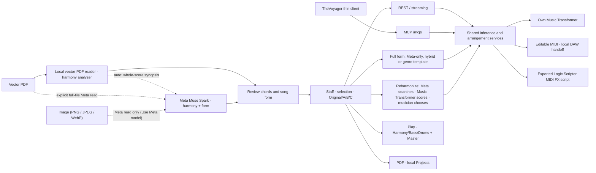

<h1 align="center">TheArtist</h1>

<p align="center">
  <em>An AI arrangement tool: bring in a score or chord sketch, shape its harmony, form and accompaniment, and continue in your DAW.</em>
</p>

<p align="center">
  <a href="https://arxiv.org/abs/2605.04998"></a>
  <a href="https://arxiv.org/abs/2606.07334"></a>
  <a href="https://huggingface.co/PearlLeeStudio"></a>
  <a href="https://artist-daw.pearlleestudio.co"></a>
  <a href="#hackathon-work-and-where-meta-is-used"></a>
  <a href="https://youtu.be/iSDj4VK9nKc"></a>
  <a href="LICENSE"></a>
  <a href="https://huggingface.co/PearlLeeStudio"></a>
  
</p>

## Arrange with TheArtist

TheArtist helps musicians turn an existing score or chord sketch into an editable
arrangement. Work on the passage that needs attention, compare harmonic options
in context, shape the song form, choose the accompaniment and take separate
Harmony, Bass and Drums tracks into a DAW. Chord generation is one step in that
workflow; the musician chooses what stays in the score.

**[Open the arrangement workspace](https://artist-daw.pearlleestudio.co)** ·
[Workflow guide](docs/arrangement-workflow.md) · [Documentation](docs/README.md) ·
[Hackathon work log](HACKATHON.md) · [Run locally](#getting-started)

### Try it in two minutes

On the [live workspace](https://artist-daw.pearlleestudio.co), in a desktop browser (no sign-in; projects stay in the browser):

1. **New from Song Form → Full form**, Length 32 bars, press **Muse Spark only**. Muse Spark plans the sections and writes every chord; the form lands on the staff in about 25 seconds. Press Play.
2. Drag across two to four chords, right-click → **Reharmonize** → **Find 3 alternatives** (about 10 seconds). Switch **Alter 1–3** on the staff, listen, then **Apply**; Ctrl/⌘+Z undoes it.
3. **Import Score**, choose a PDF lead sheet, tick **Use Meta model** and press **Analyze and import**. The score opens from the local reading at once; Meta's reading of the original runs in the background (up to 150 seconds), marks the bars where the two readings differ and fills bars the local reader left empty.
4. **Export ▾ → Download MIDI** for separate Harmony, Bass and Drums tracks, or **PDF · Light (print)** for the score.

The local reader handles vector PDFs, reading printed chord symbols or analyzing the notes. It read
none of eight Mutopia editions, and scans or photos go to Meta only, whose readings need checking
(a notes-only PNG matched 1/4 chords).

| Step | Work in the editor | Result |
|---|---|---|
| Bring in the material | Import Score, MIDI keyboard, manual chords, or New from Song Form | An editable harmonic score with key, meter and section boundaries |
| Shape the harmony | Select existing chords and Reharmonize, or Generate a new passage | Combine Reharmonize alternatives, preview Origin and Apply; each alternative changes up to 1–4 selected chords. Generate retains Original/A/B/C |
| Develop the form | Extend a sketch, add a section or start a new song | A complete harmonic form; starting fresh first saves the existing score in Projects |
| Arrange and audition | Adjust voicings, sounds, comping rhythm, drums, tempo and part levels in Play | A playable Harmony/Bass/Drums arrangement |
| Continue production | Save a project, export MIDI or score PDF, or hand off to Logic | Editable material for further instrumental, melodic and production work |

**What the AI contributes.** The author's Music Transformer proposes and scores
harmony; Meta reads scores, plans and writes song forms, drives the reharmonization
search with tool calls and judges candidates.
Voicings, accompaniment patterns, mixer controls and MIDI rendering use application
code. The current arrangement is a harmonic score with three accompaniment parts.
Imported melody notes and durations are not transferred as an editable melody
track, and the app does not generate vocals or a finished audio master.

## Hackathon work and where Meta is used

**Build for Your World.** The author's own problem is carrying musical material
from a score into an arrangement: reviewing harmony, trying substitutions,
developing sections, choosing accompaniment and transferring it without retyping.
TheArtist connects those decisions in one workspace and delivers editable parts
to the DAW. Its existing chord model supplies a harmonic engine for this workflow.

| | Pre-existing (tag `baseline`) | Hackathon work (commits after the tag) |
|---|---|---|
| Models | 25M-parameter Music Transformer, 11 genre LoRAs, R1 rerank, R2 theory retrieval (Berklee + OMT) | no new weights; Meta Muse Spark as reader, planner, composer, tool-driven reharmonizer and judge; cached own-model inference; source-isolated OMT retrieval (OMT on by default, Berklee off, local TF-IDF, attributed excerpts) |
| Editor | staff, voicings, Roman numerals, MIDI input, playback, saved-sessions page | Import Score, Original/A/B/C, Reharmonize (Origin / Alter 1–3), Second ear, Complete the form, Projects rework (first-row previews, full Export menu, bulk delete, preserve current work), the Play panel and mixer, Safari MIDI bridge and Logic handoff |
| Service | `/api/generate*`, basic `midi_b64` render | local vector-PDF reader and harmony analyzer, editable three-part MIDI export (`/api/export/midi`, replacing the baseline's basic MIDI download), score PDF, DAW handoff, Logic Scripter script, REST + MCP contract, Meta client with ledger, planner, Second-ear review, Reharmonize |

Since the `baseline` tag: more than 250 commits and 120 entries in the [work log](HACKATHON.md),
each with its tests and limits.

**Where Meta is used.** These six paths are the only Meta calls in the product; voicings, accompaniment, MIDI rendering and the local score reader are application code, and Generate's chord candidates come from the author's Music Transformer. Every call uses the Standard model `muse-spark-1.3` through the Meta Model API and records its timeout, request id, token count and cost in the ledger; Import labels a recovered local result as local.

| Path | File | Calls per use | Switch |
|---|---|---|---|
| **Use Meta model** checkbox, `engine: "verified"`, run in the background after the local reading has opened the PDF: concurrent Meta/local reading, explicit local recovery on failure, comparison when both succeed; disputed bars are marked and still-empty bars filled on the staff; a score over Meta's 128-bar limit opens from the local reader without a Meta call | `score_verification.py`, `score_import.py` | 1 PDF/image request, default ≤ $1.50; no automatic Meta retry | `THEARTIST_META_ENABLED`; public hosts also require `THEARTIST_PUBLIC_META_READER=1` |
| Direct full-file API reading, `engine: "meta"` | `score_import.py` | 1 request, default ≤ $1.50 | same |
| Bounded API assist, `engine: "auto"` | `score_assistance.py`, `harmony_meta.py`, `score_form.py` | ≤ 2 × 8-bar harmony reviews + 1 form analysis, ≤ $0.30 total | `THEARTIST_META_ENABLED` only (public hosts do not require the reader flag); leave the editor checkbox off for no Meta calls |
| Complete the form planner (plan, validate, revise, judge) | `backend/app/services/planner.py`, `routes/plan.py` | ≤ 5 calls per run (1 plan, ≤ 2 revisions, then either 1 Muse Spark composition call in **Muse Spark only** mode or ≤ 2 judgments in the hybrid mode) | `THEARTIST_META_ENABLED` only; judge role via `LLM_JUDGE_*` |
| Second ear: pick one of a Generate's A/B/C on analyzer facts, each reason checked | `backend/app/services/review.py`, `routes/review.py` | 1 judge call | `THEARTIST_META_ENABLED` only; judge role via `LLM_JUDGE_*` |
| [Reharmonize](docs/reharmonization.md): search sparse substitutions, compare learned context scores, offer three persistent score previews | `backend/app/services/reharmonize_agent.py`, `reharmonize.py` | ≤ 4 native tool turns, ≤ $0.15 per search | `THEARTIST_META_ENABLED`; selected Music Transformer must be available |

With `THEARTIST_META_ENABLED=0` any attempted Meta call answers HTTP 503 "disabled":
Reharmonize, both Meta modes of Complete the form and Second ear stop there, and Import
opens from the local reader alone. Generate with the author's model, the Genre template
and every export keep working.

**Meta capabilities in use.**

| Meta capability | Where it does the work | Recorded result |
|---|---|---|
| Whole-document reading of a score PDF or image | Import's **Use Meta model** check, compared bar by bar with the local reader; images are read by Meta only | 52-bar PDF on the hosted demo: 51.4 s, $0.053 |
| Native tool calling over a bounded music search | Reharmonize: up to 4 tool turns drive the substitution search; Meta picks three contrasting patches the Music Transformer has scored in context | hosted median 10.4 s; $0.014–0.021 per search in recorded runs |
| Strict JSON checked by code, with revision rounds | Complete the form: plan → validate → up to 2 revisions → compose (**Muse Spark only**) or judge (hybrid) | empty score → 32 bars / 6 sections on the hosted demo: 23.7 s, $0.020 |
| Reasoning held to computed facts | Second ear: each reason cites an analyzer fact and is marked *analyzer confirmed* or *model statement* | 115/115 reasons confirmed in 60 reviews; $0.0041, 2.8 s per review |
| Reading harmony from notes | The note-interpretation task behind Import assist (API `engine: "auto"`) | exact chords: Muse Spark 89.5%, local analyzer 77.8% (640 slots of real progressions rendered as notes) |
| Meta open weights | The judge role can run on Muse Spark Open through Baseten (`LLM_JUDGE_*`) | same pick as Muse Spark in 52/60 reviews at $0.0028 per review |

Reasoning effort is set per role, for example low for file reading and tool turns and medium
for the form plan. Measurements and their limits are under [Evidence](#evidence).

The [hackathon work log](HACKATHON.md) separates these additions from the existing
editor and trained models. This development repository stays intact; a separate
submission repository will contain event work and patches against a pinned core
dependency. The screenshots illustrate their documented flows and predate the
latest Import controls and theory references; the linked YouTube video
is the pre-existing demo. Verified paths and remaining audio/device checks are
separated in the [manual checklist](docs/manual-checks.md).
The [repository consistency report](docs/repository-checks.md) records the
file, contract and test coverage, fixes, and remaining verification limits.

### Where Meta appears in the editor

Meta's work appears on the score rather than in a chat window. The two places a
musician meets it most often:

| Place | What the musician does | What Meta does | What appears |
|---|---|---|---|
| **Import Score → Use Meta model** | Picks a PDF, ticks the checkbox, clicks **Analyze and import** | Reads the original file once (≤ $1.50, 150 s) after the local reading has already opened the score | A one-line status above the staff while the check runs, then **Review** marks on bars where the two readings differ and chords filled into bars the local reader left empty, each with its request id in the bar's source details |
| **Input → Reharmonize → Find 3 alternatives** | Selects written chords, sets *Change up to* and a mode | Explores the mathematical substitution search with native tool calls (≤ 4 turns, ≤ $0.15) and picks three contrasting candidates scored by the Music Transformer | **Origin / Alter 1 / Alter 2 / Alter 3** cards under the passage; **Apply** keeps a combination and closes them |

<!-- Screenshots of these two states go here as screenshot/12-import-use-meta.png and
     screenshot/13-reharmonize-alternatives.png once captured in a browser. -->

Complete the form (Muse Spark only / Music Transformer + Meta review) and Second ear
are the other two paths; all four are listed with their files, call counts and
switches in the table above.

## Live sites

| Project | Website | Role |
|---|---|---|
| **TheArtist-DAW — hackathon demo** | [artist-daw.pearlleestudio.co](https://artist-daw.pearlleestudio.co) | AI arrangement workspace: score/sketch → harmony and form → accompaniment → DAW |
| TheArtist — public release | [artist.pearlleestudio.co](https://artist.pearlleestudio.co) | Separately deployed release editor |
| **TheVoyager — project extension** | [voyager.pearlleestudio.co](https://voyager.pearlleestudio.co) | Travel globe, stories and photographs accompanied by generated music |

Both Artist editors share one Docker backend on DigitalOcean
(`https://music-api.pearlleestudio.co`) that serves all 18 released model choices
with a server-only Meta key. The frontends build on Cloudflare Pages from each
public repository; the model server polls this repository's `main` and redeploys
runtime changes with health checks and rollback. Hosted **Open in Logic Pro** goes
through a local Mac bridge, and Download MIDI works without it. Pipeline, image
contents, Voyager's adapter status and the limits:
[web projects and deployment](docs/web-projects.md) · [hosting and measurements](deploy/vps.md) ·
[automatic deployment](deploy/autodeploy.md).

## What the editor does

- **Import Score** — one PDF or image becomes an editable score with key, meter,
  sections and per-bar source evidence. A PDF opens from the local reader in a
  second or two; **Review** and **Unresolved** marks stay on the staff. With
  **Use Meta model**, Meta then reads the original in the background and a band
  above the staff reports the bars it flagged or filled where the local reader
  had no chord, without replacing anything already visible.
- **Select and edit on the staff** — drag to select slots, Ctrl/⌘+A for the whole
  score, Ctrl/⌘+X·C·V to cut, copy and paste (a copied passage that divides the
  selection repeats over it; otherwise it is written forward and bars are added),
  Delete to clear, Ctrl/⌘+Z to undo, and the same edits on right-click. Chord text
  such as `Dm7 G7 | Cmaj7` pastes from anywhere.
- **Generate** — three candidates (**Original/A/B/C**) for a selected passage from
  the chosen Music Transformer, streamed phase by phase and ranked by R1 roughness
  plus local theory relevance when the OMT corpus is prepared.
- **Reharmonize** — Meta searches bounded substitutions of 1–4 selected chords with
  the surrounding harmony in view; the Music Transformer scores them in context;
  **Origin / Alter 1–3** cards combine on the staff, and **Apply** keeps the
  choice and closes them (undo with Ctrl/⌘+Z).
- **Second ear** — a bounded Meta judge picks among A/B/C on facts the analyzer
  computed, each reason marked *analyzer confirmed* or *model statement*.
- **New from Song Form** — add a section or complete the form with **Muse Spark
  only** (default), **Music Transformer + Meta review** or a **Genre template**;
  **Keep the theme** reuses a chorus; the existing sketch is preserved.
- **Play** — piano or guitar voicing view, 31 sounds, 13 comping rhythms, 15 drum
  patterns and BPM / Master / Harmony / Bass / Drums faders, saved with each project.
- **Projects and Export** — browser-local projects; editable three-part MIDI with
  tempo, meter, markers and levels; score PDF; Logic handoff (local backend or the
  Mac bridge); a Logic Scripter MIDI FX script; the same service over REST and MCP.

Exact controls, limits and provenance rules: [editor reference](docs/editor-reference.md) ·
[workflow guide](docs/arrangement-workflow.md) · [screenshots](docs/walkthrough.md).

## Evidence

Every number comes from a recorded run whose calls, costs and failures are kept.
Automatic judge scores are not listener preference, and no row is a listening study.

| Evaluation | Material | Result |
|---|---|---|
| Reharmonization selectors (own F4 model / Meta / hybrid ×1 / hybrid ×2) | JAZZVAR jazz-standard passages, 40; 200 Meta calls, $2.465 | A Muse Spark judge with sources hidden (the same model family as the Meta selector) gave means 2.464 / 2.671 / 2.624 / 2.649 of 4; no clear winner among Meta and hybrids; a second pass changes 5/40 sets |
| F2 vs F3 checkpoints | Same 40 passages, 200 calls each | Rank differences include 0 in all four methods; top-2 unions keep the overall best in 35/40 |
| Full-form planner, fixed seeds | 60 Muse+F1 vs template pairs, $1.02 | Structure 60/60 both; section variety 2.75 → 3.48; out-of-key slots 19.4% → 14.7%; judge still asked regeneration in 21/60 |
| Second ear: a judge picks one of A/B/C | 20 candidate lists × 3 orders, 60 reviews per model | Muse Spark: 115/115 reasons confirmed by the analyzer; most in-key pick in diatonic genres 33/36 (R1 order 67%); same pick in all orders 17/20; $0.0041, 2.8 s. Muse Spark Open: 112/112, same pick 52/60, $0.0028, 2.1 s |
| Chord reading from notes | 40 real-progression excerpts rendered as notes, 640 slots; Muse Spark 40 calls, $0.338 | Exact: local analyzer 77.8%, Muse Spark 89.5% (answers every slot), local-then-Meta 83.9% for $0.050, Muse Spark Open 73.8%; local is more precise where it answers (95.4%); one real PDF 18.9 / 29.7 / 21.6% |
| Score readers (local / Meta / hybrid ×1 / ×2) | 5 PDFs, 14 calls, $0.272 | Completed 3/5, 3/5, 4/5, 3/5 |
| Import: own fixtures and published editions | 20-bar vector score; notes-only PNG; 8 Mutopia PDFs | 20/20 chords and 8/8/4 sections; PNG 1/4; local reader 0/8 on Mutopia, Meta Bach pitch sets 8/32 |
| Own-model speed, identical outputs | CPU 4 threads, F1/F4/Rock LoRA, 30 pairs | 1.73–3.89× faster; F1 64 bars 7.18 → 1.85 s; loading 0.471 → 0.080 s; hosted Reharmonize median 13.8 → 10.4 s |

F1–F5 are checkpoints of the author's Music Transformer (F4 serves jazz); R1 orders candidates
by Sethares roughness; OMT is the Open Music Theory text behind the attributed excerpts.
Automated checks on 2026-11-01: 641 backend tests (`python -m unittest discover -s tests -t .`
in `backend/`; the MIDI-bridge test needs permission to open a local port) and 304 frontend
tests (`node --test "frontend/src/**/*.test.ts"`).

Conditions, costs, failures and every record: [evaluation evidence](docs/evidence.md) ·
[evaluation framing](docs/evaluation.md) · [manual checks](docs/manual-checks.md).

<p align="center">
  
</p>

<p align="center"><sub>
Current Safari interface: section labels, chord staff, Play controls and the always-visible mixer. This capture predates the optional theory references. Corpus text is not shipped in the repository.
</sub></p>

<p align="center">
  <a href="https://youtu.be/iSDj4VK9nKc">
    
  </a>
</p>

<p align="center"><sub>
▶ <a href="https://youtu.be/iSDj4VK9nKc">Watch the baseline demo on YouTube</a> — existing staff editor, MIDI input and generation; this is not the hackathon submission video.
</sub></p>

## Links

| | |
|---|---|
| 🎬 **Demo videos** | [youtube.com/@StudioPearlLee](https://www.youtube.com/@StudioPearlLee) |
| 🤗 **Released models** | [huggingface.co/PearlLeeStudio](https://huggingface.co/PearlLeeStudio) — 7 base checkpoints + 11 LoRA adapters |
| 📄 **Paper / technical report** | [arXiv:2605.04998](https://arxiv.org/abs/2605.04998) · [arXiv:2606.07334](https://arxiv.org/abs/2606.07334) |
| 💼 **Author** | [linkedin.com/in/pearlmedicilee](https://www.linkedin.com/in/pearlmedicilee) |

---

## Architecture

### Shared arrangement workflow



The MCP tools wrap implemented services, including score import and the
planner's `plan_song` / `validate_plan`. There is no standalone theory-explanation
tool. Generation can return attributed OMT source excerpts; it does not generate
new theory explanations. See the
[versioned contract and tool list](docs/mcp.md).

**Chord-generation data flow.** The editor sends selected measures and context to
`/api/generate/stream`, or a named section to `/api/generate/section/stream`.
The backend resolves the checkpoint, samples three candidates, anchors a fresh
passage to its key, and ranks by R1 roughness. Section/cadence rules run **before**
voice-leading inversions, so the inversions describe the resulting chords.
The response identifies the actual model or rule source; the frontend computes
voicings and Roman numerals and plays the arrangement through Tone.js.
SSE events report the stages actually performed. Ready OMT retrieval contributes
text relevance to ranking and adds attributed source excerpts after voice leading.
Berklee is disabled by default; retrieval makes no LLM or external API calls.

Full-form planning wraps the section generator: Muse Spark proposes form and
cadences and code validates them; in the hybrid mode the author's model generates
the chords and a bounded judge can request regeneration, while the default
**Muse Spark only** mode lets one bounded Muse Spark call write every planned
section with no Transformer pass, cadence rewrite or judge. Import uses a separate local score reader
and harmony analyzer, with optional Meta harmony/form reasoning. Both preserve
their source and cost records; neither substitutes an AI success for a failed call.

Editor/backend/model internals, the `/api/generate/stream` sequence, the MIDI input
state machine and the module layout: [architecture](docs/architecture.md).

## Tech Stack

| Layer | Technologies |
|-------|-------------|
| **Frontend** | React 19, TypeScript (strict), Vite 8, Tailwind CSS 4, Zustand 5, VexFlow 5, Tone.js 15, smplr (GM Soundfont + drum machines) |
| **Backend** | FastAPI, Pydantic v2, Uvicorn, Python 3.12+ |
| **AI/ML and score reading** | PyTorch, custom Music Transformer, music21, pdfplumber; HuggingFace Datasets and TensorBoard in the preserved training pipeline |
| **Model/tool integration** | Meta Model API through the OpenAI-compatible SDK, official MCP Python SDK |
| **Dev Tools** | uv (Python), npm, ESLint |

## Getting Started

### Prerequisites

- Node.js 22.12+ (the locked Vite package also supports 20.19+)
- Python 3.12+ with [uv](https://docs.astral.sh/uv/)
- (Optional) NVIDIA GPU with CUDA 12.1 — inference also runs CPU-only

### Installation

```bash
# Clone the repository
git clone https://github.com/PearlLeeStudio/TheArtist-DAW.git /absolute/path/TheArtist-DAW

# Frontend
npm --prefix /absolute/path/TheArtist-DAW/frontend ci

# Backend
uv sync --frozen --directory /absolute/path/TheArtist-DAW/backend
# Prepare the default OMT corpus once (downloads the reviewed Open Music Theory pages; retrieval itself runs offline afterwards).
uv run --frozen --directory /absolute/path/TheArtist-DAW/backend python /absolute/path/TheArtist-DAW/backend/scripts/setup_omt.py

# Model checkpoints — download trained weights from HuggingFace so the backend
# serves real models (skip this and it falls back to a rule-based generator).
# Public repos (CC BY-NC, no token). --smoke fetches F1 only into ai/checkpoints/.
uv run --frozen --directory /absolute/path/TheArtist-DAW/backend python /absolute/path/TheArtist-DAW/model/_download.py --smoke
# Omit --smoke to download all 18 checkpoints for the genre adapters and model picker.
```

### Running Locally

Start the backend and frontend in separate terminals:

```bash
# Terminal 1 — Backend (port 8000)
uv run --directory /absolute/path/TheArtist-DAW/backend uvicorn app.main:app --reload

# Terminal 2 — Frontend (port 5173)
npm --prefix /absolute/path/TheArtist-DAW/frontend run dev
```

Vite proxies `/api` requests to the backend automatically. Open `http://localhost:5173` in your browser.

For one process serving the built UI and API, see the [single-origin server](deploy/README.md).
The [submission extraction tools](scripts/submission_README.md) reconstruct the app
from a pinned external core plus verified event changes. Neither setup configures a domain.

To preload AI models on startup:

```bash
THEARTIST_WARMUP=1 uv run --directory /absolute/path/TheArtist-DAW/backend uvicorn app.main:app --reload
THEARTIST_WARMUP_KEYS=ft_f1,ft_f4 uv run --directory /absolute/path/TheArtist-DAW/backend uvicorn app.main:app
```

For a public judge server, `THEARTIST_PUBLIC_HOST=1` turns off DAW handoff, the warmup
route and MCP, and puts Meta calls behind per-session and daily spend limits.
Whole-file reading (`engine: "meta"` or the checkbox's `verified`) also needs
`THEARTIST_PUBLIC_META_READER=1`; the hosted Artist service enables that option.
The file reader has a 150-second timeout, one Meta call, low reasoning effort and
32,768 output tokens so a complete score can fit beside reasoning tokens.
`THEARTIST_META_UNLIMITED=1` explicitly disables session, daily, ledger, per-request
and per-run dollar caps for development; the shared hosted demo server
(`music-api.pearlleestudio.co`) currently runs with it, so its dollar caps are off
while call counts, timeouts and the ledger stay on.
Request IDs, token usage, costs, timeouts and finite call counts remain recorded.
Without that opt-in, the configured dollar caps apply; see `deploy/env.example`.

## Models and data

The harmonic engine is the author's ~25M-parameter Music Transformer from a
pop→jazz adaptation study ([arXiv:2605.04998](https://arxiv.org/abs/2605.04998)):
Phase 0, F1–F5, the selection-corrected F1 v2 and eleven genre LoRA adapters, all
public on [Hugging Face](https://huggingface.co/PearlLeeStudio) (CC BY-NC 4.0) and
fetched into `ai/checkpoints/` by `model/_download.py`. The released F1 base is
weight-identical to Phase 0, a checkpoint-selection artifact recorded with the
numbers. Candidates are ordered by R1 Sethares roughness plus local Open Music
Theory text relevance once that corpus is prepared; Berklee is off by default.
Per-run metrics and caveats, training corpora and retrieval sources:
[models, training data and theory sources](docs/models.md) ·
[theory retrieval](docs/theory-retrieval.md).

## API

The REST API and eleven MCP tools use the same application services. MCP is
mounted at `/mcp/` on local/default servers; `THEARTIST_PUBLIC_HOST=1` disables
that mount. MCP results use a `schemaVersion: "1.0"` envelope, while REST responses
follow the endpoint schemas.

| REST endpoint | Method | MCP tool | Purpose |
|---|---|---|---|
| `/api/health` | GET | — | Health check |
| `/api/capabilities` | GET | `capabilities` | Contracts, tools, feature availability and bounds |
| `/api/models/list` | GET | `list_models` | Checkpoint labels and installed availability |
| `/api/genres/list` | GET | `list_genres` | Supported genres and model dispatch |
| — | — | `get_genre_preset` | Key, tempo, meter, rhythm and instrument defaults |
| `/api/generate` · `/api/generate/stream` | POST | — | Three chord candidates for selected score slots; optional SSE |
| `/api/generate/chords` | POST | — | Programmatic chord-only generation |
| `/api/generate/section` · `/api/generate/section/stream` | POST | `generate_section` | Named section generation with source/model and optional seed |
| `/api/generate/song` | POST | `build_song` | One complete three-track arrangement and MIDI, with optional seed |
| `/api/plan/song` · `/api/plan/song/stream` | POST | `plan_song` (**planning stage only**) | REST plans, generates and judges; MCP returns a validated plan without chords |
| — | — | `validate_plan` | Validate a plan against its request without a model call |
| `/api/review/candidates` | POST | — | Meta Second-ear review of three candidates |
| `/api/reharmonize` | POST | — | Three contextual substitution patches, each changing at most 1–4 selected chords |
| `/api/import/score` · `/api/import/score/stream` | POST | `import_score` | Local vector-score reading or explicit bounded/full-file Meta analysis; the stream variant adds SSE progress |
| `/api/export/midi` | POST | `render_midi` | Render the shared `ExportSpec`; MCP returns base64 file data |
| `/api/export/scripter` | POST | — | Export a Logic Scripter MIDI FX script |
| `/api/daw/targets` | GET | — | Discover available local DAW targets |
| `/api/daw/open` | POST | `export_daw` | Save MIDI and open Logic or reveal it for Ableton |
| `/api/models/status` | GET | — | Loaded model status |
| `/api/models/warmup` | POST | — | Preload models; disabled on public hosts |

MCP `import_score` requires explicit attachment confirmation. `export_daw` requires
a direct loopback connection, server opt-in and per-call confirmation. Public-host
restrictions also disable DAW handoff. Whole-file Meta reading needs explicit
server opt-in; it and bounded Import assist retain their spend limits. See [API_SPEC.md](API_SPEC.md)
and [docs/mcp.md](docs/mcp.md) for the full contracts and the
[async client](backend/theartist_client/client.py).

TheVoyager's `build_song` / `POST /api/generate/song` request and response shapes,
genre defaults and error codes: [Voyager API quick start](docs/voyager-api.md).

## Research

- **arXiv preprint** — *Empirical Study of Pop and Jazz Mix Ratios for Genre-Adaptive Chord Generation*, Lee, 2026, [arXiv:2605.04998](https://arxiv.org/abs/2605.04998).
- **arXiv technical report** — *How Far Can Chord-Symbol Time-Series Adaptation Carry Genre Identity?*, Lee, 2026, [arXiv:2606.07334](https://arxiv.org/abs/2606.07334).
- **HuggingFace** — seven F-series base checkpoints (incl. the selection-corrected F1 v2 retrain) + eleven LoRA adapters at [huggingface.co/PearlLeeStudio](https://huggingface.co/PearlLeeStudio); download into `ai/checkpoints/` with `model/_download.py`. Per-model evaluation summaries (real-song matrix, LoRA rank sweep) live on the model cards.

### Citation

```bibtex
@misc{lee2026chordmix,
  title         = {Empirical Study of Pop and Jazz Mix Ratios for Genre-Adaptive Chord Generation},
  author        = {Lee, Jinju},
  year          = {2026},
  eprint        = {2605.04998},
  archivePrefix = {arXiv}
}

@misc{lee2026genreidentity,
  title         = {How Far Can Chord-Symbol Time-Series Adaptation Carry Genre Identity?},
  author        = {Lee, Jinju},
  year          = {2026},
  eprint        = {2606.07334},
  archivePrefix = {arXiv}
}
```

## Not in this repository

- **Paper sources** — the papers themselves are on arXiv (links above); LaTeX sources and research notes are private.
- **Trained checkpoints** — published on [HuggingFace](https://huggingface.co/PearlLeeStudio) (CC BY-NC 4.0), fetched via `model/_download.py`.
- **Raw datasets** — license + size constraints; see [Datasets](docs/models.md#datasets) for upstream sources.
- **Berklee Book of Jazz Harmony PDF** — copyrighted; disabled by default and excluded from public retrieval. Owning a copy does not itself grant service or redistribution rights.
- **Internal design notes, deliberation logs, and roadmap drafts** — private.

## License

Electric piano playback uses Greg Sullivan's Yamaha CP80 samples and kinwie's SFZ mapping from
[GregSullivan.E-Pianos](https://github.com/sfzinstruments/GregSullivan.E-Pianos), under
[CC BY 3.0](https://github.com/sfzinstruments/GregSullivan.E-Pianos/blob/master/LICENSE).
The original FLAC samples are streamed unchanged; the player maps its CP80 sample requests to those lossless files.

**Code: [MIT](LICENSE)** © 2026 Jinju Lee (PearlLeeStudio).

Downloaded OMT prose and its displayed excerpts retain CC BY-SA 4.0 with attribution;
see [the source policy](docs/theory-retrieval.md). This does not change the app code license.

The released model checkpoints are distributed separately on [HuggingFace](https://huggingface.co/PearlLeeStudio) under **CC BY-NC 4.0** (they derive from the CC BY-NC Chordonomicon corpus) — non-commercial paper / portfolio / demo use only. Bundled GPL-3.0 drum samples keep their own license ([frontend/public/drums/LICENSE.txt](frontend/public/drums/LICENSE.txt)). Raw datasets are not redistributed — see [Datasets](docs/models.md#datasets).

Contact: pearl1379@gmail.com
