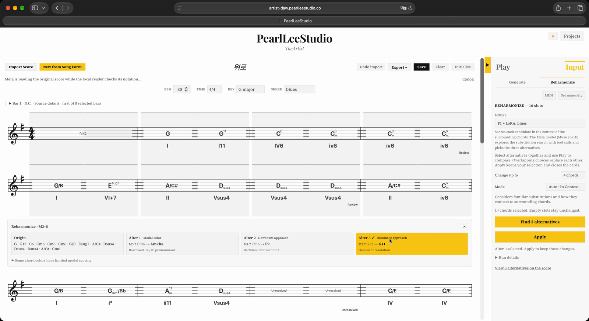
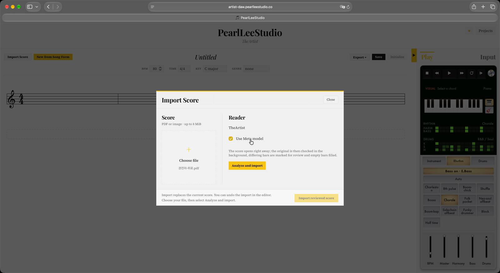
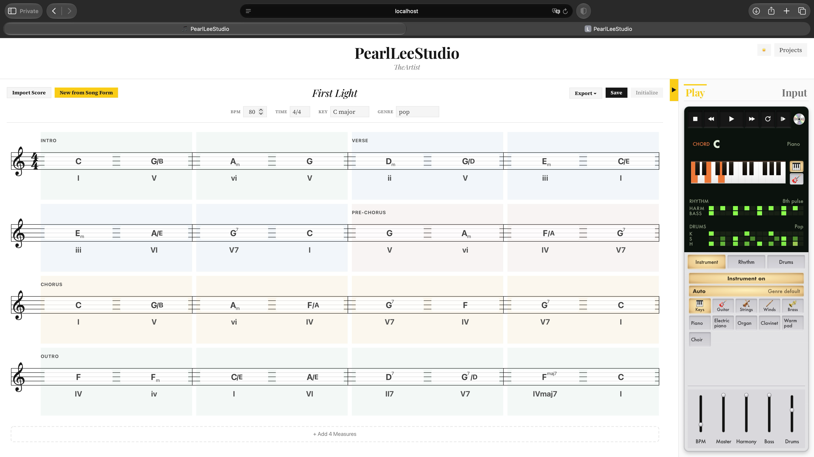
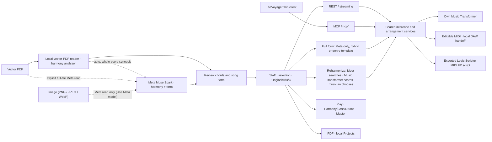
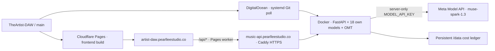

<h1 align="center">TheArtist</h1>

<p align="center">
  <em>From score to editable DAW parts, with less preparation: extract chords, explore harmony with Meta Muse Spark and the Music Transformer, and build your accompaniment.</em>
</p>

<p align="center">
  <a href="https://artist-daw.pearlleestudio.co"></a>
  <a href="#hackathon-work-and-where-meta-is-used"></a>
  <a href="docs/open-weights.md"></a>
  <a href="https://youtu.be/wC-dkLfot-c"></a>
  <a href="LICENSE"></a>
  <a href="https://huggingface.co/PearlLeeStudio"></a>
  
</p>

## Arrange with TheArtist

**Why I built it.** The chord helpers I used in DAWs suggest the next chord while the
song just keeps growing: no set length, no verses or choruses, no idea where a phrase
has to land. A chord that does not know the song form cannot be suggested well.
TheArtist keeps song length and sections visible, imported from a score or planned
by Muse Spark. The planner uses that structure; Reharmonize preserves it while the
Music Transformer scores alternatives against surrounding harmony.

**Built October 27 – November 4, 2026 with Meta Muse Spark (`muse-spark-1.3`), on
top of my own score editor and chord model.** Bring a lead sheet, select the bars that
feel flat and hear alternatives in context:

- **Reharmonize agent.** Muse Spark runs a bounded substitution search through native
  tool calls, my Music Transformer scores each change against the surrounding bars,
  and the musician combines and applies the alternatives on the staff. Run details
  show the completed calls: hosted median 10.4 s, about $0.02 per search.
- **Import.** A supported vector PDF opens as editable chords from the local reader;
  with **Use Meta model**, Muse Spark checks the original in the background. Images
  need Meta reading before they can open. In a separate 640-slot notes-to-chords
  benchmark, Muse Spark matched exactly 89.5% against the local analyzer's 77.8%.
  That benchmark predates the current full-file Import workflow.
- **DAW export.** Separate Harmony, Bass and Drums MIDI tracks go to Logic Pro or any
  DAW, so the harmony is never typed twice.

Existing before the event and not claimed as event work: the score editor with its
voicings, playback engine and MIDI input; the 31 sounds, genre comping rhythms and drum
patterns; and the Music Transformer with 11 genre adapters ([research](#research)).
The Play panel with its mixer and timing fixes, the Logic Pro bridge and every
Meta-powered feature are event work; the full split is in
[Hackathon work](#hackathon-work-and-where-meta-is-used).

**[Open the arrangement workspace](https://artist-daw.pearlleestudio.co)** ·
[Watch the hackathon demo](https://youtu.be/wC-dkLfot-c) ·
[Submission repository](https://github.com/PearlLeeStudio/TheArtist-Meta-Hackathon) ·
[Workflow guide](docs/arrangement-workflow.md) · [Documentation](docs/README.md) ·
[Local / Meta / hybrid results](docs/model-comparison.md) ·
[Run with Docker](#getting-started) · [Deploy to a domain](#deploy-to-a-domain)

<p align="center">
  <a href="https://youtu.be/wC-dkLfot-c">
    
  </a>
</p>

<p align="center">
  <a href="https://youtu.be/wC-dkLfot-c"><strong>TheArtist — From Chord Sketch to Your Own Music</strong></a>
</p>

<p align="center">
  
  <br>
  <sub>Reharmonize on an imported lead sheet in the live workspace: Muse Spark explores the substitution search with tool calls, the Music Transformer scores the candidates in context, and Alter 1–3 wait under the passage until the musician applies one.</sub>
</p>

Import a score, try and combine harmonic alternatives, and listen again as the
sketch takes shape. Export a PDF chord chart or editable MIDI tracks to continue
making your own music in a DAW such as Logic Pro.

### Try the core workflow

On the [live workspace](https://artist-daw.pearlleestudio.co), in a desktop browser (no sign-in; projects stay in the browser):

1. **Import Score**: choose a supported PDF you own or have permission to process, optionally tick **Use Meta model**, then press **Analyze and import**. A readable PDF opens from the local reading without waiting for Meta. With Meta selected, the original-file review runs in the background (up to 150 seconds), flags differences and fills untouched empty bars. Check the key, meter and imported chords against your own source.
2. Drag across two to four existing chords, right-click → **Reharmonize** → **Find 3 alternatives** (about 10 seconds in recorded hosted runs). Switch **Alter 1–3** on the staff, listen and combine alternatives, then **Apply**; Ctrl/⌘+Z undoes it. Before applying, **Run details** shows Muse Spark's tool calls, request ids, cost and time.
3. In **Play**, choose the instruments, accompaniment rhythm and drums, then adjust the part levels. The harmonic edits feed the same Harmony, Bass and Drums arrangement.
4. **Export ▾ → PDF · Light (print)** to check the harmonic score. Then **Download MIDI** and continue editing its separate tracks in your DAW, or use [Open in Logic Pro](docs/midi-input.md#open-a-hosted-score-in-logic-pro). The Logic handoff needs the local Mac bridge; the MIDI download does not.

To start without a source score, first choose **Genre → Pop**, then **New from
Song Form → Full form**, Length 32 bars, and press **Muse Spark only**. Muse Spark
plans the sections and writes the chords; the recorded hosted run took about 25
seconds. Genre selection is required before the button is enabled.

No PDF at hand? Set **Key** to G major and **Time** to 3/4 above the staff, click the first bar and paste
this chart with Ctrl/⌘+V. It is *Amazing Grace* with the traditional harmonization of the CC0
[Public Domain Song Anthology](https://doi.org/10.32881/book2); then Reharmonize bars 5–8.

```text
G | G D7 | Em C | G | G | G D7 | G | G | G | G | C | G | Em G/D | D7 | G | G
```

The local reader handles supported vector PDFs, reading printed chord symbols or
analyzing notes. In the recorded external-edition test it supported none of eight
Mutopia PDFs. Scans and photos require Meta, whose readings still need review
(a notes-only PNG fixture matched 1/4 chords). [Reading evidence](docs/model-comparison.md).

**Respecting source material.** The workspace focuses on harmonic decisions and
accompaniment, rather than publishing the original score. It does not display the
uploaded PDF/image or export its melody as an editable melody track. Use your own,
public-domain or appropriately permitted material; analysis does not grant rights
to arrange or redistribute someone else's work.

**Analyze, extract chords, discard the source.** The selected file is uploaded to
the TheArtist server for analysis. File bytes and extracted notes are used only
while analysis and any selected background review are active: the application
does not cache parsed scores, write uploaded scores to disk, or retain extracted
note arrays in the editor or saved projects. The retained working material is the
editable harmony, key, meter, form, playback settings and minimal reading/review
metadata. When existing browser projects are opened, source-note data is removed
without discarding musical edits; a blocked storage rewrite is reported so it can
be retried. Import responses use `Cache-Control:
no-store`. Normal model-loading and inference caches do not hold uploaded scores.

Checking **Use Meta model** also sends the full selected PDF/image to Meta for
analysis. Meta's handling of that request is governed by its own service terms;
the application's source-discard policy does not control the provider's retention.
See [score processing and retention](docs/score-analysis.md#source-handling-and-retention).

| Step | Work in the editor | Result |
|---|---|---|
| Bring in the material | Import Score, MIDI keyboard, manual chords, or New from Song Form | Editable harmony with key, meter and section boundaries, without a retained source-score cache |
| Shape the harmony | Select existing chords and Reharmonize, or Generate a new passage | Combine Reharmonize alternatives, preview Origin and Apply; each alternative changes up to 1–4 selected chords. Generate retains Original/A/B/C |
| Develop the form | Extend a sketch, add a section or start a new song | A complete harmonic form; starting fresh first saves the existing score in Projects |
| Arrange and audition | Adjust voicings, sounds, comping rhythm, drums, tempo and part levels in Play | A playable Harmony/Bass/Drums arrangement |
| Continue production | Save a project, export MIDI or score PDF, or hand off to Logic | Editable material for further instrumental, melodic and production work |

**What the AI contributes.** The author's Music Transformer proposes and scores
harmony; Meta reads scores, plans and writes song forms, drives the reharmonization
search with tool calls and judges candidates.
Voicings, accompaniment patterns, mixer controls and MIDI rendering use application
code. The current arrangement is a harmonic score with three accompaniment parts.
**Melody editing and reproduction of the source melody as an editable track are
deliberately outside the design.** TheArtist focuses on harmonic decisions and
accompaniment preparation; melody writing and further production stay with the
musician in the DAW. The app does not generate vocals or a finished audio master.

## Hackathon work and where Meta is used

**Build for Your World.** The author's own problem: DAW chord helpers keep proposing
chords for a song with no set length or form, so the suggestions cannot follow its
sections or where a phrase resolves. TheArtist fixes the form first and works inside
it: Import keeps the score's sections, Complete the form has Muse Spark plan them, and
Reharmonize scores every change against the surrounding bars. The same workspace then
covers the preparation between a score and a DAW session: reading and entering
chords, trying substitutions, developing sections, choosing accompaniment and
transferring the result without retyping it. It keeps the musician's choices editable, discards the source
data after analysis and delivers accompaniment parts for further DAW work.
Its existing chord model supplies a harmonic engine for this workflow.

**Who it is for.** Musicians who already have a song on paper (a lead sheet or a chord chart)
and want to hear harmonic options and take playable parts into their DAW: arrangers, band
leaders, accompanists and students. Producers mostly want assistive AI rather than generated
songs: in Tracklib's 2025 survey of 1,734 producers, 6% used generative tools regularly and 82%
opposed full-song generation from text prompts
([MusicTech](https://musictech.com/news/industry/music-producers-are-rejecting-ai-study-reveals-over-80-of-producers-are-against-ai-generated-songs)).
TheArtist keeps the musician's score and choices and hands over editable MIDI, not finished audio.
Each piece exists elsewhere: Logic's Session Players follow a chord track, Scaler 3 suggests
substitutions from MIDI or audio, and Band-in-a-Box has arranged typed chords for decades. What is
new here is the chain from the printed score to contextual alternatives the musician chooses, a
completed form and editable parts in the DAW. TheArtist keeps their source material and
editing decisions connected: printed score → contextual harmonic alternatives →
song form → accompaniment → editable MIDI. The musician can audition, combine,
apply and undo proposals before continuing production in a DAW.

| | Pre-existing (tag `baseline`) | Hackathon work (commits after the tag) |
|---|---|---|
| Models | 25M-parameter Music Transformer, 11 genre LoRAs, R1 rerank, R2 theory retrieval (Berklee + OMT) | no new weights; Meta Muse Spark as reader, planner, composer, tool-driven reharmonizer and judge; cached own-model inference; source-isolated OMT retrieval (OMT on by default, Berklee off, local TF-IDF, attributed excerpts) |
| Editor | staff, voicings, Roman numerals, MIDI input, playback, saved-sessions page | Import Score, Original/A/B/C, Reharmonize (Origin / Alter 1–3), Second ear, Complete the form, Projects rework (first-row previews, full Export menu, bulk delete, preserve current work), the Play panel and mixer, Safari MIDI bridge and Logic handoff |
| Service | `/api/generate*`, basic `midi_b64` render | local vector-PDF reader and harmony analyzer, editable three-part MIDI export (`/api/export/midi`, replacing the baseline's basic MIDI download), score PDF, DAW handoff, Logic Scripter script, REST + MCP contract, Meta client with ledger, planner, Second-ear review, Reharmonize |

The [hackathon work log](HACKATHON.md) links each addition to its implementation,
tests and limits. The trained model assets remain pre-existing dependencies.

**Where Meta is used.** The default service calls Standard **`muse-spark-1.3`** at
**`https://api.meta.ai/v1`**, using the server-side **`MODEL_API_KEY`**. The
OpenAI-compatible SDK is the transport; it does not call an OpenAI model.
The six paths below account for the product's Meta integration. Request IDs,
token usage and costs are recorded in a persistent ledger, with time and call
bounds. The judge role can separately use Meta open weights through `LLM_JUDGE_*`;
the [Muse Spark Open comparison](experiments/review_eval/summary.md) uses Baseten.
Voicings, accompaniment and MIDI rendering use application code; Generate's
chord candidates come from the author's Music Transformer.

**Which model does what.** Baseten is an inference host, not a model: it serves
Meta's open-weight Muse Spark Open, a sibling of the Muse Spark 1.3 that Meta's own
API serves. In this product the two Meta models have different jobs:

| Job | Model | Served by | Key |
|---|---|---|---|
| Reading a score PDF or image (Import, **Use Meta model**); planning and writing the song form; the Reharmonize tool-call search when the agent role is left on it (the default) | **Muse Spark 1.3** (Standard) | Meta Model API, `https://api.meta.ai/v1` | `MODEL_API_KEY` |
| Judging: Second ear's pick among A/B/C and the hybrid form judge; since 2026-11-04 also the Reharmonize tool-call search, with the tools stated as JSON (the hosted demo runs both roles this way during judging) | **Muse Spark Open**, `meta-models/muse-spark-open-1026` (Meta open weights) | Baseten, `https://inference.baseten.co/v1` | `LLM_JUDGE_API_KEY` with `LLM_JUDGE_PROVIDER=baseten` and `LLM_AGENT_API_KEY` with `LLM_AGENT_PROVIDER=baseten`; left empty, that role uses Muse Spark 1.3 above |
| Chord generation and the context score of every candidate (Generate, Reharmonize scoring, the hybrid form's chords) | the author's Music Transformer (Phase 0, F1–F5, F1 v2, 11 genre LoRAs) | this server, CPU | — |

| Path | File | Calls per use | Switch |
|---|---|---|---|
| **Use Meta model**, `engine: "verified"`: local PDF opens first when readable; independent Meta reading runs in the background, flags disagreements and fills untouched empty bars. A successfully read local score over Meta's 128-bar limit stays local | [comparison](backend/app/services/score_verification.py), [file reader](backend/app/services/score_import.py) | 1 PDF/image request, 150 s, 32,768 output tokens, default ≤ $1.50; no automatic retry | `THEARTIST_META_ENABLED`; public hosts also require `THEARTIST_PUBLIC_META_READER=1` |
| Direct full-file API reading, `engine: "meta"` | [file reader](backend/app/services/score_import.py) | Same one-call file limits | Same |
| Bounded API assist, `engine: "auto"`: review locally inferred/unresolved harmony with complete score context, preserve printed chords and N.C. | [assist](backend/app/services/score_assistance.py), [harmony](backend/app/services/harmony_meta.py), [form](backend/app/services/score_form.py) | ≤ 2 × 8-bar harmony reviews + 1 form analysis, default ≤ $0.30 total | `THEARTIST_META_ENABLED`; this API mode is separate from the checkbox |
| Complete the form: plan → validate → revise, then compose or generate and judge | [planner](backend/app/services/planner.py) | ≤ 5 calls: 1 plan, ≤ 2 revisions, then 1 Meta composition (**Muse Spark only**) or ≤ 2 judgments (hybrid with own-model chords) | `THEARTIST_META_ENABLED`; judge role via `LLM_JUDGE_*` |
| Second ear: choose among Generate's A/B/C using analyzer facts, with checked reasons | [review](backend/app/services/review.py) | 1 configured judge call (Muse Spark Open on Baseten in the hosted demo) | `THEARTIST_META_ENABLED`; judge role via `LLM_JUDGE_*` |
| [Reharmonize](docs/reharmonization.md): Meta calls `search_substitutions` on bounded mathematical families, sees Music Transformer context scores, then calls `offer_candidates` | [agent](backend/app/services/reharmonize_agent.py), [own-model scorer](backend/app/services/reharmonize.py) | ≤ 4 model turns, 6 tool calls, 100 s; default ≤ $0.15 per search | Selected own model must be available; [local recovery](docs/reharmonization.md#without-meta) is marked *picked without Meta* |

Dollar values are default application limits. The hosted demo's explicit
`THEARTIST_META_UNLIMITED=1` setting bypasses dollar caps while preserving time
and call bounds, accounting and the configured credit stop line. It does not
represent an unlimited provider balance. [Runtime settings](deploy/env.example).

Reharmonize, both Meta modes of Complete the form, Second ear and Import's Meta check use
the configured Meta service. If Import recovers locally, it says **“Meta reading was
unavailable. The local reader recovered this score.”** and keeps local provenance. When
the server would refuse Meta (off, no key, or paused at the credit stop line), the Meta
controls are disabled and say why, without any amount. Reharmonize then picks its three
alternatives without Meta and says so.

**How the editor tells whether Meta did the work.** Nothing is inferred from prose; every
result carries fields the editor checks, and the same fields are in the API responses and
the server ledger. Import's background check returns `verification.status`: `compared`,
`unaligned` or `local_unavailable` mean Meta read the original (`model` and `requestId`
name the call), and the band above the staff becomes a yellow **✓ Meta muse-spark-1.3
checked this score against the original** box with the flagged/filled summary and the
request id; `local_fallback` or `local_only` mean the local reader stood in, shown in a
plain box with the fixed recovery text; a request that fails (HTTP 429, 502, 503 or 504)
is a **Meta check failed** box. A Reharmonize result carries `selection` (`meta` or
`local`), `metaModel` (`not used` when local), `metaUnavailable` (`disabled`,
`unconfigured`, `paused` or `limit`), `requestIds`, `toolCalls` and `costUsd`: `meta` gives
the yellow **✓ Meta muse-spark-1.3 chose these alternatives** box with the tool calls and
cost, `local` the plain **Picked without Meta** box with the reason, and an error a
**Meta search failed** box with the server's message. Second ear and Complete the form
print `provider`, `model`, `requestId` and `costUsd` on every result line, so a judge on
Muse Spark Open reads `baseten meta-models/muse-spark-open-1026`. A failed call is never
turned into a result that looks like success.

**Meta capabilities in use.**

| Meta capability | Where it does the work | Recorded result |
|---|---|---|
| Whole-document reading of a score PDF or image | Import's **Use Meta model** check, compared bar by bar with the local reader; images are read by Meta only | 52-bar PDF on the hosted demo: 51.4 s, $0.053 |
| Agentic tool calling over a bounded music search | Reharmonize: up to 4 tool turns drive the substitution search; Meta picks three contrasting patches the Music Transformer has scored in context; **Run details** show the calls | hosted median 10.4 s; $0.014–0.021 per search in recorded runs |
| Agentic plan → validate → revise loop with strict JSON | Complete the form: code validates each plan and sends errors back for up to 2 revisions, then Meta composes (**Muse Spark only**) or judges (hybrid) | empty score → 32 bars / 6 sections on the hosted demo: 23.7 s, $0.020 |
| Reasoning held to computed facts | Second ear: each reason cites an analyzer fact and is marked *analyzer confirmed* or *model statement* | 115/115 reasons confirmed in 60 reviews; $0.0041, 2.8 s per review |
| Reading harmony from notes | The note-interpretation task behind Import assist (API `engine: "auto"`) | exact chords: Muse Spark 89.5%, local analyzer 77.8% (640 slots of real progressions rendered as notes) |
| Meta open weights | The judge role (`LLM_JUDGE_*`) and the Reharmonize agent (`LLM_AGENT_*`, tools stated as JSON) run on Muse Spark Open through Baseten on the hosted demo; the notes → chords task was also run on it | Second ear: same pick as Muse Spark in 52/60 reviews at $0.0028 per review. Notes → chords: 89.4% exact where answered (73.8% of all 640 slots; 7 of 40 calls failed). Reharmonize: three hosted searches on open weights completed with three tool calls and three candidates each ($0.0121, $0.0096, $0.0048; 11.5, 9.3, 7.7 s); the blinded comparison was not run on open weights |

Reasoning effort is set per role, for example low for file reading and tool turns and medium
for the form plan. Measurements and their limits are under [Evidence](#evidence).

**Two agents, bounded.** Reharmonize and Complete the form are agents in the plain
sense: Muse Spark decides the next step itself, through tool calls or a plan that code
validates, and stops when it has a result or hits a limit.

- *Reharmonize.* Muse Spark chooses which substitution families to search, calls
  `search_substitutions` as often as it needs (at most 4 turns), reads the Music
  Transformer's context score for every patch the tool returns, and ends the run with
  `offer_candidates`: three patches that differ from each other. The musician hears
  them, combines them and applies. Nothing outside the selected bars can change.
- *Complete the form.* Muse Spark plans the song form as strict JSON; code checks
  section lengths, recurrence and key and returns the errors; Muse Spark revises (at
  most twice) and then writes every chord of the plan.

Every run has a timeout, a turn limit and a ledger line with its request id,
tokens and cost. Cost reservations enforce the configured caps unless the explicit
unlimited setting above is active. A judge can inspect what the agent did and what
it cost. Both loops are measured under [Evidence](#evidence) and described step by
step, with their limits, in [two bounded agents](docs/agents.md).

**Running the judge and the agent on Meta open weights.** The Second ear judge and the
Reharmonize agent are client roles with their own provider, ledger and cap. A few lines
in the server environment move them to Muse Spark Open on Baseten; the rest of the
product stays on Muse Spark:

```bash
LLM_JUDGE_PROVIDER=baseten            # base URL and model default to Baseten's
LLM_JUDGE_API_KEY=...                 # Baseten API key
LLM_JUDGE_REASONING_EFFORT=low        # the setting the comparison used
THEARTIST_JUDGE_BUDGET_USD=10         # the judge's own cap
LLM_AGENT_PROVIDER=baseten            # the Reharmonize agent too (on, in the hosted demo)
LLM_AGENT_API_KEY=...
LLM_AGENT_REASONING_EFFORT=low
THEARTIST_AGENT_BUDGET_USD=10         # the agent's own cap
```

With the judge switched, every Second ear result line in the editor reads
`baseten meta-models/muse-spark-open-1026 · <request id> · $<cost>`, and the judge
ledger records the same ids, so the switch is verifiable from the screen and the
server. **The hosted demo runs the judge and the agent this way through the judging
window:** its first hosted review answered from
`baseten meta-models/muse-spark-open-1026` (request `54ca701a1a106f7d176838a17f443fb7df547`,
$0.0045, 5.4 s) with every reason confirmed by the analyzer.
The [comparison](experiments/review_eval/summary.md) ran the same 60 reviews
on both models: same pick in 52/60, every reason confirmed by the analyzer, $0.0028
and 2.1 s per review on Muse Spark Open. The notes → chords task was run on the same
open weights too ([Evidence](#evidence)).

The Reharmonize agent can be switched the same way (`LLM_AGENT_PROVIDER=baseten`,
`LLM_AGENT_API_KEY`): it keeps its loop and limits but changes transport. Muse Spark Open
has no native function calls, so the two tools are stated in the system message and each
turn is one strict-JSON call, `{"name", "arguments"}`, whose arguments are checked
against the tool's schema (one retry, then a visible failure); tool results go back as
user messages, and Run details name the open-weight model. The hosted demo switched
the agent to open weights on 2026-11-04: its first three searches, on the Amazing Grace
request below, each completed `search_substitutions → search_substitutions →
offer_candidates` with three candidates at $0.0121, $0.0096 and $0.0048 and 11.5, 9.3
and 7.7 s ([record](experiments/meta/reharmonize_open_weights_live.json)). The blinded
Reharmonize comparison was not run on open weights, so no open-weight comparison number
is claimed; `agent/compare_reharmonization.py --selector-provider baseten` runs it with
the blinded judge still on Muse Spark. What runs on open weights, how to verify it on
the screen and in the ledger, and both measurements:
[Meta open weights in TheArtist](docs/open-weights.md).

**One Reharmonize run, recorded.** *Amazing Grace* bars 5–8 (`G | G D7 | G | G`, G major, 3/4)
with the gospel adapter as the scorer and *Change up to* 4, on the hosted demo
([record](experiments/meta/reharmonize_amazing_grace.json)):

- Muse Spark (`muse-spark-1.3`) called `search_substitutions` twice and finished with
  `offer_candidates`: three requests, $0.0197, 12.5 s.
- The tool scored each shortlisted patch with F1 + gospel LoRA against the surrounding bars,
  and Muse Spark offered three contrasting ones: **Alter 1** bar 6 D7 → D7b9, **Alter 2** bar 6
  D7 → Ab7#11 (a tritone substitute), **Alter 3** bar 7 G → G7.
- Alter 2 and Alter 3 change different chords, so the musician can combine them before Apply.

The [hackathon work log](HACKATHON.md) separates these additions from the existing
editor and trained models. This development repository stays intact. The separate
[submission repository](https://github.com/PearlLeeStudio/TheArtist-Meta-Hackathon)
contains browsable new source, documentation, comparison reports and raw evidence,
plus a patch for existing-code changes and a bootstrap against the pinned core.
The [hackathon demo](https://youtu.be/wC-dkLfot-c) is the featured
video above; the pre-existing demo is listed separately under [Links](#links).
The screenshots illustrate their documented flows and predate the latest Import
controls and theory references. Verified paths and remaining audio/device checks are
separated in the [manual checklist](docs/manual-checks.md).
Runtime contracts are documented in [API_SPEC](API_SPEC.md) and the
[MCP guide](docs/mcp.md); verification limits stay in the manual checklist.

### Where Meta appears in the editor

Meta's work appears on the score rather than in a chat window. The two places a
musician meets it most often:

| Place | What the musician does | What Meta does | What appears |
|---|---|---|---|
| **Import Score → Use Meta model** | Picks a PDF, ticks the checkbox, clicks **Analyze and import** | Reads the original file once (150 s; default $1.50 cap), independently of the local reading | A status band while the check runs, then a yellow **✓ Meta … checked this score** box (plain when the local reader stood in or the check failed) with the flagged/filled summary and request id, **Review** marks for disagreements and fills for untouched empty bars, with source details. Existing chords and user edits stay intact |
| **Input → Reharmonize → Find 3 alternatives** | Selects written chords, sets *Change up to* and a mode | Explores mathematical substitutions with native tool calls (≤ 4 turns; default $0.15 cap) and picks three candidates scored by the Music Transformer | **Origin / Alter 1 / Alter 2 / Alter 3** cards; a yellow **✓ Meta … chose these alternatives** box with the tool calls and cost (or **Picked without Meta** with the reason); **Run details** lists calls, request ids, cost and time; **Apply** keeps the chosen combination |

<p align="center">
  
  <br>
  <sub>Import Score with <strong>Use Meta model</strong> ticked. The Reharmonize cards are pictured at the top of this page.</sub>
</p>

Complete the form (Muse Spark only / Music Transformer + Meta review) and Second ear
are the other two paths; all four are listed with their files, call counts and
switches in the table above.

## Live sites

| Project | Website | Role |
|---|---|---|
| **TheArtist-DAW — hackathon demo** | [artist-daw.pearlleestudio.co](https://artist-daw.pearlleestudio.co) | AI arrangement workspace: score/sketch → harmony and form → accompaniment → DAW |
| TheArtist — public release | [artist.pearlleestudio.co](https://artist.pearlleestudio.co) | Separately deployed release editor |
| **TheVoyager — project extension** | [voyager.pearlleestudio.co](https://voyager.pearlleestudio.co) | Travel globe, stories and photographs accompanied by generated music |

Both Artist editors share one Docker backend on DigitalOcean
(`https://music-api.pearlleestudio.co`) that serves all 18 released model choices
with a server-only Meta key. The frontends build on Cloudflare Pages from each
public repository; the model server polls this repository's `main` and redeploys
runtime changes with health checks and rollback. Hosted **Open in Logic Pro** goes
through a local Mac bridge, and Download MIDI works without it. Pipeline, image
contents, Voyager's adapter status and the limits:
[web projects and deployment](docs/web-projects.md) · [hosting and measurements](deploy/vps.md) ·
[automatic deployment](deploy/autodeploy.md).

## What the editor does

- **Import Score** — a supported PDF or image becomes editable harmony with key,
  meter, sections and per-bar reading/review status. A readable vector PDF opens from
  the local reader first; **Review** and **Unresolved** marks stay on the staff. With
  **Use Meta model**, Meta then reads the original in the background and a box
  above the staff (yellow when Meta read it, plain when the local reader stood in)
  reports the bars it flagged or filled where the local reader had no chord, without
  replacing anything already visible.
- **Select and edit on the staff** — drag to select slots, Ctrl/⌘+A for the whole
  score, Ctrl/⌘+X·C·V to cut, copy and paste (a copied passage that divides the
  selection repeats over it; otherwise it is written forward and bars are added),
  Delete to clear, Ctrl/⌘+Z to undo, and the same edits on right-click. Chord text
  such as `Dm7 G7 | Cmaj7` pastes from anywhere.
- **Generate** — three candidates (**Original/A/B/C**) for a selected passage from
  the chosen Music Transformer, streamed phase by phase and ranked by R1 roughness
  plus local theory relevance when the OMT corpus is prepared.
- **Reharmonize** — Meta searches bounded substitutions of 1–4 selected chords with
  the surrounding harmony in view; the Music Transformer scores them in context;
  a yellow box says Muse Spark chose the three (or that they were picked without
  Meta, and why); **Origin / Alter 1–3** cards combine on the staff, and **Apply**
  keeps the choice and closes them (undo with Ctrl/⌘+Z).
- **Second ear** — a bounded Meta judge picks among A/B/C on facts the analyzer
  computed, each reason marked *analyzer confirmed* or *model statement*.
- **New from Song Form** — add a section or complete the form with **Muse Spark
  only** (default), **Music Transformer + Meta review** or a **Genre template**;
  **Keep the theme** reuses a chorus; the existing sketch is preserved.
- **Play** — piano or guitar voicing view, 31 sounds, 13 comping rhythms, 15 drum
  patterns and BPM / Master / Harmony / Bass / Drums faders, saved with each project.
- **Projects and Export** — browser-local projects; editable three-part MIDI with
  tempo, meter, markers and levels; score PDF; Logic handoff (local backend or the
  Mac bridge); a Logic Scripter MIDI FX script; the same service over REST and MCP.

Exact controls, limits and provenance rules: [editor reference](docs/editor-reference.md) ·
[workflow guide](docs/arrangement-workflow.md) · [screenshots](docs/walkthrough.md).

## Evidence

Every number comes from a recorded run whose calls, costs and failures are kept.
Automatic judge scores are not listener preference, and no row is a listening study.
No end-to-end time saving over a musician's existing workflow has been measured.

**Why there is no listening study here.** Judgments about music are strongly
subjective, so a few experts rating a few examples would not show that one harmony is
better than another. How to measure that quantitatively is a hard, open problem that
cannot be solved within a hackathon week, and I am still working on it. A proper
listening evaluation is planned and will be reported in a paper. This section reports
only what can be measured now: agreement with reference chords, constraint checks,
cost and time. The full records are in the [evaluation evidence](docs/evidence.md),
the [evaluation framing](docs/evaluation.md) and the
[three-way model comparison](docs/model-comparison.md).

### Local vs Meta vs hybrid

| Task and metric | Local / own model | Meta only | Hybrid, one pass |
|---|---:|---:|---:|
| Reharmonize, F4 — mean blind judge score / 4 | 2.464 | **2.671** | 2.624 |
| Reharmonize, F2 — same material, score / 4 | 2.516 | 2.589 | **2.688** |
| Reharmonize, F3 — same material, score / 4 | 2.524 | 2.565 | **2.644** |
| Import, notes → chords — exact agreement across 640 slots | 77.8% | **89.5%** | 83.9% |
| Import, original PDF → complete score — five-file diagnostic | 3/5 | 3/5 | **4/5** |

**Reharmonize:** each run uses the same 40 passages from 16 tunes, with a shared
candidate pool. Hybrid exceeds local in all three runs; Meta versus hybrid
depends on the checkpoint/run, with no clear F4 winner. Muse Spark also supplies
the blinded judge, so these scores are not independent human preference evidence.

**Import:** the 640-slot comparison tests the deterministic local harmony analyzer,
not the Music Transformer or PDF recognition. Meta improves exact agreement by
**11.7 percentage points** and the historical unresolved-only hybrid by **6.1**.
The separate five-PDF hybrid combines a local reading with one Meta read.
Both Import experiments predate the current background verification flow; their
scores are not a benchmark of the current checkbox. The present local Reharmonize
fallback also adds diversity beyond the tested local baseline.

**Meta open weights on the same 640 slots.** Muse Spark Open on Baseten (effort high)
answered 82.5% of the slots and was exact on **89.4%** of those it answered, level with
Muse Spark; 7 of its 40 calls failed (3 harmony validation, 4 length), so its exact
agreement over all slots is 73.8%, below the local analyzer's 77.8%. Median call
8.0 s, $0.63 in total. So the open weights were measured, not skipped: they can carry
the judge role (above) but read notes less reliably, and the product ships on Muse
Spark 1.3 for that reason. The Reharmonize rows have no open-weight column: the hosted agent
runs on open weights (tools stated as JSON) since 2026-11-04, but that comparison has not
been run on them.

Definitions, confidence intervals, coverage, costs, failures, raw results and
differences from the current code: **[three-way model comparison](docs/model-comparison.md)**.

### Other recorded evidence

| Evaluation | Material | Result |
|---|---|---|
| Second ear: a judge picks one of A/B/C | 20 candidate lists × 3 orders, 60 reviews per model | Muse Spark: 115/115 reasons confirmed by the analyzer; most in-key pick in diatonic genres 33/36 (R1 order 67%); same pick in all orders 17/20; $0.0041, 2.8 s. Muse Spark Open: 112/112, same pick 52/60, $0.0028, 2.1 s |
| Full-form planner, fixed seeds | 60 Muse+F1 vs template pairs, $1.02 | Structure 60/60 both; section variety 2.75 → 3.48; out-of-key slots 19.4% → 14.7%; judge still asked regeneration in 21/60 |
| Import: own fixtures and published editions | 20-bar vector score; notes-only PNG; 8 Mutopia PDFs | 20/20 chords and 8/8/4 sections; PNG 1/4; local reader 0/8 on Mutopia, Meta Bach pitch sets 8/32 |
| Own-model speed, identical outputs | CPU 4 threads, F1/F4/Rock LoRA, 30 pairs | 1.73–3.89× faster; F1 64 bars 7.18 → 1.85 s; loading 0.471 → 0.080 s; hosted Reharmonize median 13.8 → 10.4 s |

F1–F5 are checkpoints of the author's Music Transformer (F4 serves jazz); R1 orders candidates
by Sethares roughness; OMT is the Open Music Theory text behind the attributed excerpts.
Automated behavior checks live in [backend/tests](backend/tests) and alongside
the frontend modules. They verify contracts and editing behavior; they do not
establish musical quality. [Validation commands](#validation).

Conditions, costs, failures and every record: [evaluation evidence](docs/evidence.md) ·
[evaluation framing](docs/evaluation.md) · [manual checks](docs/manual-checks.md).

<p align="center">
  
</p>

<p align="center"><sub>
Current Safari interface: section labels, chord staff, Play controls and the always-visible mixer. This capture predates the optional theory references. Corpus text is not shipped in the repository.
</sub></p>

## Links

| | |
|---|---|
| 🎬 **Hackathon demo** | [TheArtist — From Chord Sketch to Your Own Music](https://youtu.be/wC-dkLfot-c) |
| **Demo on X** | [Hackathon demo post](https://x.com/pearlmedicilee/status/2117606784819249170) |
| **Pre-hackathon demo** | [Existing score editor, MIDI input and chord generation](https://youtu.be/iSDj4VK9nKc) — baseline work, not the hackathon submission video |
| 🎬 **Demo videos** | [youtube.com/@StudioPearlLee](https://www.youtube.com/@StudioPearlLee) |
| 🤗 **Released models** | [huggingface.co/PearlLeeStudio](https://huggingface.co/PearlLeeStudio) — 7 base checkpoints + 11 LoRA adapters |
| 📄 **Paper / technical report** | [arXiv:2605.04998](https://arxiv.org/abs/2605.04998) · [arXiv:2606.07334](https://arxiv.org/abs/2606.07334) |
| 💼 **Author** | [linkedin.com/in/pearlmedicilee](https://www.linkedin.com/in/pearlmedicilee) |

---

## Architecture

### Shared arrangement workflow



The MCP tools wrap implemented services, including score import and the
planner's `plan_song` / `validate_plan`. There is no standalone theory-explanation
tool. Generation can return attributed OMT source excerpts; it does not generate
new theory explanations. See the
[versioned contract and tool list](docs/mcp.md).

**Chord-generation data flow.** The editor sends selected measures and context to
`/api/generate/stream`, or a named section to `/api/generate/section/stream`.
The backend resolves the checkpoint, samples three candidates, anchors a fresh
passage to its key, and ranks by R1 roughness. Section/cadence rules run **before**
voice-leading inversions, so the inversions describe the resulting chords.
The response identifies the actual model or rule source; the frontend computes
voicings and Roman numerals and plays the arrangement through Tone.js.
SSE events report the stages actually performed. Ready OMT retrieval contributes
text relevance to ranking and adds attributed source excerpts after voice leading.
Berklee is disabled by default; retrieval makes no LLM or external API calls.

Full-form planning wraps the section generator: Muse Spark proposes form and
cadences and code validates them; in the hybrid mode the author's model generates
the chords and a bounded judge can request regeneration, while the default
**Muse Spark only** mode lets one bounded Muse Spark call write every planned
section with no Transformer pass, cadence rewrite or judge. Import uses a separate local score reader
and harmony analyzer, with optional Meta harmony/form reasoning. Both preserve
their source and cost records; neither substitutes an AI success for a failed call.

Editor/backend/model internals, the `/api/generate/stream` sequence, the MIDI input
state machine and the module layout: [architecture](docs/architecture.md).

## Tech Stack

| Layer | Technologies |
|-------|-------------|
| **Frontend** | React 19, TypeScript (strict), Vite 8, Tailwind CSS 4, Zustand 5, VexFlow 5, Tone.js 15, smplr (GM Soundfont + drum machines) |
| **Backend** | FastAPI, Pydantic v2, Uvicorn, Python 3.12+ |
| **AI/ML and score reading** | PyTorch, custom Music Transformer, music21, pdfplumber; HuggingFace Datasets and TensorBoard in the preserved training pipeline |
| **Model/tool integration** | Meta Model API through the OpenAI-compatible SDK, official MCP Python SDK |
| **Dev Tools** | uv (Python), npm, ESLint |

## Getting Started

### Docker: complete local app

Install Git and Docker with a running engine. Replace `/absolute/path` with your
chosen absolute directory. The first build needs network access for dependencies,
about 2.2 GB of released weights, and reviewed OMT text. No host Python, Node,
CUDA or Hugging Face token is required for this route.

```sh
git clone https://github.com/PearlLeeStudio/TheArtist-DAW.git /absolute/path/TheArtist-DAW
docker build -f /absolute/path/TheArtist-DAW/deploy/Dockerfile -t theartist-demo /absolute/path/TheArtist-DAW
docker run --rm --name theartist-demo -p 127.0.0.1:7860:7860 --mount type=volume,source=theartist-ledger,target=/data theartist-demo
```

Open [localhost:7860](http://localhost:7860). Docker builds the frontend, installs
the frozen CPU runtime, downloads **all seven base checkpoints and eleven LoRA
adapters**, prepares OMT, and serves UI/API together as an unprivileged user.
Startup checks the complete model catalog and OMT readiness before serving.
The image defaults to Meta off and public-host restrictions. Generate, local
PDF import, local Reharmonize, Genre template and exports work without an API key.
The image has been deployed on Ubuntu x64 with 2 vCPUs and 4 GiB RAM; that is a
low-traffic functional check, not a concurrency guarantee.

The separately reconstructed submission also passed a fresh
[Docker run](https://github.com/PearlLeeStudio/TheArtist-Meta-Hackathon/actions/runs/41653628490)
with all 18 models and live HTTP import → completion → MIDI. Its exported MIDI
played in Logic Pro and rendered a full stereo WAV; the
[measurement record](experiments/speed/reconstruction.json) links the tested
revisions and distinguishes native, Docker and DAW checks.

```sh
curl --fail http://localhost:7860/api/health
curl --fail http://localhost:7860/api/models/list
curl --fail http://localhost:7860/api/capabilities
```

Expect health `ok`, all 18 models available, OMT `ready` and Berklee `disabled`.
Meta is unavailable until explicitly configured. A health response alone does
not test inference: generate a passage and export MIDI in the editor too.

### Enable the Meta features

Create a private environment file outside the checkout, for example
`/absolute/private/theartist.env`, from the container-oriented
[deploy/vps.env.example](deploy/vps.env.example). Its session allowance accommodates
the file reader's $1.50 worst-case reservation. Set these fields there; replace
the key placeholder only in that private file:

```dotenv
THEARTIST_META_ENABLED=1
THEARTIST_PUBLIC_META_READER=1
LLM_PROVIDER=meta
LLM_MODEL=muse-spark-1.3
MODEL_API_KEY=your-meta-standard-api-key
THEARTIST_META_LEDGER=/data/meta_ledger.json
THEARTIST_JUDGE_LEDGER=/data/judge_ledger.json
```

The broader [environment reference](deploy/env.example) also contains native-dev
defaults that turn static serving/public-host mode off; do not copy those defaults
over the Docker settings. The container must retain `THEARTIST_SERVE_FRONTEND=1`
and `THEARTIST_PUBLIC_HOST=1` for this recipe.

Stop the previous local container with Ctrl+C, then run the same image with the
private file and persistent ledger volume:

```sh
docker run --rm --name theartist-demo -p 127.0.0.1:7860:7860 --env-file /absolute/private/theartist.env --mount type=volume,source=theartist-ledger,target=/data theartist-demo
```

The key stays on the Python server, never in a `VITE_*` variable, frontend bundle
or Pages build setting. `/api/capabilities` reports feature availability without
the key or credit amount. `THEARTIST_META_ENABLED=0` disables paid actions;
supported local operations remain available with explicit source labels.
Persistent usage accounting and deployment-specific limits are documented in
[the server guide](deploy/README.md#optional-meta-service).

### Running Locally

For development with hot reload, use Python 3.12 and uv, plus a supported Node
version (the Docker/Pages builds pin Node 26.13.0). This native route is separate
from Docker:

```sh
npm --prefix /absolute/path/TheArtist-DAW/frontend ci
uv sync --frozen --directory /absolute/path/TheArtist-DAW/backend
uv run --frozen --directory /absolute/path/TheArtist-DAW/backend python /absolute/path/TheArtist-DAW/backend/scripts/setup_omt.py
uv run --frozen --directory /absolute/path/TheArtist-DAW/backend python /absolute/path/TheArtist-DAW/model/_download.py
```

The download command deliberately omits `--smoke`: that option fetches only F1
and is insufficient for the complete-catalog launcher. Start these in separate
terminals:

```sh
# Backend, port 8000
uv run --frozen --directory /absolute/path/TheArtist-DAW/backend uvicorn app.main:app --host 127.0.0.1 --port 8000 --reload
# Frontend, port 5173
npm --prefix /absolute/path/TheArtist-DAW/frontend run dev
```

Open [localhost:5173](http://localhost:5173); Vite proxies `/api` to port 8000.
For one process without Docker, first build the frontend and then run
[deploy/serve.py](deploy/serve.py) as described in the [server guide](deploy/README.md).
Its full-catalog requirement is the same as Docker's. The
[submission bootstrap](scripts/submission_README.md) reconstructs the pinned core
plus event changes, then uses the Docker route for the complete app.

### Deploy to a domain

The live deployment separates the static editor from CPU model serving:



1. **Server:** install Docker Engine/Compose on the Linux host, clone to
   `/srv/TheArtist-DAW`, and keep runtime settings in `/srv/theartist.env` outside
   Git. [compose.yaml](deploy/compose.yaml) runs the app and Caddy, with named
   volumes for the ledger and HTTPS certificates.
2. **API domain:** point the API hostname's DNS A record at the server's public
   IPv4, set `API_HOST=music-api.pearlleestudio.co` (or your hostname), and allow
   ports 80/443. Caddy handles HTTPS and proxies to internal port 7860.
3. **Start Docker:** run `docker compose --env-file /srv/theartist.env -f
   /srv/TheArtist-DAW/deploy/compose.yaml up -d --build`, then verify HTTPS health,
   all 18 models, and actual generation.
4. **Frontend domain:** connect the GitHub repo to Cloudflare Pages, branch `main`,
   root `frontend`, build `npm run build`, output `dist`, Node `26.13.0`. Set
   Production runtime `BACKEND_ORIGIN=https://music-api.pearlleestudio.co`, choose
   **Fail closed**, redeploy, and attach the editor hostname through **Custom
   domains**. The worker forwards `/api/*`; model inference stays on the server.
5. **Updates:** Git pushes build Pages. The separately installed server timer
   polls public `main`, builds runtime changes, checks the catalog and F1
   generation, and rolls back failures. Documentation/frontend-only changes do
   not restart the model server. App replacement can briefly interrupt the API.

The public-release editor uses its own Pages project and domain with the same
backend. A complete command sequence, DNS/Pages steps, acceptance checks and
deployment file map are in **[web projects and deployment](docs/web-projects.md)**.

### Validation

From a normal checkout, the commands are:

```sh
npm --prefix /absolute/path/TheArtist-DAW/frontend run build
npm --prefix /absolute/path/TheArtist-DAW/frontend run lint
node --test "/absolute/path/TheArtist-DAW/frontend/src/**/*.test.ts"
uv run --frozen --directory /absolute/path/TheArtist-DAW/backend python -c "import app.main; print('import app.main: ok')"
uv run --frozen --directory /absolute/path/TheArtist-DAW/backend python -m unittest discover -s /absolute/path/TheArtist-DAW/backend/tests -t /absolute/path/TheArtist-DAW/backend
```

The MIDI-bridge tests need a local listening port. Live Meta evaluation requires
separate credentials and paid calls; it is not part of ordinary build/lint checks.

## Models and data

The harmonic engine is the author's ~25M-parameter Music Transformer from a
pop→jazz adaptation study ([arXiv:2605.04998](https://arxiv.org/abs/2605.04998)):
Phase 0, F1–F5, the selection-corrected F1 v2 and eleven genre LoRA adapters, all
public on [Hugging Face](https://huggingface.co/PearlLeeStudio) (CC BY-NC 4.0) and
fetched into `ai/checkpoints/` by `model/_download.py`. The released F1 base is
weight-identical to Phase 0, a checkpoint-selection artifact recorded with the
numbers. Candidates are ordered by R1 Sethares roughness plus local Open Music
Theory text relevance once that corpus is prepared; Berklee is off by default.
Per-run metrics and caveats, training corpora and retrieval sources:
[models, training data and theory sources](docs/models.md) ·
[theory retrieval](docs/theory-retrieval.md).

## API

The REST API and eleven MCP tools use the same application services. MCP is
mounted at `/mcp/` on local/default servers; `THEARTIST_PUBLIC_HOST=1` disables
that mount. MCP results use a `schemaVersion: "1.0"` envelope, while REST responses
follow the endpoint schemas.

| REST endpoint | Method | MCP tool | Purpose |
|---|---|---|---|
| `/api/health` | GET | — | Health check |
| `/api/capabilities` | GET | `capabilities` | Contracts, tools, feature availability and bounds |
| `/api/models/list` | GET | `list_models` | Checkpoint labels and installed availability |
| `/api/genres/list` | GET | `list_genres` | Supported genres and model dispatch |
| — | — | `get_genre_preset` | Key, tempo, meter, rhythm and instrument defaults |
| `/api/generate` · `/api/generate/stream` | POST | — | Three chord candidates for selected score slots; optional SSE |
| `/api/generate/chords` | POST | — | Programmatic chord-only generation |
| `/api/generate/section` · `/api/generate/section/stream` | POST | `generate_section` | Named section generation with source/model and optional seed |
| `/api/generate/song` | POST | `build_song` | One complete three-track arrangement and MIDI, with optional seed |
| `/api/plan/song` · `/api/plan/song/stream` | POST | `plan_song` (**planning stage only**) | REST plans, generates and judges; MCP returns a validated plan without chords |
| — | — | `validate_plan` | Validate a plan against its request without a model call |
| `/api/review/candidates` | POST | — | Meta Second-ear review of three candidates |
| `/api/reharmonize` | POST | — | Three contextual substitution patches, each changing at most 1–4 selected chords |
| `/api/import/score` · `/api/import/score/stream` | POST | `import_score` | Local vector-score reading or explicit bounded/full-file Meta analysis; the stream variant adds SSE progress |
| `/api/export/midi` | POST | `render_midi` | Render the shared `ExportSpec`; MCP returns base64 file data |
| `/api/export/scripter` | POST | — | Export a Logic Scripter MIDI FX script |
| `/api/daw/targets` | GET | — | Discover available local DAW targets |
| `/api/daw/open` | POST | `export_daw` | Save MIDI and open Logic or reveal it for Ableton |
| `/api/models/status` | GET | — | Loaded model status |
| `/api/models/warmup` | POST | — | Preload models; disabled on public hosts |

MCP `import_score` requires explicit attachment confirmation. `export_daw` requires
a direct loopback connection, server opt-in and per-call confirmation. Public-host
restrictions also disable DAW handoff. Whole-file Meta reading needs explicit
server opt-in; configured spend limits apply unless explicitly bypassed by the
deployment's unlimited setting. See [API_SPEC.md](API_SPEC.md)
and [docs/mcp.md](docs/mcp.md) for the full contracts and the
[async client](backend/theartist_client/client.py).

TheVoyager's `build_song` / `POST /api/generate/song` request and response shapes,
genre defaults and error codes: [Voyager API quick start](docs/voyager-api.md).

## Research

- **arXiv preprint** — *Empirical Study of Pop and Jazz Mix Ratios for Genre-Adaptive Chord Generation*, Lee, 2026, [arXiv:2605.04998](https://arxiv.org/abs/2605.04998).
- **arXiv technical report** — *How Far Can Chord-Symbol Time-Series Adaptation Carry Genre Identity?*, Lee, 2026, [arXiv:2606.07334](https://arxiv.org/abs/2606.07334).
- **HuggingFace** — seven F-series base checkpoints (incl. the selection-corrected F1 v2 retrain) + eleven LoRA adapters at [huggingface.co/PearlLeeStudio](https://huggingface.co/PearlLeeStudio); download into `ai/checkpoints/` with `model/_download.py`. Per-model evaluation summaries (real-song matrix, LoRA rank sweep) live on the model cards.

### Citation

```bibtex
@misc{lee2026chordmix,
  title         = {Empirical Study of Pop and Jazz Mix Ratios for Genre-Adaptive Chord Generation},
  author        = {Lee, Jinju},
  year          = {2026},
  eprint        = {2605.04998},
  archivePrefix = {arXiv}
}

@misc{lee2026genreidentity,
  title         = {How Far Can Chord-Symbol Time-Series Adaptation Carry Genre Identity?},
  author        = {Lee, Jinju},
  year          = {2026},
  eprint        = {2606.07334},
  archivePrefix = {arXiv}
}
```

## Not in this repository

- **Paper sources** — the papers themselves are on arXiv (links above); LaTeX sources and research notes are private.
- **Trained checkpoints** — published on [HuggingFace](https://huggingface.co/PearlLeeStudio) (CC BY-NC 4.0), fetched via `model/_download.py`.
- **Raw datasets** — license + size constraints; see [Datasets](docs/models.md#datasets) for upstream sources.
- **Berklee Book of Jazz Harmony PDF** — copyrighted; disabled by default and excluded from public retrieval. Owning a copy does not itself grant service or redistribution rights.
- **Internal design notes, deliberation logs, and roadmap drafts** — private.

## License

Electric piano playback uses Greg Sullivan's Yamaha CP80 samples and kinwie's SFZ mapping from
[GregSullivan.E-Pianos](https://github.com/sfzinstruments/GregSullivan.E-Pianos), under
[CC BY 3.0](https://github.com/sfzinstruments/GregSullivan.E-Pianos/blob/master/LICENSE).
The original FLAC samples are streamed unchanged; the player maps its CP80 sample requests to those lossless files.

**Code: [MIT](LICENSE)** © 2026 Jinju Lee (PearlLeeStudio).

Downloaded OMT prose and its displayed excerpts retain CC BY-SA 4.0 with attribution;
see [the source policy](docs/theory-retrieval.md). This does not change the app code license.

The released model checkpoints are distributed separately on [HuggingFace](https://huggingface.co/PearlLeeStudio) under **CC BY-NC 4.0** (they derive from the CC BY-NC Chordonomicon corpus) — non-commercial paper / portfolio / demo use only. Bundled GPL-3.0 drum samples keep their own license ([frontend/public/drums/LICENSE.txt](frontend/public/drums/LICENSE.txt)). Raw datasets are not redistributed — see [Datasets](docs/models.md#datasets).

Contact: pearl1379@gmail.com
