<h1 align="center">TheArtist</h1>

<p align="center">
  <em>Bring in a chord score, develop a selected passage with a custom Music Transformer, compare it with the original, and take the arrangement into your DAW.</em>
</p>

<p align="center">
  <a href="https://arxiv.org/abs/2605.04998"></a>
  <a href="https://arxiv.org/abs/2606.07334"></a>
  <a href="https://huggingface.co/PearlLeeStudio"></a>
  <a href="https://youtu.be/iSDj4VK9nKc"></a>
  <a href="LICENSE"></a>
  <a href="https://huggingface.co/PearlLeeStudio"></a>
  
</p>

## Hackathon workflow

**Build for Your World.** The author's own problem: a chord sketch stops at eight
bars, and getting it from a score into an arrangement a DAW can play means
retyping everything. TheArtist takes a chord score in, lets a musician develop a
passage with the author's Music Transformer, and hands the arrangement to the DAW.

| | Pre-existing (tag `baseline`) | Hackathon work (commits after the tag) |
|---|---|---|
| Models | 25M-parameter Music Transformer, 11 genre LoRAs, R1 rerank | no new weights; Meta Muse Spark as planner / judge / reader |
| Editor | staff, voicings, Roman numerals, MIDI input, playback | Import Score, Original/A/B/C, Second ear, Complete the form, Projects, the Play panel and mixer |
| Service | `/api/generate*` | local vector-PDF reader and harmony analyzer, MIDI/PDF/DAW export, Logic Scripter script, REST + MCP contract, Meta client with ledger, planner, Second-ear review |

**Where Meta is used** (every call: Standard model id, timeout, cost reservation, request id and token count in the ledger; a failure is shown as a failure):

| Path | File | Calls per use | Switch |
|---|---|---|---|
| Full file score reading, explicitly selected `engine: "meta"` | `backend/app/services/score_import.py` | 1 PDF/image request, ≤ $1.35 | `THEARTIST_META_ENABLED`; unavailable on a public host |
| Meta assist, `engine: "auto"` (the editor default when configured) | `score_assistance.py`, `harmony_meta.py`, `score_form.py` | ≤ 2 × 8-bar harmony reviews + 1 form analysis, ≤ $0.30 total; every call sees the complete musical synopsis | same; choose **Local** for no Meta calls |
| Complete the form planner (plan, validate, revise, judge) | `backend/app/services/planner.py`, `routes/plan.py` | ≤ 5 calls per run (1 plan, ≤ 2 revisions, ≤ 2 judgments) | same; judge role via `LLM_JUDGE_*` |
| Second ear: pick one of a Generate's A/B/C on analyzer facts, each reason checked | `backend/app/services/review.py`, `routes/review.py` | 1 judge call | same; judge role via `LLM_JUDGE_*` |

With `THEARTIST_META_ENABLED=0` any attempted Meta call answers HTTP 503 "disabled".
An auto import requiring no Meta work may finish locally. The local reader,
the author's model and every export keep working.

**Import Score → review chords and song form → select a passage → Original/A/B/C
→ arrange in Play → export MIDI or PDF.** Local code reads supported vector-score
notation and proposes note-based harmony; the author's Music Transformer generates
chord variations. Muse Spark assistance reviews inferred harmony in whole-score
context and proposes missing form sections. **Full file (Meta)** is a separate,
explicit PDF/image reader; unsupported local files never switch to it automatically.
The musician corrects the import, chooses the passage and keeps the version they want.

The [hackathon work log](HACKATHON.md) separates these additions from the existing
editor and trained models. This development repository stays intact; a separate
submission repository will contain event work and patches against a pinned core
dependency. The screenshots show the current interface; the linked YouTube video
is the pre-existing demo. Verified paths and remaining audio/device checks are
separated in the [manual checklist](docs/manual-checks.md).

- **Import Score**, immediately left of **New from Song Form**, accepts one
  PDF or image up to 8 MiB. Choose the file and Reader in either order, then click
  **Analyze score**. File selection and Reader changes do not start analysis.
  Changing Reader clears the previous review; during analysis it also cancels
  that request. Printed chords are preserved; only
  passages without chords receive note-based harmony proposals. Confirm the
  title, key and meter, then open the score view to check and edit chords. Inferred
  chords are interpretations, not verified original harmony; melody notes and their
  durations are not imported. Unresolved or unsupported chords stay editable
  without blocking import; their original symbols and evidence are retained.
  Correct highlighted project fields, then click
  **Import reviewed score** to confirm. The footer explains any blocker.
  **TheArtist + Meta** is selected when Meta is enabled and configured.
  Up to sixteen eligible bars, including confident local inferences, receive a
  note-based review. Each batch receives the same complete ordered synopsis;
  printed chords and N.C. stay intact. One further call proposes form ranges in
  uncovered passages. Uncertain functions remain **Section**, and insufficient
  evidence can yield no sections. The synopsis is bounded at 40 KiB and is never
  silently truncated. Longer imports retain unreviewed local bars with their origin.
  Choose **Meta only** for an image or unsupported PDF on a local server,
  or **Local** to make no Meta calls. API defaults remain local.
- **Roman-numeral analysis** follows the review key: in C major, C → I, Am → vi,
  G7 → V7. Changing the review key reanalyzes the same symbols. The editor's main Key
  control retains its existing behavior of transposing the score. Source proposals
  remain available after importing, saving and reopening a project.

- **Sections** preserves explicit versus inferred labels, lets you edit boundaries,
  and selects a region by its staff label. **Original/A/B/C** changes only the chosen
  slots and can restore the exact original voicings.
- **Second ear** under a three-candidate list asks the judge model which candidate
  fits, on facts code computed (chords outside the key, changed slots, repetition of
  the previous section, roughness). Each reason shows its fact marked *analyzer
  confirmed* or *model statement*, plus the request id and cost; picking a version
  stays your click.
- **Projects** saves work in this browser. **Edit** returns a saved project to the
  editor; loading another score first preserves the current work. Select individual
  projects or **Select all**, then **Delete selected** after confirmation. There is
  no account or cloud synchronization. Cards show the first staff row and offer the
  same **Export** menu as the editor, using the saved project's complete score and
  playback settings even when another song is open.
- **New from Song Form → Full form** offers **Muse Spark** and **Genre template**.
  A successful run is applied from the dialog; the staff stays free of execution
  logs. Reopen the dialog's collapsed **Run details** for Undo and the trace.
  Ctrl+A or ⌘A selects every bar in the editor; text inputs retain native selection.
  The chord model receives key, meter, genre and preceding chords. Section identities
  are not learned conditioning tokens in the served tokenizer: Muse or the genre
  template plans the form, and song-form rules adjust starts, loops and cadences.
  The [three-seed paired evaluation](experiments/agent_eval/fixed-seed/comparison.md)
  completed 60/60 pairs with actual F1 generation. Muse increased section-type
  variety and reduced out-of-key slots in the diatonic subset, but 21/60 final
  judgments still requested regeneration. This does not establish a listening preference.
- **Play** keeps the active chord and its Piano/Guitar display directly below
  transport. The keyboard keeps its natural SVG proportions with compact spacing;
  the small 🎹/🎸 selectors retain English accessible labels and tooltips.
  One continuous black housing with rounded top corners runs from the playback keys
  and CD through the chord, drawing and selector surroundings to Rhythm/Drums.
  Subtle inset grooves distinguish the black playback keys; display labels
  contrast against the same black surface in both app themes.
  Play uses bright Apple-style silver in the light theme and near-black charcoal
  in the dark theme, with light labels on its black panel, fader bays and keys.
  Selection, tab and emoji-selector keys have recessed faces, dark upper grooves
  and soft lower highlights;
  selected keys light up with a warm amber face. Bass off
  keeps its unlit face and explicit off label.
  Play uses a system Futura-first stack when available, with Avenir Next and
  sans-serif fallbacks. Full-width Rhythm and Drums status windows remain underneath,
  above the selection tabs, each 60 px tall with flat black/green step cells.
  Preset names such as Bossa and Samba use right-aligned 12 px regular text.
  At viewport heights of at least 900 px, the responsive layout targets a full-panel
  fit; shorter windows keep vertical scrolling. All three selection panes fit
  their controls without internal scrolling. Instrument uses five emoji family
  selectors and shows the current family's 4–8 sound buttons to reach all 31 sounds.
  Its family selectors and sound grid both use five columns; sound buttons keep
  the same 36 px height as family keys rather than stretching into empty space.
  Each pane starts with a full-width On/Off button for its part
  (harmony, bass or drums), followed by a separate full-width Auto choice.
  Rhythm and Drums use four-column preset grids. Harmony mute restores the previous
  audible level, and drum On restores its previous Auto/manual pattern.
  Their green step meters remain visible across every tab. The bottom controls stay
  present without a tab: BPM plus Master, Harmony, Bass and Drums use five vertical
  faders with photo-inspired slim black tracks, 10 px round metal caps and names
  below. All six playback keys sit in one row, with a wider Play key and a 27 px 💿
  disc that rotates only during playback. The 13 harmony rhythms and 15 drum patterns
  retain their playback behavior.
- **Export** downloads editable, three-part MIDI with tempo, meter, section markers
  and mixer levels, or an A4 score PDF. Local Logic opening and Ableton file reveal
  use the local backend; hosted clients can download MIDI.
- **Logic Scripter script**: the same arrangement as a Logic Pro Scripter MIDI FX
  script that plays the harmony and bass inside Logic, following its transport,
  locate and cycle ([plugin/logic-scripter](plugin/logic-scripter/README.md)).
- The same service is available through [REST and MCP](docs/mcp.md). TheVoyager has
  a thin MCP adapter; a native AU/VST3 plugin is a future separate client.

The [local analysis implementation](docs/score-analysis.md) separates PDF glyph
reading from duration/bass/voice-aware chord and Roman-numeral analysis. Original
[treble](experiments/local/vector-score-c.json) and
[bass](experiments/local/vector-score-f.json) PDF fixtures exercise the complete
local path without an API call. Font encodings, unclear rhythm, octave markings
and ambiguous harmony still require review. Earlier direct-vision
[Meta trials](experiments/meta/note_harmony_first_attempt.json) contain pitch errors;
they are retained as failures, not an accuracy claim.

The [real Meta smoke record](experiments/meta/score_import_smoke.json) matched all
eight symbols and both explicit sections in an original four-bar PNG fixture:
5.62 seconds, $0.007285. It is one simple example, not a score-recognition benchmark.
Meta import errors stay visible and each call has a timeout, cost reservation and
usage/request-ID record. Set `MODEL_API_KEY` on the backend for this feature.
The [whole-score Import evaluation](experiments/import_eval/README.md) includes
both successes and failures: the twenty-bar vector case retained 20/20 correct
chords (sixteen Meta-reviewed, four local) and inferred 8/8/4-bar neutral sections;
the notes-only PNG matched only 1/4 chords. These fixtures are not an accuracy benchmark.

<p align="center">
  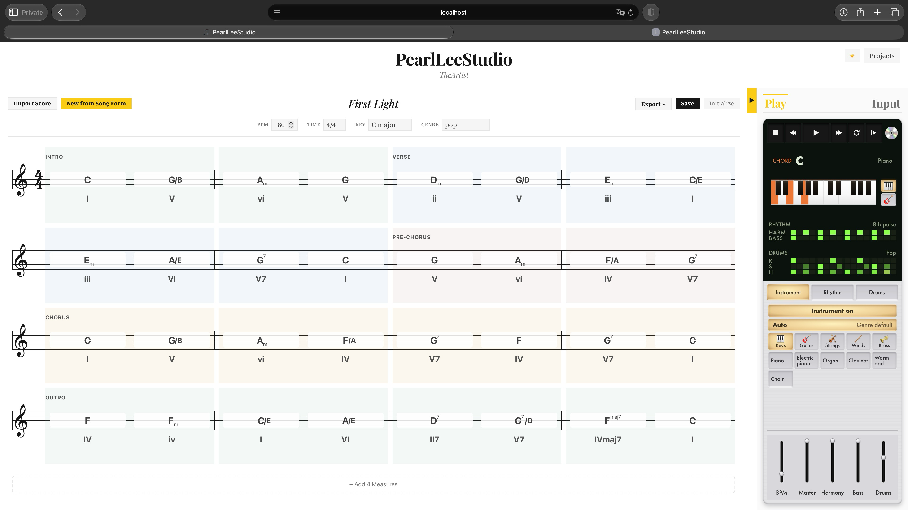
</p>

<p align="center"><sub>
Current Safari interface: section labels, chord staff, Play controls and the always-visible mixer. This capture predates the optional theory references. Corpus text is not shipped in the repository.
</sub></p>

<p align="center">
  <a href="https://youtu.be/iSDj4VK9nKc">
    
  </a>
</p>

<p align="center"><sub>
▶ <a href="https://youtu.be/iSDj4VK9nKc">Watch the baseline demo on YouTube</a> — existing staff editor, MIDI input and generation; this is not the hackathon submission video.
</sub></p>

## Links

| | |
|---|---|
| 🎬 **Demo videos** | [youtube.com/@StudioPearlLee](https://www.youtube.com/@StudioPearlLee) |
| 🤗 **Released models** | [huggingface.co/PearlLeeStudio](https://huggingface.co/PearlLeeStudio) — 7 base checkpoints + 11 LoRA adapters |
| 📄 **Paper / technical report** | [arXiv:2605.04998](https://arxiv.org/abs/2605.04998) · [arXiv:2606.07334](https://arxiv.org/abs/2606.07334) |
| 💼 **Author** | [linkedin.com/in/pearlmedicilee](https://www.linkedin.com/in/pearlmedicilee) |

---

## What it does

| | |
|---|---|
| **Compose on a staff** | VexFlow notation, click to select measures, drag-select ranges, slash-chord support |
| **Generate with a paper-trained model** | F1 default (10K pop mix); the released F1 base is weight-identical to the Phase 0 pop baseline (~84.2% pop / 72.9% jazz top-1 — a checkpoint-selection artifact), and the selection-corrected `ft_f1_v2` retrain (83.7% pop / 80.3% jazz) restores the jazz adaptation; F1–F5 + F1 v2 + Phase 0 baseline + 11 LoRA adapters (13-genre vocabulary) selectable |
| **Live progress streaming** | `/api/generate/stream` SSE pipeline shows each phase (Read → Load → Compose → Rank → Voice → Done) as the model thinks; a Theory phase retrieves attributed source excerpts when an enabled corpus is ready; OMT is enabled by default after its setup step |
| **Candidate ranking** | R1 — Sethares sensory roughness, plus local OMT text relevance when its corpus is ready. Berklee is disabled by default. Retrieval relevance is not a musical-quality score. |
| **Voice-leading inversions** | Post-process injects slash-chord inversions (e.g. `Am7/C`) where they smooth the bass line — the LM only emits root-position chords, voice leading is added on top |
| **MIDI input with confirm flow** | Hold a chord ≥3 s → auto-commit · release early → Confirm card with root-cycling chips, slash-chord inversion detection, and a 3-chord transition view (prev → curr → next + voice-leading arrows) |
| **Audio playback** | Tone.js + smplr — sampled piano, GM guitars / keys / strings, and 15 drum pattern presets. Switch instruments live mid-playback. |
| **Controller mixer** | Always at the bottom of Play: separate BPM, Master, Harmony, Bass and Drums faders. Live output gains are saved with each session; the lowest volume position mutes the part, Master mutes the whole mix. |
| **Dark + light theme** | Classical staff with an editorial dark/light palette; a tactile Play panel with compact text keys, flat status cells and slim vertical faders. |
| **Resizable right panel** | Drag the boundary 300–640 px wide; collapse with a short tab-aligned toggle. |
| **Generation provenance** | Backend fallback results are explicitly labeled `rules`; transport failures stay errors. Model results retain `source: ai`, `modelUsed`, and the slots changed by song-form rules. |

## Walkthrough

### Import in whole-score context

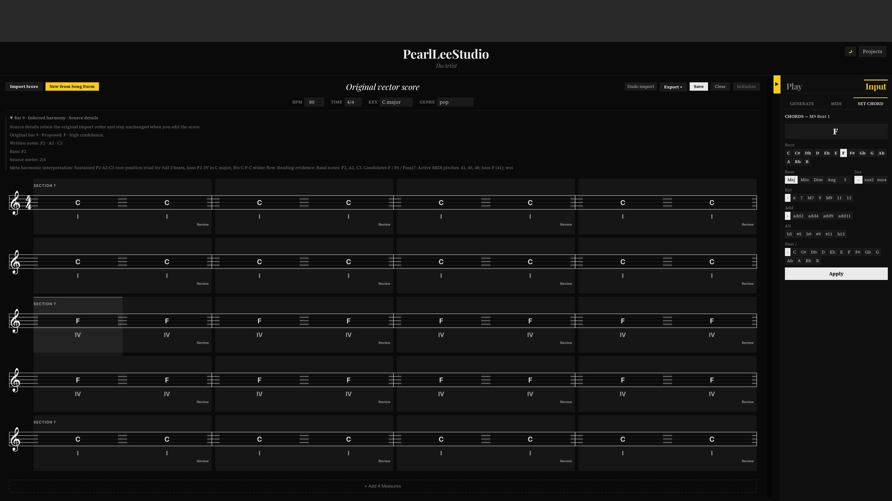

Import keeps the original chord evidence alongside editable proposals. Meta assist
receives the complete musical synopsis even when its harmony review covers only a
bounded range. Form suggestions can use neutral **Section** labels when a specific
Intro, Verse or Chorus function is uncertain.

### AI generation with live progress

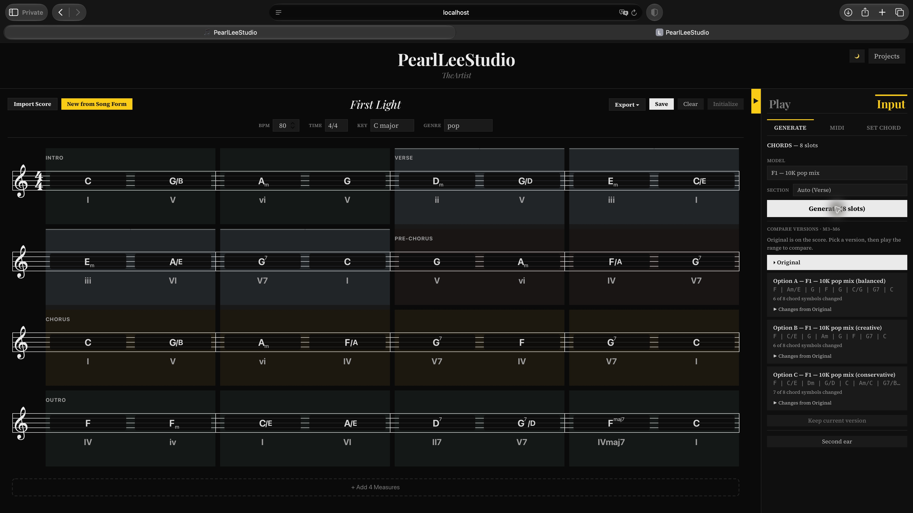

Click **Generate** with a slot range selected. The right panel reports composition,
ranking and voice-leading stages through SSE, then shows three candidates ordered
by R1 roughness. This capture shows actual F1 A/B/C results. Apply a candidate,
compare it with the original passage, or switch between alternatives. The model
picker includes the F-series checkpoints and eleven genre LoRA adapters. This
capture uses R1 alone; current builds also use OMT relevance when prepared.

### MIDI input

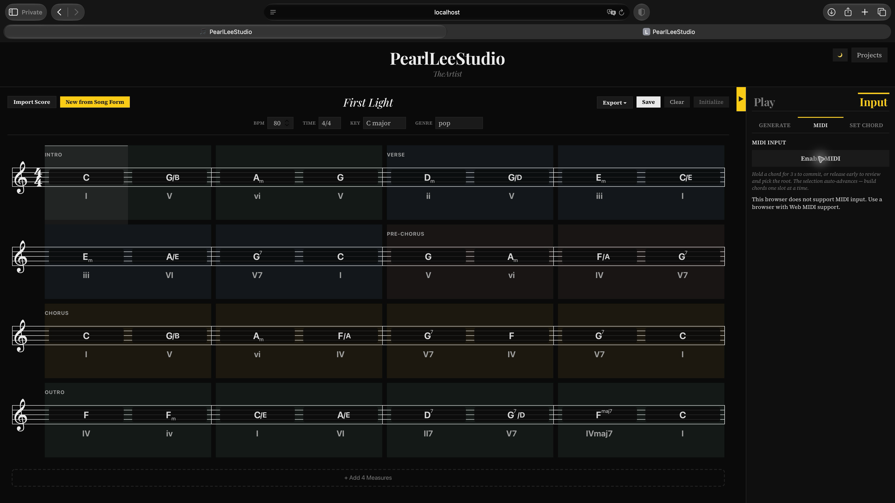

This Safari capture reports Web MIDI as unavailable. The input workflow needs a
browser with Web MIDI support; connected-keyboard behavior has not been verified
by this capture.

Pick a slot on the staff, hit **Enable MIDI** with a connected keyboard. Hold a chord on the keys for ≥3 s and it auto-commits to the slot (and the selection auto-advances to the next one). Release early and you get a Confirm card with root-cycling chips — `C6` ↔ `Am7/C` etc. — that reflect the actual played bass, plus inversion detection for slash chords. The Confirm card also shows a 3-chord transition view: prev (purple strip below the keyboard) → current candidate (yellow fill) → next (green strip above), with curved voice-leading arrows tracing how each voice moves.

### Play — piano + guitar

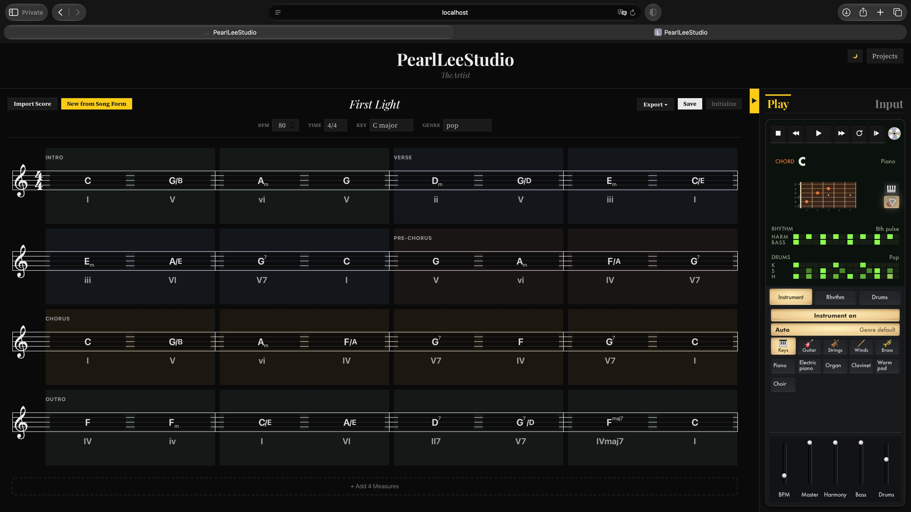

Whichever chord is active (selected on the staff, currently playing back, or under a MIDI hold) lights up its tones on a styled keyboard or fretboard. Voicings cap at 4 notes — for tension chords (9 / 11 / 13 / altered dominants) the 5th drops, keeping the hand realistic and leaving register room for future melody lines. Switch instruments live; the playback engine swaps mid-song.

### Controller — master and part levels

The bottom of **Play** always shows **BPM**, **Master**, **Harmony**, **Bass**
and **Drums** as five vertical faders, independently of the selected preset tab.

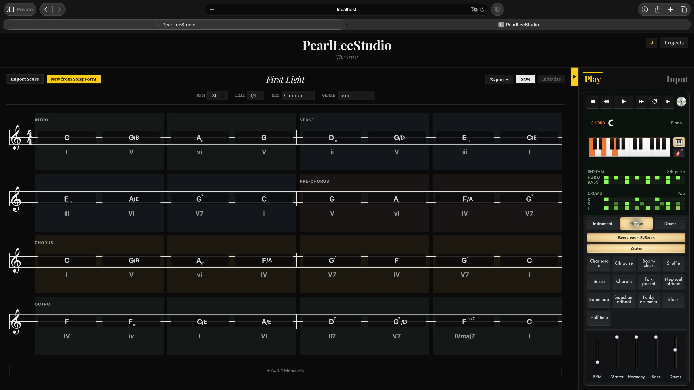

Drag a metal cap or use the arrow keys to change a value; Home/End reach the
range limits. Double-click a fader to restore its default.
Levels change the audio output, including notes already ringing. Harmony and
Bass remain independent even when they use the same instrument. Save preserves
the mix for Projects playback and **Edit** in the editor; old sessions
retain their previous levels.

### Projects and complete exports

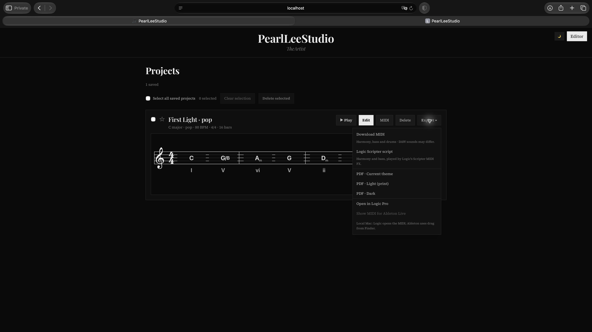

Project cards show the first four bars. **Export** uses the saved project's full
score and playback settings, including when a different project is open in the
editor.

### MIDI handoff and score PDF

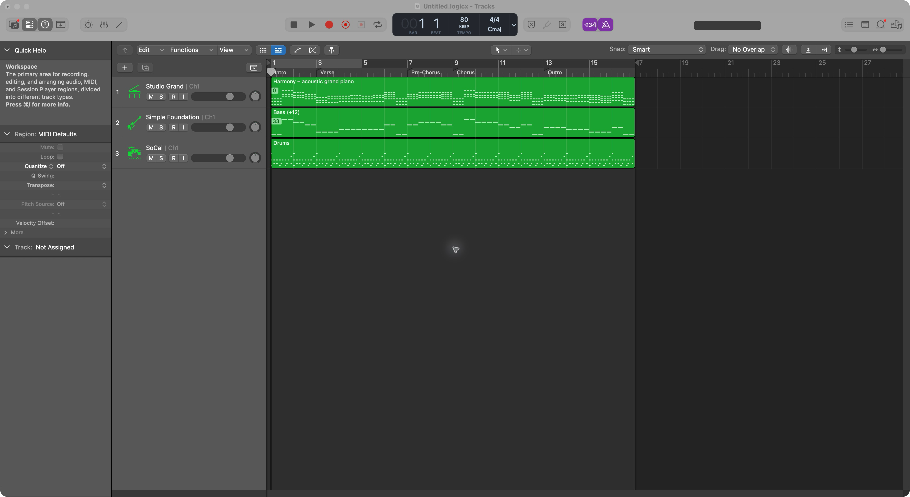

The exported arrangement opens in Logic as Harmony, Bass and Drums with sixteen
bars, 80 BPM, 4/4 meter and five section markers. This verifies the MIDI handoff;
listening, GM/CC response and the separate Scripter transport behavior remain
manual checks.

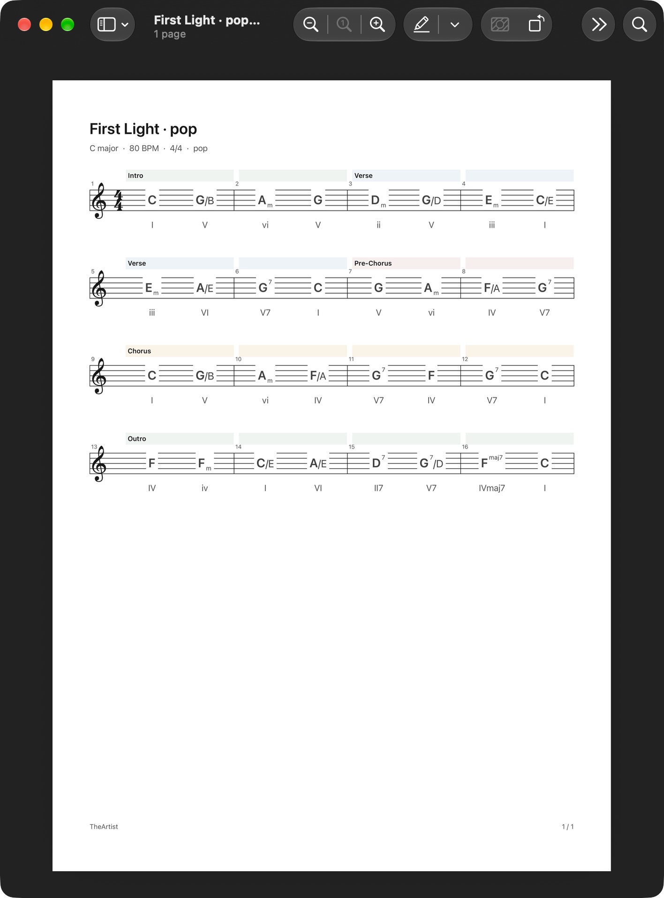

The light-theme PDF contains the complete sixteen-bar score on one page. PDF
export also offers dark and current-theme variants.

### Dark + light themes

<table>
<tr>
<td width="50%" valign="top"></td>
<td width="50%" valign="top">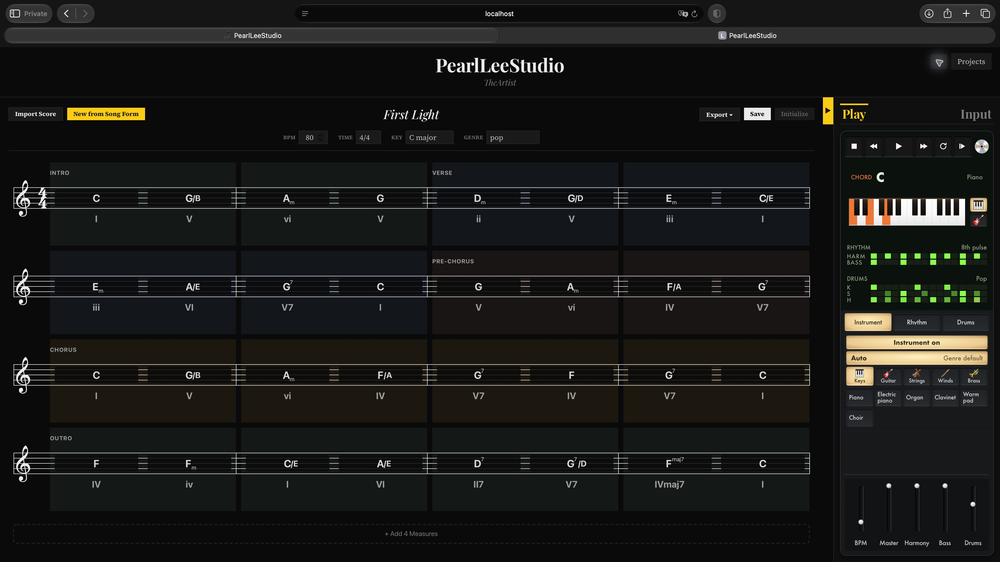</td>
</tr>
<tr>
<td><sub><strong>Light</strong> — paper-white score, silver Play panel and amber selected controls.</sub></td>
<td><sub><strong>Dark</strong> — near-black surfaces with readable staff lines, chord labels and Play controls.</sub></td>
</tr>
</table>

Both modes use `--brand-yellow` (#facc15) for active Play/Input tabs, the panel
toggle, focus rings and voicing highlights. The header's 8 px theme emoji retains
its 32×28 px button area and accessible label. The Play panel combines subtle inset
key grooves, flat black/green step cells and slim faders while the staff keeps its
classical styling.

## Architecture

### Shared hackathon service

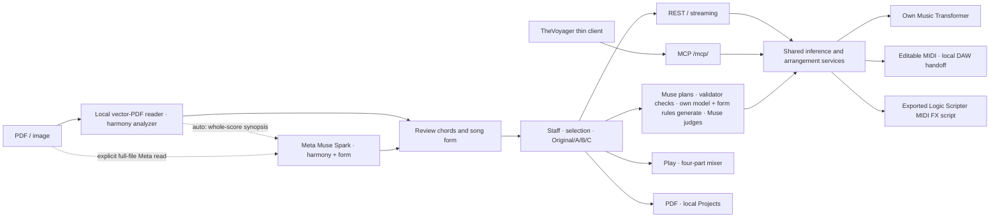

The MCP tools wrap implemented services, including score import and the
planner's `plan_song` / `validate_plan`. Theory explanation is not advertised
because it is not implemented. See the
[versioned contract and tool list](docs/mcp.md).

### Model and editor internals

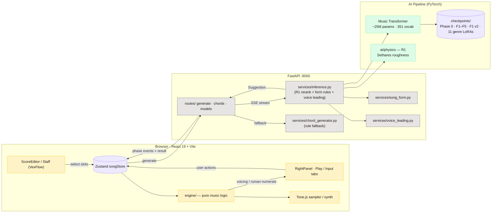

### `/api/generate/stream` — default runtime

```mermaid
sequenceDiagram
  autonumber
  participant FE as Frontend (ChordActions)
  participant API as POST /api/generate/stream
  participant Inf as inference.py (orchestrator)
  participant MT as Music Transformer
  participant R1 as R1 (Sethares)
  participant VL as voice_leading.py

  FE->>API: { key, genre, context, selectedMeasures, modelKey }
  API->>Inf: generate_ai_result(...)
  Inf-->>FE: event: model_load (cold start only)
  Inf->>MT: load checkpoint
  loop step ∈ {1..3}
    Inf-->>FE: event: composing { step, total, creativity }
    Inf->>MT: forward(prompt, temperature=0.7/0.9/1.1)
    MT-->>Inf: bars
  end
  Inf-->>FE: event: ranking
  Inf->>R1: mean Sethares roughness per suggestion
  R1-->>Inf: r1 score
  Note over Inf: sort candidates; apply section and cadence rules
  Inf-->>FE: event: voicing
  Inf->>VL: pick_bass_for_smooth_voice_leading(prev, curr)
  VL-->>Inf: chords w/ slash bass injected
  Inf-->>FE: event: complete
  Inf-->>API: GenerateResponse(suggestions, source)
  API-->>FE: event: result { suggestions }
```

### MIDI input state machine

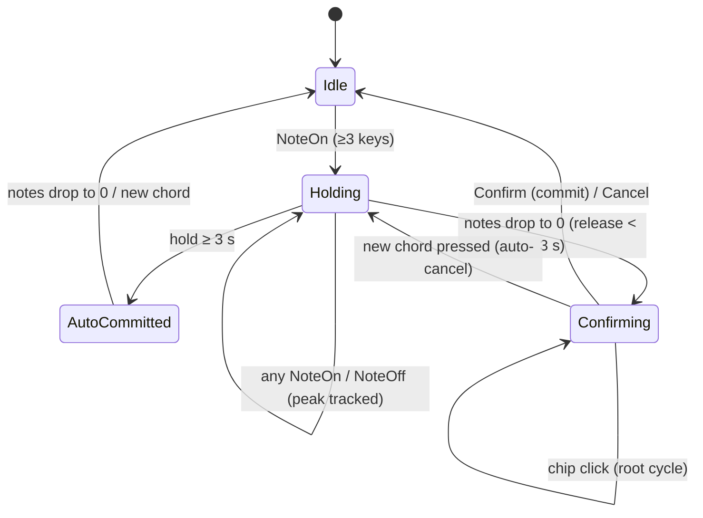

### Module layout

```text
TheArtist-DAW/
├── frontend/src/
│   ├── components/
│   │   ├── ScoreEditor/                  # Staff, Import, Song Form and full Export menu
│   │   ├── RightPanel/                   # Input/Generate, MIDI capture and Play controls
│   │   └── MyPage/                       # Projects and first-row score previews
│   ├── engine/
│   │   ├── chordGenerator.ts             # Chord/section generation clients
│   │   ├── planClient.ts · sseStream.ts   # Full-form runs and SSE transport
│   │   ├── scoreImport.ts                # Import requests and source provenance
│   │   ├── exportSpec.ts · pdf.ts        # Shared export snapshot and PDF rendering
│   │   ├── scoreLayout.ts · scoreStaveLayout.ts
│   │   ├── chordParser.ts · voicingEngine.ts · romanNumeral.ts
│   │   ├── playback.ts · arrangement.ts · drums.ts
│   │   ├── genreTables.ts · playSettings.ts · instruments.ts
│   │   └── midiInput.ts · midiCaptureState.ts · scoreShortcuts.ts
│   ├── store/                           # Song, generation, plan, review, playback and sessions
│   └── models/types.ts                  # Shared frontend music/source types
├── backend/
│   ├── app/
│   │   ├── routes/                      # Generate, plan, review, Import, export and discovery
│   │   ├── mcp_server.py                # Eleven tools over shared application services
│   │   ├── models/                      # Pydantic music, plan, review, import/export contracts
│   │   └── services/
│   │       ├── inference.py             # Model sampling → rank → form rules → voice leading
│   │       ├── planner.py · review.py   # Meta form planning and candidate review
│   │       ├── llm.py · limits.py       # Bounded Meta calls, attempt costs and admission limits
│   │       ├── score_import.py · score_pdf.py · score_analysis.py
│   │       ├── score_context.py · score_assistance.py · score_form.py
│   │       ├── harmony_analysis.py · harmony_meta.py
│   │       ├── song_form.py · voice_leading.py · song_builder.py
│   │       └── smf_export.py · scripter_export.py · daw_launcher.py
│   └── theartist_client/                # Async MCP client with schema/result checks
└── ai/
    ├── training/                        # Music Transformer/tokenizer and preserved research pipeline
    ├── physics/                         # R1 roughness and related research metrics
    ├── rag/                             # Reviewed OMT preparation and separate legacy research code
    └── checkpoints/                     # Gitignored weights fetched from Hugging Face
```

**Chord-generation data flow.** The editor sends selected measures and context to
`/api/generate/stream`, or a named section to `/api/generate/section/stream`.
The backend resolves the checkpoint, samples three candidates, anchors a fresh
passage to its key, and ranks by R1 roughness. Section/cadence rules run **before**
voice-leading inversions, so the inversions describe the resulting chords.
The response identifies the actual model or rule source; the frontend computes
voicings and Roman numerals and plays the arrangement through Tone.js.
SSE events report the stages actually performed. Ready OMT retrieval contributes
text relevance to ranking and adds attributed source excerpts after voice leading.
Berklee is disabled by default; retrieval makes no LLM or external API calls.

Full-form planning wraps the section generator: Muse Spark proposes form and
cadences, code validates them, the author's model generates the chords, and a
bounded judge can request regeneration. Import uses a separate local score reader
and harmony analyzer, with optional Meta harmony/form reasoning. Both preserve
their source and cost records; neither substitutes an AI success for a failed call.

## Tech Stack

| Layer | Technologies |
|-------|-------------|
| **Frontend** | React 19, TypeScript (strict), Vite 8, Tailwind CSS 4, Zustand 5, VexFlow 5, Tone.js 15, smplr (GM Soundfont + drum machines) |
| **Backend** | FastAPI, Pydantic v2, Uvicorn, Python 3.12+ |
| **AI/ML and score reading** | PyTorch, custom Music Transformer, music21, pypdf; HuggingFace Datasets and TensorBoard in the preserved training pipeline |
| **Model/tool integration** | Meta Model API through the OpenAI-compatible SDK, official MCP Python SDK |
| **Dev Tools** | uv (Python), npm, ESLint |

## Getting Started

### Prerequisites

- Node.js 22.12+ (the locked Vite package also supports 20.19+)
- Python 3.12+ with [uv](https://docs.astral.sh/uv/)
- (Optional) NVIDIA GPU with CUDA 12.1 — inference also runs CPU-only

### Installation

```bash
# Clone the repository
git clone https://github.com/PearlLeeStudio/TheArtist-DAW.git /absolute/path/TheArtist-DAW

# Frontend
npm --prefix /absolute/path/TheArtist-DAW/frontend ci

# Backend
uv sync --frozen --directory /absolute/path/TheArtist-DAW/backend
# Prepare the default OMT corpus once (network required for this step only).
uv run --frozen --directory /absolute/path/TheArtist-DAW/backend python /absolute/path/TheArtist-DAW/backend/scripts/setup_omt.py

# Model checkpoints — download trained weights from HuggingFace so the backend
# serves real models (skip this and it falls back to a rule-based generator).
# Public repos (CC BY-NC, no token); ~2.2 GB into ai/checkpoints/.
uv run --with huggingface_hub python /absolute/path/TheArtist-DAW/model/_download.py --smoke
# Omit --smoke to download all 18 checkpoints for the genre adapters and model picker.
```

### Running Locally

Start the backend and frontend in separate terminals:

```bash
# Terminal 1 — Backend (port 8000)
uv run --directory /absolute/path/TheArtist-DAW/backend uvicorn app.main:app --reload

# Terminal 2 — Frontend (port 5173)
npm --prefix /absolute/path/TheArtist-DAW/frontend run dev
```

Vite proxies `/api` requests to the backend automatically. Open `http://localhost:5173` in your browser.

To preload AI models on startup:

```bash
THEARTIST_WARMUP=1 uv run --directory /absolute/path/TheArtist-DAW/backend uvicorn app.main:app --reload
THEARTIST_WARMUP_KEYS=ft_f1,ft_f4 uv run --directory /absolute/path/TheArtist-DAW/backend uvicorn app.main:app
```

For a public judge server, `THEARTIST_PUBLIC_HOST=1` turns off DAW handoff, the warmup
route, MCP and the whole-file Meta score read (`engine: "meta"`), keeps the bounded
import assist (`engine: "auto"`), and puts the Meta-calling routes behind
per-session and daily spend limits; see `deploy/env.example`.

## AI Model

TheArtist serves a custom Music Transformer (~25M parameters) from a pop→jazz genre-adaptation study ([arXiv:2605.04998](https://arxiv.org/abs/2605.04998)). The Pop / Jazz top-1 columns are each run's best-epoch training-log metrics; note that the *released* F1 base coincides with Phase 0 (see the F1 row and note below):

| Run | Data | Focus | Pop top-1 | Jazz top-1 |
|-----|------|-------|----------:|-----------:|
| **Phase 0** | Chordonomicon + Billboard, ~544K songs × 3 ep | Pop baseline | 84.21% | 72.86% |
| **F1** `ft_jazz_pop80` | Phase 0 + 10K pop mix | Preserve pop (paper run) | **84.60%** | 81.03% |
| **F1 v2** `ft_jazz_pop80_v2` | Phase 0 + 10K pop mix (jazz_val-selected) | Selection-corrected F1 (served as `ft_f1_v2`) | 83.73% | 80.31% |
| **F2** `ft_jazz_pop67` | Phase 0 + 5K pop mix | Balanced | 84.06% | 79.91% |
| **F3** `ft_jazz_pop50` | Phase 0 + 2.5K pop mix | Paper sweet-spot finding (no longer default) | 84.20% | 80.99% |
| **F4** `ft_jazz_pop29` | Phase 0 + 1K pop mix | Jazz-leaning | 83.02% | 81.50% |
| **F5** `ft_jazz_only` | Phase 0 + 0 pop | Jazz only (catastrophic forgetting) | 82.10% | 81.30% |

> **F1 served-weights note.** The *released* F1 `best.pt` is weight-identical to Phase 0 — a best-checkpoint-selection artifact (a seed/data-dependent worst case where min-mixed-val selection retained the un-adapted init, not a deterministic outcome), so the served v1 F1 evaluates at the Phase 0 numbers (84.21% pop / 72.86% jazz); the 84.60 / 81.03 above are the paper's epoch-6 training-log figures, never released as `best.pt`. The selection-corrected retrain `ft_jazz_pop80_v2` (`select_best_on: jazz_val`, served as `ft_f1_v2`) is hash-distinct from Phase 0 and embodies the intended jazz adaptation; the 11 LoRA adapters remain paired with the v1 base.

> **Jazz top-1 comparability note.** The F-series and `ft_f1_v2` Jazz top-1 figures in the table above are measured on the **6-source jazz test (167 seqs)** and are **not** directly comparable to the expanded **9-source jazz test (501 seqs)** used for multi-seed validation: the same `ft_jazz_pop80_v2` weights score 80.31 on the 6-src test but 75.05 on the 9-src test, and the matched-data 9-src multi-seed retrains {seeds 42, 123, 7; n=3} land at jazz top-1 75.76 ± 0.03 (per-seed 75.78 / 75.78 / 75.72), all hash-distinct from Phase 0. Compare like-for-like within a single test set only.

The backend defaults to F1 (`ft_f1`, pop-preserving baseline). Recommended ⭐ picks are F1 / F1 v2 (pop-leaning) and F4 (jazz-leaning). F3 — the paper's sweet-spot finding — remains served but is no longer the default. The model selector exposes the other paper checkpoints + the selection-corrected `ft_f1_v2` + 11 LoRA per-genre adapters covering the 13-genre vocabulary (jazz/pop run on the F-series base directly).

These weights are gitignored — they live on HuggingFace as public repos under [PearlLeeStudio](https://huggingface.co/PearlLeeStudio) (seven F-series base — incl. the selection-corrected F1 v2 retrain `ft-pop80-v2` — + eleven LoRA adapters, CC BY-NC). Fetch them into `ai/checkpoints/` with `uv run --with huggingface_hub python /absolute/path/TheArtist-DAW/model/_download.py`; without them the backend serves rule-based fallback.

### R1 ranking and local theory retrieval

**R1 is active in the product.** The backend uses mean Sethares sensory roughness
from [`ai/physics/`](ai/physics/) to order the author's model candidates.
Roughness measures sensory consonance; it is not a next-chord accuracy or listener
preference score. The same directory also contains Stolzenburg periodicity,
composite metrics and diversity experiments from the pre-existing research.

**OMT retrieval is enabled by default once its corpus is prepared.** The product
uses local TF-IDF over 29 reviewed prose passages from seven chapters of the
original [Open Music Theory GitHub edition](https://openmusictheory.github.io/).
It adds text relevance to R1 ranking and displays related source excerpts with
attribution and CC BY-SA 4.0 links. These are references, not generated musical
explanations or evidence of a quality improvement. Berklee is independently
switchable and **off by default**; public hosts reject enabling it.

[Setup, source controls and license handling](docs/theory-retrieval.md) describe
the corpus boundaries and missing-data status. The older Snowflake/Chroma/Gemma
research modules remain separate and are not loaded by the product. The product's
AI runtime continues to use the author's Music Transformer and Meta models.
The mix-ratio papers describe the training study, not a quality evaluation of
this retrieval or the hackathon planner.

The training and evaluation pipeline is included under `ai/training/` (preprocess → dataset splits → config-driven training → evaluation → aggregation, plus the checkpoint-selection audit scripts `check_claims.py` and `model/_verify_release.py` and the selection-criterion analysis under `ai/analysis/`). The experiments themselves (mix-ratio sweep, 13-genre LoRA grid, rank sweep, multi-seed validation) are documented in [arXiv:2605.04998](https://arxiv.org/abs/2605.04998) and [arXiv:2606.07334](https://arxiv.org/abs/2606.07334), and the per-model evaluation summaries live on the [HuggingFace model cards](https://huggingface.co/PearlLeeStudio). Datasets and checkpoints are not redistributed here — data comes from the upstream sources above, checkpoints from the Hub.

## Datasets

### Training corpora

| Dataset | Songs (used) | Genre | License |
|---|---:|---|---|
| [Chordonomicon](https://huggingface.co/datasets/ailsntua/Chordonomicon) | ~679K | Pop / rock + community-tagged subsets (country, alt, rap, soul, electronic) | CC BY-NC 4.0 |
| [McGill Billboard](https://ddmal.music.mcgill.ca/research/The_McGill_Billboard_Project_(Chord_Analysis_Dataset)/) | ~890 | Pop / rock | CC0 |
| [Jazz Harmony Treebank (JHT)](https://github.com/DCMLab/JazzHarmonyTreebank) | ~1,170 | Jazz | Public |
| [Weimar Jazz Database (WJazzD)](https://jazzomat.hfm-weimar.de/) | ~283 | Jazz | ODbL |
| [JAAH](https://mtg.github.io/JAAH/) | ~113 | Jazz | Research |
| [JazzStandards / iReal-derived](https://github.com/mikeoliphant/JazzStandards) | ~293 | Jazz | Community corpus |
| [Bach 371 chorales (via music21)](https://web.mit.edu/music21/) | 371 | Tonal chorales (used as the "classical" LoRA target) | Public domain |

Raw datasets are **not redistributed** in this repo. Chordonomicon is CC BY-NC; the others have their own per-source terms. Acquire each from the upstream link above.

For the LoRA expansion, the 11 target genres draw from Chordonomicon's genre-labeled subsets; see paper §4 for selection-bias notes (e.g., the "electronic" slice is biased toward synthwave / melodic house, "hip-hop" toward jazz-rap / neo-soul).

### Theory retrieval

- **Open Music Theory** — the default source is a reviewed subset of the original
  GitHub edition, not the complete v2 book. Setup fetches hash-checked prose only;
  music examples, images, block quotations and external-link paragraphs are excluded.
  Retrieved excerpts retain author/editor credit, source, license and modification notices.
- **The Berklee Book of Jazz Harmony** — disabled by default. Neither its text nor
  its index is distributed. Explicit private opt-in is separate from the legal
  permission needed for a particular use; public hosts reject it.

See [theory retrieval](docs/theory-retrieval.md) for configuration and limitations.

## Project Structure

The [module layout](#module-layout) describes the runtime code. Supporting files are:

```text
TheArtist-DAW/
├── agent/                 # Planner runner and offline comparison tools
├── experiments/           # Public fixtures, request traces and evaluation results
├── backend/tests/         # API, service and contract regression tests
├── docs/                  # MCP, score analysis, evaluation and manual-check contracts
├── deploy/                # Public-host configuration examples
├── model/_download.py     # Fetch released checkpoints into ai/checkpoints/
├── screenshot/            # Application and export captures
├── API_SPEC.md            # REST request/response contract
├── HACKATHON.md           # Baseline distinction and event-work commit history
└── LICENSE
```

## API

The REST API and eleven MCP tools use the same application services. MCP is
mounted at `/mcp/` on local/default servers; `THEARTIST_PUBLIC_HOST=1` disables
that mount. MCP results use a `schemaVersion: "1.0"` envelope, while REST responses
follow the endpoint schemas.

| REST endpoint | Method | MCP tool | Purpose |
|---|---|---|---|
| `/api/health` | GET | — | Health check |
| `/api/capabilities` | GET | `capabilities` | Contracts, tools, feature availability and bounds |
| `/api/models/list` | GET | `list_models` | Checkpoint labels and installed availability |
| `/api/genres/list` | GET | `list_genres` | Supported genres and model dispatch |
| — | — | `get_genre_preset` | Key, tempo, meter, rhythm and instrument defaults |
| `/api/generate` · `/api/generate/stream` | POST | — | Three chord candidates for selected score slots; optional SSE |
| `/api/generate/chords` | POST | — | Programmatic chord-only generation |
| `/api/generate/section` · `/api/generate/section/stream` | POST | `generate_section` | Named section generation with source/model and optional seed |
| `/api/generate/song` | POST | `build_song` | One complete three-track arrangement and MIDI, with optional seed |
| `/api/plan/song` · `/api/plan/song/stream` | POST | `plan_song` (**planning stage only**) | REST plans, generates and judges; MCP returns a validated plan without chords |
| — | — | `validate_plan` | Validate a plan against its request without a model call |
| `/api/review/candidates` | POST | — | Meta Second-ear review of three candidates |
| `/api/import/score` | POST | `import_score` | Local vector-score reading or explicit bounded/full-file Meta analysis |
| `/api/export/midi` | POST | `render_midi` | Render the shared `ExportSpec`; MCP returns base64 file data |
| `/api/export/scripter` | POST | — | Export a Logic Scripter MIDI FX script |
| `/api/daw/targets` | GET | — | Discover available local DAW targets |
| `/api/daw/open` | POST | `export_daw` | Save MIDI and open Logic or reveal it for Ableton |
| `/api/models/status` | GET | — | Loaded model status |
| `/api/models/warmup` | POST | — | Preload models; disabled on public hosts |

MCP `import_score` requires explicit attachment confirmation. `export_daw` requires
a direct loopback connection, server opt-in and per-call confirmation. Public-host
restrictions also disable DAW handoff and whole-file Meta reading; bounded Import
assist remains available behind its spend limits. See [API_SPEC.md](API_SPEC.md)
and [docs/mcp.md](docs/mcp.md) for the full contracts and the
[async client](backend/theartist_client/client.py).

### Voyager API quick start

TheVoyager defaults to MCP `build_song` (`THEARTIST_TRANSPORT=mcp`); its REST compatibility mode uses `POST /api/generate/song` when `THEARTIST_TRANSPORT=rest`. Both invoke the same song service. Send a genre and length to receive one three-track arrangement. Artist picks the key, BPM, time signature, chord checkpoint and instruments; Voyager handles mood→genre mapping and audio rendering. The REST examples below exercise that same contract.

**1) Curl smoke-test**

```bash
curl -sS http://localhost:8000/api/generate/song \
  -H 'Content-Type: application/json' \
  -d '{"genre": "jazz", "length_bars": 8}' | jq '.key, .bpm, .model_used, (.tracks | keys)'
```

```
"F major"
110
"ft_f4"
[
  "bass",
  "drum",
  "harmony"
]
```

**2) Python client (example shape)**

```python
import base64
import io
import requests
import pretty_midi   # caller-side render

BASE = "http://localhost:8000"

def generate_song(genre: str, length_bars: int = 8) -> dict:
    r = requests.post(f"{BASE}/api/generate/song", json={
        "genre": genre,
        "length_bars": length_bars,
    })
    r.raise_for_status()
    return r.json()

def to_pretty_midi(song: dict) -> pretty_midi.PrettyMIDI:
    return pretty_midi.PrettyMIDI(io.BytesIO(base64.b64decode(song["midi_b64"])))

song = generate_song("country", length_bars=4)
print(song["bars"])               # [{"chords": [...]}, ...]
print(song["tracks"]["harmony"]["instrument"])   # "acoustic_guitar_steel"
midi = to_pretty_midi(song)       # ready for a soundfont render
```

**3) Request fields** (`SongGenerateRequest`)

| Field | Type | Required | Default | Notes |
|---|---|---|---|---|
| `genre` | string | ✓ | — | One of `jazz, pop, rock, blues, bossa, classical, country, rnb_soul, hip_hop, electronic, funk, folk, gospel`. 400 if not in list. |
| `length_bars` | int | — | `8` | Range 1–64. |
| `n_candidates` | int | — | `1` | Must be exactly `1`; unsupported candidate fan-out returns 422. |
| `seed` | int \| null | — | `null` | Strict integer `0..2^32-1`; request-local sampling, echoed in the response. Reproducibility requires the same model and runtime. |
| `harmony_rhythm` | string \| null | — | `null` | A comping-rhythm preset id (`charleston`, `eighth_pulse`, `boom_chick`, `shuffle`, `bossa`, `chorale`, `folk_pocket`, `neo_soul_offbeat`, `boom_bap`, `sidechain_offbeat`, `funky_drummer`, `block`, `half`). `null` = the genre's. |
| `drum_pattern` | int \| `"off"` \| null | — | `null` | A drum pattern id 1–15, or `"off"` for no drums. `null` = the genre's. |
| `harmony_instrument` | string \| null | — | `null` | One of the editor's 31 harmony instruments (GM Soundfont names). `null` = the genre's. |

The three optional fields are the editor's Play-panel choices; [API_SPEC.md](API_SPEC.md) lists every preset, pattern and instrument.

**4) Response shape** (`SongGenerateResponse` — top-level keys)

| Key | Type | Description |
|---|---|---|
| `genre` | string | Echo of request. |
| `seed` | int \| null | Echo of the sampling seed; `null` keeps stochastic generation. |
| `key` | string | Picked from `GENRE_DEFAULTS` — e.g. jazz→`F major`, electronic→`A minor`. |
| `bpm` | int | Picked from `GENRE_DEFAULTS` — e.g. blues→90, electronic→128. |
| `time_signature` | `[int, int]` | `[4, 4]` for all 13 genres in v1. |
| `harmony_rhythm` | string | The comping-rhythm preset that played (the request's, else the genre's). |
| `drum_pattern` | int \| `"off"` | The drum pattern that played, or `"off"`. Sent back in a request, it replays the same drums. |
| `bars` | `[{"chords": [str, str]}]` | Exactly `length_bars` bars of two chord slots. Slot 0 covers `[0, beats/2)`, slot 1 covers `[beats/2, beats)`. |
| `tracks.harmony.events[]` | `[TrackEvent]` | Chord voicing struck on the 1-bar comping rhythm; a strike lasts until just before the next one. Each event = `{bar, beat, pitch, duration, velocity}`. |
| `tracks.bass.events[]` | `[TrackEvent]` | Chord root struck on `GENRE_BASS_RHYTHM` positions, anchored at MIDI 36 (C2). |
| `tracks.drum.events[]` | `[TrackEvent]` | The drum pattern that played (empty when `"off"`). `voice` is `K`/`S`/`H`/`O`/`X`/`C`/`R`/`T`/`M`/`L`; `pitch` is `null`. |
| `tracks.<name>.instrument` | string | GM Soundfont name (e.g. `electric_piano_1`, `contrabass`) for harmony/bass — harmony is `harmony_instrument` when sent; `gm_drum_kit` for drum. |
| `tracks.<name>.source` | `"rule"` | All three layers rule-based in v1. |
| `midi_b64` | string | Convenience MIDI render. 4 internal tracks: meta (tempo+time-sig), harmony ch 0, bass ch 1, drum ch 9. |
| `model_used` | string | Chord-generation checkpoint (`ft_f4`, `ft_f1_lora_country`, …) or `"rules"` if the AI path was unavailable. |

Drum voice letters → GM percussion (channel 10) mapping lives in `backend/app/services/genre_tables.py:DRUM_VOICE_TO_GM_NOTE` if you want to remap to a custom kit.

**5) Genre defaults table** (artist's internal picks)

| Genre | Key | BPM | Harmony instrument | Bass instrument | Drum |
|---|---|---|---|---|---|
| jazz | F major | 110 | electric_piano_1 (Rhodes) | contrabass | Jazz Swing |
| pop | C major | 110 | acoustic_grand_piano | electric_bass_finger | Pop |
| rock | E major | 120 | overdriven_guitar | electric_bass_finger | Rock Anthem |
| blues | E major | 90 | electric_guitar_clean | electric_bass_finger | Blues Shuffle |
| bossa | F major | 110 | acoustic_guitar_nylon | contrabass | Bossa |
| classical | C major | 80 | acoustic_grand_piano | contrabass | Classical |
| country | G major | 100 | acoustic_guitar_steel | electric_bass_finger | Country |
| rnb_soul | Bb major | 90 | electric_piano_1 | electric_bass_finger | R&B / Soul |
| hip_hop | A minor | 90 | electric_piano_1 | electric_bass_finger | Hip-hop |
| electronic | A minor | 128 | pad_2_warm | electric_bass_finger | Electronic |
| funk | F major | 110 | electric_guitar_clean | electric_bass_finger | Funk 16 |
| folk | G major | 100 | acoustic_guitar_steel | contrabass | Folk / Ballad |
| gospel | F major | 90 | drawbar_organ | electric_bass_finger | Gospel |

The full per-genre 1-bar harmony / bass rhythm patterns live in `frontend/src/engine/genreTables.ts` (`HARMONY_RHYTHM_PRESETS`, `GENRE_BASS_RHYTHM`; mirrored in `backend/app/services/genre_tables.py`).

**6) Errors**

| Status | Body | When |
|---|---|---|
| 400 | `{"detail": "Unsupported genre '<x>'. Expected one of: ..."}` | Genre not in the 13-genre vocabulary. |
| 422 | Pydantic validation | `length_bars` out of `[1, 64]`, missing `genre`, or an unknown `harmony_rhythm` / `drum_pattern` / `harmony_instrument` (the message lists the valid values). |

For the older `/api/generate/chords` programmatic chord-only endpoint (no arrangement), see [API_SPEC.md](API_SPEC.md).

## Research

- **arXiv preprint** — *Empirical Study of Pop and Jazz Mix Ratios for Genre-Adaptive Chord Generation*, Lee, 2026, [arXiv:2605.04998](https://arxiv.org/abs/2605.04998).
- **arXiv technical report** — *How Far Can Chord-Symbol Time-Series Adaptation Carry Genre Identity?*, Lee, 2026, [arXiv:2606.07334](https://arxiv.org/abs/2606.07334).
- **HuggingFace** — seven F-series base checkpoints (incl. the selection-corrected F1 v2 retrain) + eleven LoRA adapters at [huggingface.co/PearlLeeStudio](https://huggingface.co/PearlLeeStudio); download into `ai/checkpoints/` with `model/_download.py`. Per-model evaluation summaries (real-song matrix, LoRA rank sweep) live on the model cards.

### Citation

```bibtex
@misc{lee2026chordmix,
  title         = {Empirical Study of Pop and Jazz Mix Ratios for Genre-Adaptive Chord Generation},
  author        = {Lee, Jinju},
  year          = {2026},
  eprint        = {2605.04998},
  archivePrefix = {arXiv}
}

@misc{lee2026genreidentity,
  title         = {How Far Can Chord-Symbol Time-Series Adaptation Carry Genre Identity?},
  author        = {Lee, Jinju},
  year          = {2026},
  eprint        = {2606.07334},
  archivePrefix = {arXiv}
}
```

## Not in this repository

- **Paper sources** — the papers themselves are on arXiv (links above); LaTeX sources and research notes are private.
- **Trained checkpoints** — published on [HuggingFace](https://huggingface.co/PearlLeeStudio) (CC BY-NC 4.0), fetched via `model/_download.py`.
- **Raw datasets** — license + size constraints; see [Datasets](#datasets) for upstream sources.
- **Berklee Book of Jazz Harmony PDF** — copyrighted; disabled by default and excluded from public retrieval. Owning a copy does not itself grant service or redistribution rights.
- **Internal design notes, deliberation logs, and roadmap drafts** — private.

## License

**Code: [MIT](LICENSE)** © 2026 Jinju Lee (PearlLeeStudio).

The released model checkpoints are distributed separately on [HuggingFace](https://huggingface.co/PearlLeeStudio) under **CC BY-NC 4.0** (they derive from the CC BY-NC Chordonomicon corpus) — non-commercial paper / portfolio / demo use only. Bundled GPL-3.0 drum samples keep their own license ([frontend/public/drums/LICENSE.txt](frontend/public/drums/LICENSE.txt)). Raw datasets are not redistributed — see [Datasets](#datasets).

Contact: pearl1379@gmail.com
