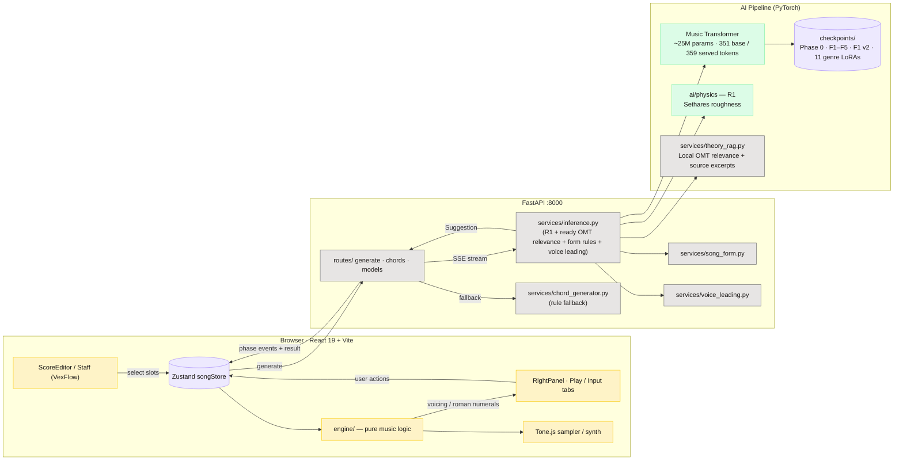
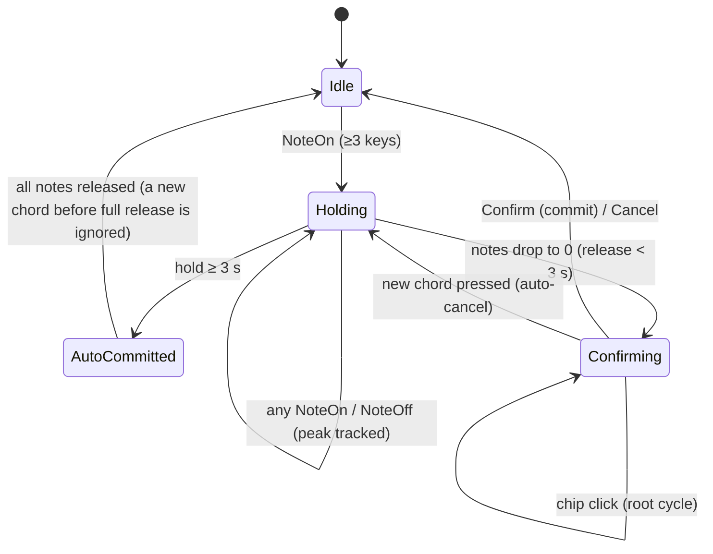

# Architecture and module layout

Internals behind the [shared arrangement workflow](https://github.com/PearlLeeStudio/TheArtist-DAW/blob/6ed1b50914c78c205ee7aabdde924c648caf292d/README.md#architecture):
the editor/backend/model split, the passage-generation path, the MIDI input
state machine and the file layout.

### Model and editor internals



### `/api/generate/stream` — passage-generation path

This is the Generate subflow within the arrangement workspace. Import, full-form
planning and [Reharmonize](reharmonization.md) have their own bounded paths;
playback and export consume the musician's selected score and arrangement settings.

```mermaid
sequenceDiagram
  autonumber
  participant FE as Frontend (ChordActions)
  participant API as POST /api/generate/stream
  participant Inf as inference.py (orchestrator)
  participant MT as Music Transformer
  participant R1 as R1 (Sethares)
  participant R2 as Local theory retrieval
  participant VL as voice_leading.py

  FE->>API: { key, genre, context, selectedMeasures, modelKey }
  API->>Inf: generate_ai_result(...)
  Inf-->>FE: event: model_load (cold start only)
  Inf->>MT: load checkpoint
  loop step ∈ {1..3}
    Inf-->>FE: event: composing { step, total, creativity }
    Inf->>MT: cached autoregressive sampling at 0.7/0.9/1.1
    MT-->>Inf: bars
  end
  Inf-->>FE: event: ranking
  Inf->>R1: mean Sethares roughness per suggestion
  R1-->>Inf: r1 score
  opt enabled source ready and R2 ranking enabled
    Inf->>R2: mean text-relevance distance per suggestion
    R2-->>Inf: retrieval scores
  end
  Note over Inf: sort candidates; apply section and cadence rules
  Inf-->>FE: event: voicing
  Inf->>VL: pick_bass_for_smooth_voice_leading(prev, curr)
  VL-->>Inf: chords w/ slash bass injected
  opt enabled source ready and notes enabled
    Inf-->>FE: event: explaining
    Inf->>R2: related excerpts for final transitions
    R2-->>Inf: excerpts with actual-hit attribution
  end
  Inf-->>FE: event: complete
  Inf-->>API: GenerateResponse(suggestions, source)
  API-->>FE: event: result { suggestions }
```

### MIDI input state machine



### Module layout

```text
TheArtist-DAW/
├── frontend/src/
│   ├── components/
│   │   ├── ScoreEditor/                  # Staff, Import, Song Form and full Export menu
│   │   ├── RightPanel/                   # Generate/Reharmonize, MIDI capture and Play controls
│   │   └── MyPage/                       # Projects and first-row score previews
│   ├── engine/
│   │   ├── chordGenerator.ts             # Chord/section generation clients
│   │   ├── reharmonize.ts · reharmonizeSession.ts # Bounded patches, multi-select preview and Apply
│   │   ├── planClient.ts · sseStream.ts   # Full-form runs and SSE transport
│   │   ├── scoreImport.ts                # Import requests and source provenance
│   │   ├── exportSpec.ts · pdf.ts        # Shared export snapshot and PDF rendering
│   │   ├── scoreLayout.ts · scoreStaveLayout.ts
│   │   ├── chordParser.ts · voicingEngine.ts · romanNumeral.ts
│   │   ├── playback.ts · arrangement.ts · drums.ts
│   │   ├── genreTables.ts · playSettings.ts · instruments.ts
│   │   └── midiInput.ts · midiCaptureState.ts · scoreShortcuts.ts
│   ├── store/                           # Song, generation, plan, review, playback and sessions
│   └── models/types.ts                  # Shared frontend music/source types
├── backend/
│   ├── app/
│   │   ├── routes/                      # Generate, plan, review, Import, export and discovery
│   │   ├── mcp_server.py                # Eleven tools over shared application services
│   │   ├── models/                      # Pydantic music, plan, review, import/export contracts
│   │   └── services/
│   │       ├── inference.py             # Cached sampling → rank → form rules → voice leading
│   │       ├── serving_readiness.py     # Require every model/adapter before hosted startup
│   │       ├── theory_rag.py            # Source-isolated OMT relevance and attributed excerpts
│   │       ├── planner.py · review.py   # Meta form planning and candidate review
│   │       ├── llm.py · limits.py       # Bounded Meta calls, attempt costs and admission limits
│   │       ├── score_import.py · score_pdf.py · score_analysis.py
│   │       ├── score_context.py · score_assistance.py · score_form.py
│   │       ├── score_verification.py    # Local/Meta comparison and long-score local results
│   │       ├── score_completion.py · chord_context.py  # F1 proposals and fixed future-chord ranking
│   │       ├── harmony_analysis.py · harmony_meta.py
│   │       ├── song_form.py · voice_leading.py · song_builder.py
│   │       └── smf_export.py · scripter_export.py · daw_launcher.py
│   └── theartist_client/                # Async MCP client with schema/result checks
└── ai/
    ├── training/                        # Music Transformer/tokenizer and preserved research pipeline
    ├── physics/                         # R1 roughness and related research metrics
    ├── rag/                             # Reviewed OMT preparation and separate legacy research code
    └── checkpoints/                     # Gitignored weights fetched from Hugging Face
```

## Project Structure

The [module layout](#module-layout) describes the runtime code. Supporting files are:

```text
TheArtist-DAW/
├── agent/                 # Planner runner and offline comparison tools
├── experiments/           # Public fixtures, request traces and evaluation results
├── backend/tests/         # API, service and contract regression tests
├── docs/                  # MCP, score analysis, evaluation and manual-check contracts
├── deploy/
│   ├── Dockerfile         # Frontend build, CPU runtime and all 18 HF model assets
│   ├── compose.yaml       # Shared model service, Caddy HTTPS and persistent volumes
│   ├── autodeploy.py      # Public main polling, candidate build, health checks and rollback
│   ├── theartist-deploy.* # systemd service and one-minute timer
│   ├── autodeploy.md      # Installation, deployment status, retry and pause commands
│   ├── serve.py           # Full-catalog startup checks and one Python worker
│   ├── catalog_probe.py   # All models resident; actual 8/32/64-bar CPU generation
│   ├── runtime/           # Frozen CPU serving dependencies
│   └── vps.md             # Live hosting, CPU measurements, updates and remaining limits
├── model/_download.py     # Fetch released checkpoints into ai/checkpoints/
├── plugin/logic-scripter/ # Logic Pro Scripter MIDI FX script, example and mock-host tests
├── tools/midi-bridge/     # macOS CoreMIDI bridge for Safari MIDI input and hosted Logic handoff
├── scripts/               # Submission extraction, bootstrap and reconstruction checks
├── screenshot/            # Application and export captures
├── API_SPEC.md            # REST request/response contract
├── HACKATHON.md           # Baseline distinction and event-work commit history
└── LICENSE
```
