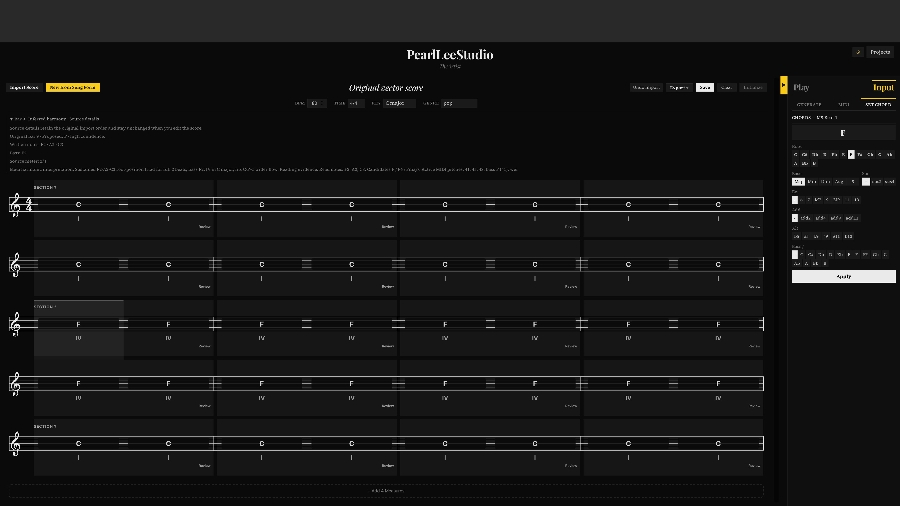
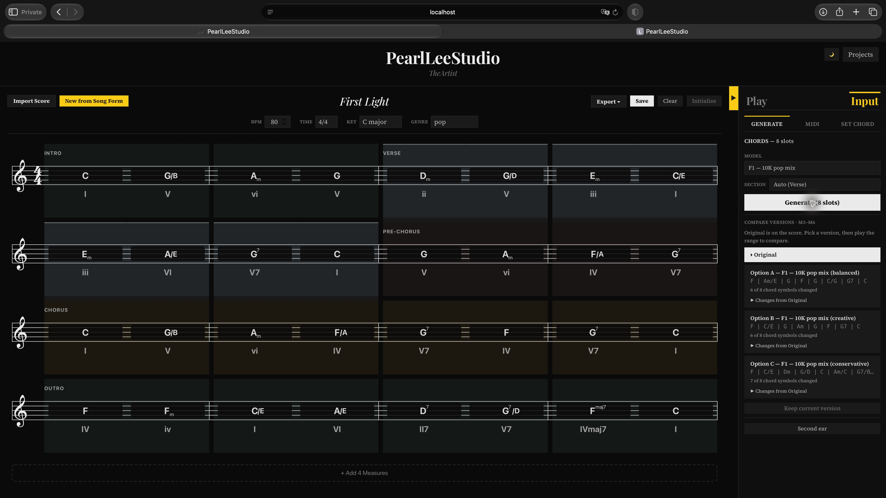
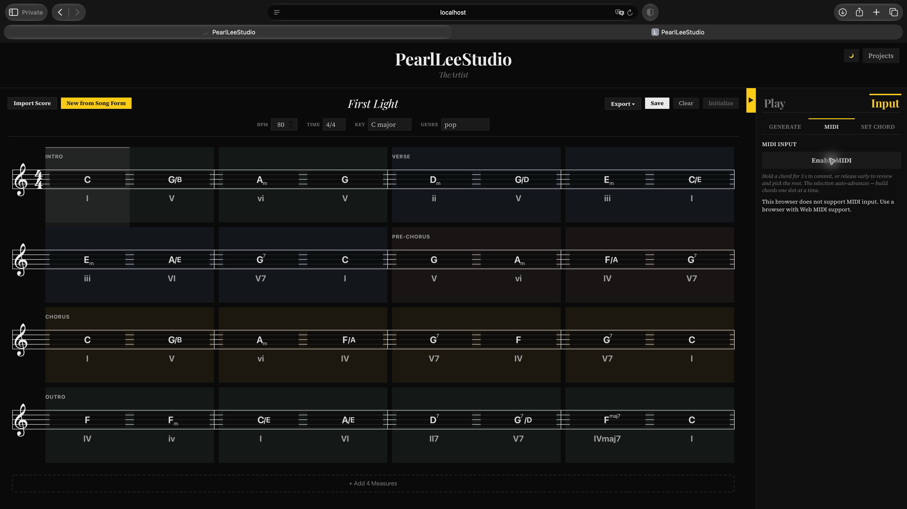
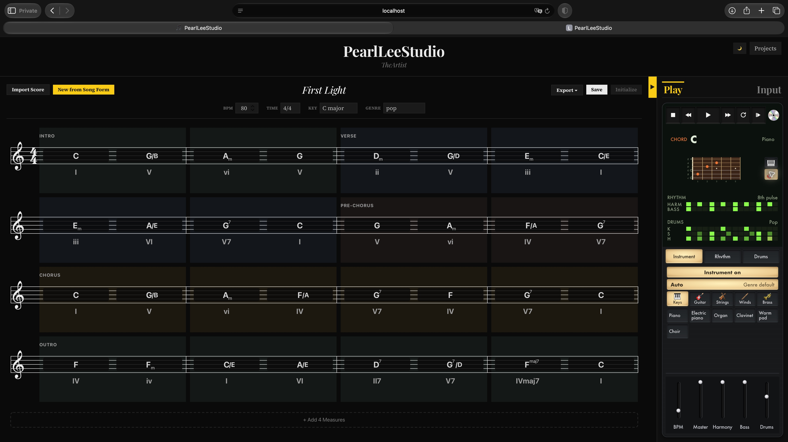
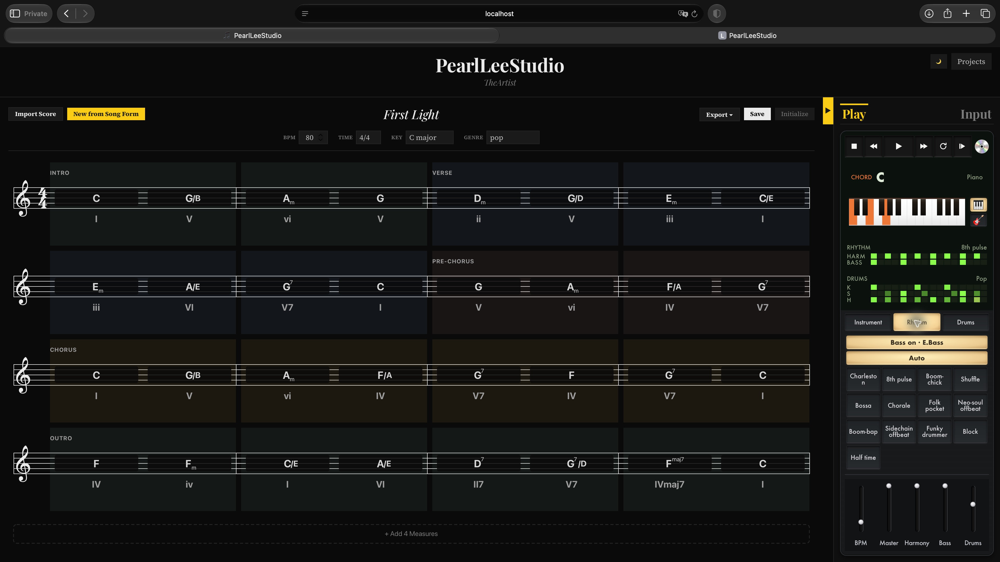
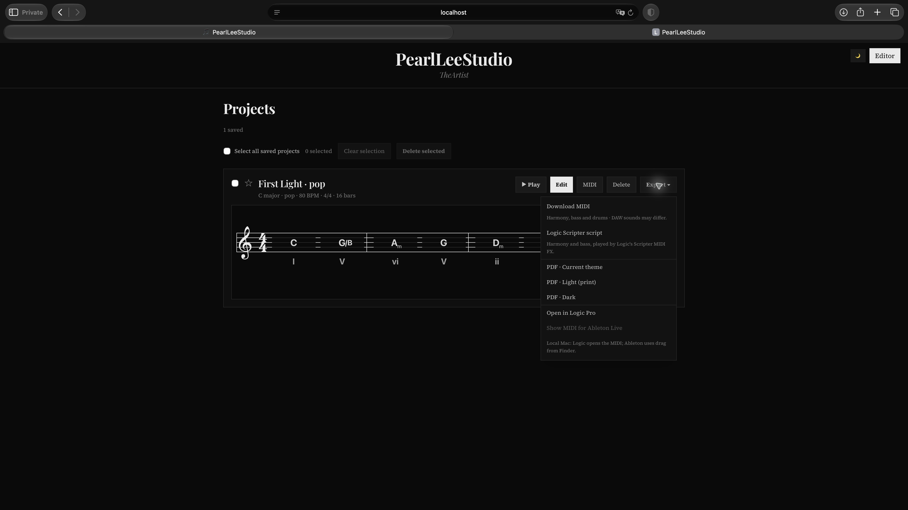
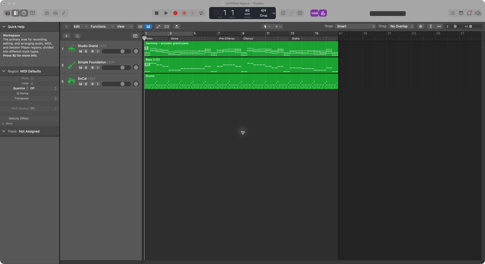
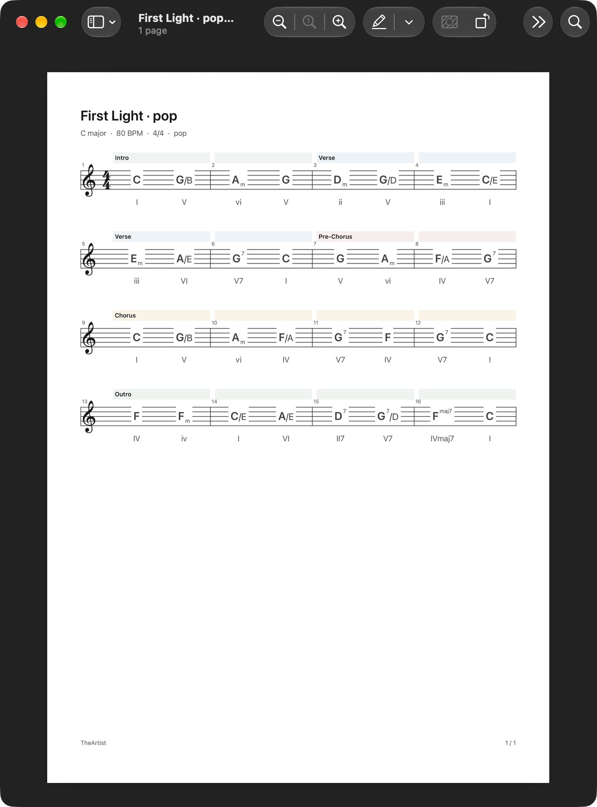
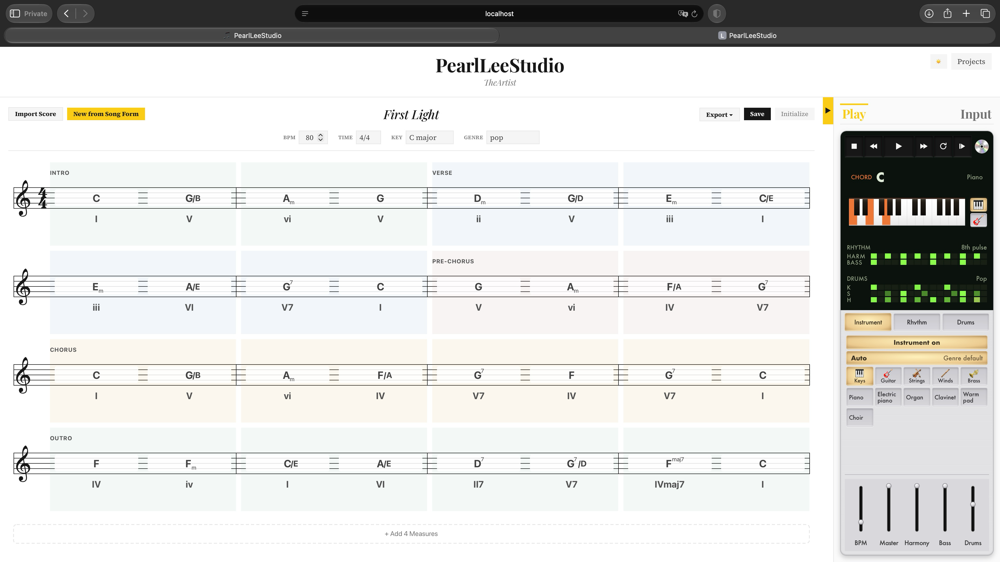
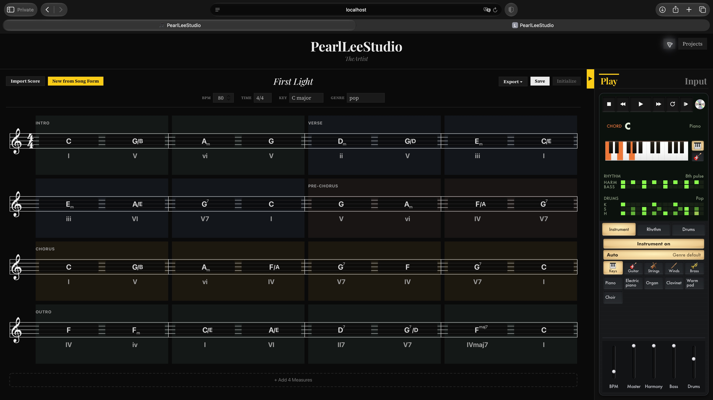

# Walkthrough

Screenshots of the arrangement workspace with the state each capture shows.
Captures predate some later controls, as noted under each one.

### Import in whole-score context

Import keeps the original chord evidence alongside editable proposals. Meta assist
receives the complete musical synopsis even when its harmony review covers only a
bounded range. Form suggestions can use neutral **Section** labels when a specific
Intro, Verse or Chorus function is uncertain.

### Develop harmony with Generate and Reharmonize

Use **Reharmonize** for substitutions within an existing passage. Choose up to
1–4 changed chords per alternative, combine non-overlapping choices on the staff,
and **Apply** to keep them. **Origin** previews the exact source passage; **×**
discards unapplied changes. [Search behavior and limits](reharmonization.md)
explain the role of neighboring chords, mode constraints and the trained scorer.
Use **Generate** when the arrangement needs new harmonic material:

Click **Generate** with a slot range selected. The right panel reports composition,
ranking and voice-leading stages through SSE, then shows three candidates ordered
by R1 roughness. This capture shows actual F1 A/B/C results. Apply a candidate,
compare it with the original passage, or switch between alternatives. The model
picker includes the F-series checkpoints and eleven genre LoRA adapters. This
capture uses R1 alone; current builds also use OMT relevance when prepared.

### MIDI input

This capture predates the local MIDI bridge and shows Safari's missing native Web
MIDI support. Chrome now connects directly; Safari on Mac uses the
[local MIDI bridge](midi-input.md). Connection/monitoring needs no selected
slot, while writing always requires exactly one selected slot with the Input tab's MIDI tool in front.
The bridge's native input and local event stream were checked with three available
ports; physical keypress confirmation in both browsers remains a manual check.

Pick a slot on the staff, hit **Enable MIDI** with a connected keyboard. Hold a chord on the keys for ≥3 s and it auto-commits to the slot (and the selection auto-advances to the next one). Release early and you get a Confirm card with root-cycling chips — `C6` ↔ `Am7/C` etc. — that reflect the actual played bass, plus inversion detection for slash chords. The Confirm card also shows a 3-chord transition view: prev (purple strip below the keyboard) → current candidate (yellow fill) → next (green strip above), with curved voice-leading arrows tracing how each voice moves.

### Play — piano + guitar

Whichever chord is active (selected on the staff, currently playing back, or under a MIDI hold) lights up its tones on a styled keyboard or fretboard. Voicings cap at 4 notes — for tension chords (9 / 11 / 13 / altered dominants) the 5th drops, keeping the hand realistic and leaving register room for future melody lines. Switch instruments live; the playback engine swaps mid-song.

### Controller — master and part levels

The bottom of **Play** always shows **BPM**, **Master**, **Harmony**, **Bass**
and **Drums** as five vertical faders, independently of the selected preset tab.

Drag a metal cap or use the arrow keys to change a value; Home/End reach the
range limits. Double-click a fader to restore its default.
Levels change the audio output, including notes already ringing. Harmony and
Bass remain independent even when they use the same instrument. Save preserves
the mix for Projects playback and **Edit** in the editor; old sessions
retain their previous levels.

### Projects and complete exports

Project cards show the first four bars. **Export** uses the saved project's full
score and playback settings, including when a different project is open in the
editor.

### MIDI handoff and score PDF

The exported arrangement opens in Logic as Harmony, Bass and Drums with sixteen
bars, 80 BPM, 4/4 meter and five section markers. This verifies the MIDI handoff;
listening, GM/CC response and the separate Scripter transport behavior remain
manual checks.

The light-theme PDF contains the complete sixteen-bar score on one page. PDF
export also offers dark and current-theme variants.

### Dark + light themes

<table>
<tr>
<td width="50%" valign="top"></td>
<td width="50%" valign="top"></td>
</tr>
<tr>
<td><strong>Light</strong> — paper-white score, silver Play panel and amber selected controls.</td>
<td><strong>Dark</strong> — near-black surfaces with readable staff lines, chord labels and Play controls.</td>
</tr>
</table>

Both modes use `--brand-yellow` (#facc15) for active Play/Input tabs, the panel
toggle, focus rings and the Input-tab keyboard highlight; inside the Play panel the
token is re-scoped to amber (#ec7737) for its selection keys and voicing highlights. The header's 8 px theme emoji retains
its 32×28 px button area and accessible label. The Play panel combines subtle inset
key grooves, flat black/green step cells and slim faders while the staff keeps its
classical styling.
